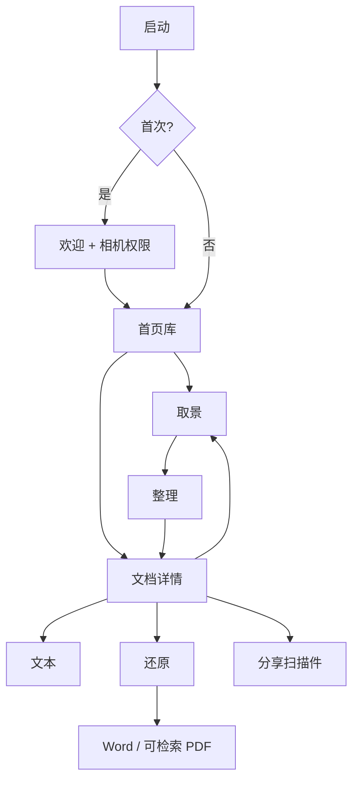

# 01 产品原型设计

产品名：**纸匣 Zhixia**  
形态：iPhone 原生 App，竖屏为主，横拍仅用于取景预览（保存后仍按页竖看）  
核心承诺：对着一张纸，三步收成一份干净文档——**拍、理、出**；需要可编辑文档时再走 **还原**。

可交互界面：[`../prototype/index.html`](../prototype/index.html)  
接手：[00-getting-started.md](00-getting-started.md) · 架构：[02-architecture.md](02-architecture.md)

对标对象：**全能扫描王**的主体功能（扫描、处理、管理、识别、导出），不对其广告、会员墙、云盘和社交裂变。

---

## 1. 使用场景

一个人，桌上或手里有纸：合同、讲义、发票、身份证、白板拍照。手机举起来，框自己贴上去，快门，完成。之后在列表里找到它，复制文字、发 PDF，或还原成 Word。

```
        纸（合同 / 证件 / 讲义 / 包装表）
                    │
                    ▼
        ┌──────────────────────────┐
        │   实时框  ·  快门         │  ← 拍
        │   裁切 / 增强 / 多页      │  ← 理
        │   文档 · OCR · 还原 · 分享 │  ← 出
        └──────────────────────────┘
```

约束：

- 主路径必须能在 **30 秒内**完成「一张纸 → 一份文档」。任何「先选云盘 / 先登录 / 先看广告」都算失败。
- 光线杂、桌面反光、纸略歪，是常态。框要稳，增强要一次能看清字。
- 连续多页是同一份文档，不是拍一张存一张再让用户合并。
- 证件是固定比例的双面物，不要当普通 A4 乱裁。
- **「文本」永不上传**；「还原」当前亦本机。将来若接云解析，必须用户主动、单页确认。

---

## 2. 产品规则（扫描怎么走）

| 规则 | 含义 |
| --- | --- |
| **先拍后归类** | 拍完默认进「全部」；文件夹是整理，不是开拍门槛。 |
| **框跟着纸走** | 预览里画四边形，稳定后可自动拍；用户始终能手动快门。 |
| **一份文档 = 一组页** | 连续拍的页属于同一份，未点「完成」不算入库。 |
| **原图与成品分离** | 每页保留原图，增强可回退；还原裁图用 **original**。 |
| **本机优先** | 图、OCR、扫描件 PDF、当前还原都在设备上。无账号也能用主体功能。 |
| **标题自动起** | `8月30日 扫描`；OCR 成功后可用首页前 16 字作副标题，用户可改。 |
| **文本 ≠ 还原** | 文本 = 行级字符串；还原 = 版面 IR（段/表/图）→ Word。 |

和全能扫描王对齐的主体能力：

| 全能扫描王 | 纸匣 | 怎么做更简单 |
| --- | --- | --- |
| 拍照扫描 + 实时框 | 要 | 默认文档模式，框稳可自动拍 |
| 连续多页 | 要 | 底栏页条，点完成才保存 |
| 相册导入 | 要 | 取景页左下角，走同一条裁切增强 |
| 自动裁切 / 透视 | 要 | 拍后可拖角；默认采用检测框 |
| 增强（原图 / 增强 / 黑白 / 灰度） | 要 | 底部 5 个滤镜（含去阴影） |
| 文档库 / 文件夹 / 搜索 / 收藏 | 要 | 首页就是库 |
| OCR 复制 | 要 | 「文本」 |
| 版面 / Word | 要（进行中） | 「还原」本机启发式；云引擎未接 |
| PDF / 图片分享 | 要 | 系统分享，不内嵌微信 SDK |
| 身份证 / 证件双面 | 要 | 取景模式切换，比例蒙版 |
| 名片入通讯录 / 签名批注 / 云账号广告 | 不做（v1） | — |

---

## 3. 信息架构

```
启动
  ├─ 首次：欢迎 → 相机权限 → 首页
  └─ 再次：首页（库）

首页（文档库）
  ├─ 全部 / 文件夹 / 收藏
  ├─ 搜索（标题 + OCR blob）
  ├─ 一份文档 → 文档详情
  └─ 底部中央：扫描（进取景）

取景
  ├─ 模式：文档 / 证件
  ├─ 快门 / 自动拍 / 闪光 / 相册导入
  ├─ 已拍页条
  └─ 完成 → 整理（裁切 + 增强）

整理
  ├─ 拖角裁切、旋转、删除、重拍
  ├─ 滤镜：原图 / 增强 / 去阴影 / 灰度 / 黑白
  └─ 保存 → 文档详情

文档详情
  ├─ 翻页、排序
  ├─ 文本（OCR，本机）
  ├─ 还原（版面 → Word / 可检索 PDF）
  ├─ 分享（扫描件 PDF / 图片）
  ├─ 加页
  └─ 更多：重命名、文件夹、收藏、删除

设置
  ├─ 默认滤镜、自动拍摄、保存原图
  ├─ 权限与存储占用
  └─ 关于
```



首页**不是**九宫格功能墙。扫描是底部一颗朱砂按钮。

---

## 4. 任务生命周期（一份文档）

```
取景中 ──完成──► 整理中 ──保存──► 已入库
   │                │
   └──取消（确认丢页）┘
```

| 动作 | 行为 |
| --- | --- |
| **快门 / 自动拍** | 写入本次会话的一页（原图 + 检测框），不入库。 |
| **完成** | 进入整理。至少 1 页才能完成。 |
| **保存** | 生成渲染图、缩略图、默认标题，写入库。 |
| **取消取景** | 已有页则确认丢弃；无页直接回首页。 |
| **加页** | 从详情再进取景，页追加到同一份文档。 |
| **杀进程** | 未保存的会话丢弃。v1 不做草稿恢复。 |

标题：保存瞬间 `M月D日 扫描`（同日多份加 ` · 2`）。

---

## 5. 关键界面

### 5.1–5.5 欢迎 / 库 / 取景 / 证件 / 整理

与初版一致：纸色库、全屏取景、证件 85.6∶54 窗、整理同屏拖角+五档滤镜。详见原型 HTML。关键规则：

- 检测失败**不阻断快门**。
- 默认滤镜「增强」；证件彩照用户可改「原图」。
- 取景页无广告、无云盘入口。

### 5.6 文档详情

```
┌ 〈 库     8月30日 扫描    …  ┐
│         大图翻页              │
│   文本   还原   分享   加页   │
└───────────────────────────────┘
```

- **文本**：本机 OCR，文案强调「在本机识别 · 未上传」。
- **还原**：进入还原页，预览 block，导出 Word / 可检索 PDF。
- **分享**：扫描件 PDF（默认）或多图 JPEG。与「可检索 PDF」不同产物。
- **…**：重命名、文件夹、收藏、按页排序、删除。

### 5.7 文本（OCR）

- 按页 / 全部页识别；可选中复制。
- 失败：「没看清字，换增强或重拍再试」。
- 不在此页导出 Word（走「还原」）。

### 5.8 还原（版面）

- 顶部说明：本机排出段落 / 表 / 配图，未上传。
- 预览：标题、段落、`Grid` 表、裁切配图 / 条码。
- 底栏：导出 Word、可检索 PDF（`ShareLink`）。
- 试卷 / 复杂表若本机结构不足，可显示弱提示（不强迫上云）。
- **当前样张未过关**：见 [06 §已知问题](06-document-reconstruction.md#12-已知问题2026-09)。

### 5.9 文件夹

- 「全部」不可删；一份文档最多属于一个用户文件夹。
- 文件夹封面 = 最近一份文档封面。

---

## 6. 交互细则（摘要）

- 主路径：**扫 → 快门（可多次）→ 完成 → 保存**。中间不插入命名 / 文件夹 / 会员。
- 四边形 EMA 平滑；锁定约 0.55s 可自动拍（设置可关）。
- 快门 72 pt；完成与相册分居两侧。
- 取景中禁用闲置熄屏；进后台停会话、关灯，草稿页保留。
- 库与设置跟随动态字体；取景预览不跟字体放大。

---

## 7. 视觉规范

| Token | Hex | 用途 |
| --- | --- | --- |
| `paper` | `#F6F3EC` | 库、详情画布 |
| `ink` | `#1B1914` | 正文；取景底另用深色 |
| `card` | `#FFFDF8` | 文档卡片 |
| `muted` | `#6E675C` | 次要信息 |
| `line` | `#E4DDD2` | 分割 |
| `seal` | `#C24A32` | 扫描钮、主按钮、锁定框 |
| `forest` | `#3D5A4C` | 文件夹点缀 |
| `wheat` | `#C4A46A` | 弱强调 |
| `danger` | `#B42318` | 删除 |

代码：`DesignSystem/Tokens.swift`。禁止蓝橙渐变促销条与功能宫格彩图标。字体用系统 SF / PingFang，文案进 `Localizable.xcstrings`（中英）。

---

## 8. 无障碍与本地化

- VoiceOver：扫描钮、卡片、取景锁定状态。
- 锁定可辅以触感；不单靠红框。
- v1 中文 + 英文 String Catalog。

---

## 9. 成功标准

**主路径（扫描）** — 不看说明书 30 秒内：

1. 打开 → 库（或空态）→ 扫描 → 对准纸 → 快门 → 完成 → 增强页 → 保存 → 能分享扫描件 PDF。

**证件**：顶部分段 → 正/反 → 一份两页。

**还原（目标，尚未达标）**：练习册 Word 含 A/B/C 配图与二维码；营养表为三列网格且「能量 | 1429 千焦 | 17%」同行。现状见 [06](06-document-reconstruction.md)。

---

## 10. 明确不做（本阶段）

- 账号、云盘默认同步、微信 / 钉钉 SDK、广告与会员墙
- 点「文本」就上传；未确认的整库云解析
- 签名、批注、水印；名片写入通讯录
- 书籍跨页拼接、多语种实时翻译
- iPad 分栏与文档提供器（v1 只做 iPhone）
- 扫描二维码作为主入口（还原里可把条码当 figure）
- 用整页截图 `.docx` 冒充可编辑 Word
