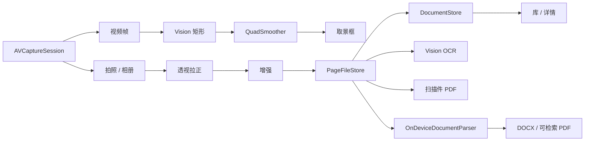

# 02 架构设计

目标：把「镜头里的一张纸」稳定变成「库里的一份可分享 / 可还原文档」，可测试、可替换、符合 Swift 6 并发。

产品：[01](01-product-prototype.md) · 接手：[00](00-getting-started.md) · 还原：[06](06-document-reconstruction.md)  
图：[layers](diagrams/layers.svg) · [pipeline](diagrams/pipeline.svg) · [modules](diagrams/modules.svg)



---

## 1. 分层

严格单向依赖。UI 不知道 `AVCaptureSession`；图像处理不知道 SwiftUI。

```
┌─────────────────────────────────────────────┐
│  App                                        │
│  ZhixiaApp · AppEnvironment · 路由 · 权限    │
├─────────────────────────────────────────────┤
│  Features                                   │
│  Library · Capture · Edit · Document        │
│  OCR · Reconstruct · Export · Settings      │
│  Onboarding                                 │
├─────────────────────────────────────────────┤
│  Domain                                     │
│  文档/页/文件夹/Quad/滤镜/OCR/还原 IR        │
│  场景路由 · 阅读序 · 表聚类 · 配图空洞        │
├─────────────────────────────────────────────┤
│  Services                                   │
│  Camera · Vision · Image · OCR · PDF        │
│  Reconstruct · DocumentStore · PageFileStore│
├─────────────────────────────────────────────┤
│  DesignSystem                               │
│  Tokens · 卡片 · 页条 · 扫描钮 · 滤镜条      │
└─────────────────────────────────────────────┘
```

| 层 | 可以依赖 | 不可以 |
| --- | --- | --- |
| App | 全部 | 写滤镜公式、写框检测阈值 |
| Features | Domain、DesignSystem、Environment 协议 | 直接创建 Session / 写 CI / 写 TextIn URL |
| Domain | Foundation 级模型 + 纯几何启发式 | SwiftUI、网络、文件 IO（除路径字符串入 IR） |
| Services | Domain + 系统框架 | 某个 Feature 的 ViewModel |
| DesignSystem | SwiftUI | 业务状态机 |

唯一允许的「UI 承载系统能力」：`UIViewRepresentable` 包 `AVCaptureVideoPreviewLayer`，只负责显示。

协议集中在 `Services/ServiceProtocols.swift`（历史上部分协议曾分文件，现以该文件为准）。

---

## 2. 工程结构（与仓库对齐）

```
Zhixia/
  App/
    ZhixiaApp.swift
    AppEnvironment.swift
    AppRoute.swift
    RootView.swift
    PreferencesStore.swift
    PreviewSupport.swift
  Features/
    Onboarding/
    Library/          LibraryView · LibraryViewModel · FolderPicker
    Capture/          CaptureView · CaptureViewModel · Preview · EdgeOverlay
    Edit/             ReviewView · ReviewViewModel · CropCanvas · FilterStrip（组件也在 DesignSystem）
    Document/         DocumentView · DocumentViewModel
    OCR/              OCRView · OCRViewModel
    Reconstruct/      ReconstructView · ReconstructViewModel
    Export/           ExportSheet
    Settings/         SettingsSheet
  Domain/
    Models/           ScanDocument · ScanPage · Folder · Quad · ScanMode
                      Enhancement · PageDraft · OCRPageText · ReconstructDocument
                      DocumentTitle · LibraryLoadState · ReconstructSemantics
    OnDeviceReadingOrder.swift
    OnDeviceTableCluster.swift    // v1 表聚类器：已退役休眠（wps-parity-layout），保留直连单测作回归钉
    OnDeviceFigureRegions.swift
    Table/            TableGridV2 · TableGridV2Detector · TableProfile   // 锚点驱动 v2
    Figure/           FigureRegionsV2 · InkFigureDetector
    Layout/           LayoutAnalyzer · PageLayoutMapper · LayoutMask(Builder) · LayoutTypography
                      PageColumnSplitter · ColumnResolver · AnchorExtractor
                      HeaderFooterClassifier · GarbledRegionDetector · RegionLayoutEngine
    CropConsistencyGate.swift     // WYSIWYG 快门裁切门禁（呈现框 = 裁切基准）
    FlowParagraphSplitter.swift   // flow 导出侧切段（三判据 + 三不变量）
    InkTextReconciler.swift       // 墨迹-文本对账哨兵 textSentinel（只记不阻断）
    OCRNoiseFilter.swift
    OverlaySpaceMap.swift · GuidanceDirective.swift · EdgeSnapper.swift
    ReconstructSceneRouter.swift
    DocumentMaskQuad.swift        // 预埋：文档区域二次分割（暂无调用者）
    CaptureGeometry.swift · FOVLayout.swift
    OCRTextQuality.swift
    ScanSession.swift
    Errors/ZhixiaError.swift
  Services/
    ServiceProtocols.swift
    Camera/           AVCameraSession · PreviewBinder · Representable 辅助
    Vision/           VisionEdgeDetector · QuadSmoother · FrameMapper · CandidateSticky
                      // CandidateSticky：live 候选粘滞（先稳者胜，3 帧无相似逃逸清锚）
    Image/            ImagePipeline · EnhancementRecipe · ImportedImage
    OCR/              VisionTextRecognizer · InkRegionProvider   // 墨迹区域（哨兵输入）
    PDF/              PDFExportService          // 扫描件图片 PDF
    Reconstruct/
      OnDeviceDocumentParser.swift
      CompositeDocumentParser.swift
      VisionDocumentStructureRecognizer.swift  // iOS 26 RecognizeDocumentsRequest（默认通路）
      TextInDocumentParser.swift     // stub
      PageBarcodeDetector.swift
      NormalizedImageCrop.swift
      DocxExportService.swift
      SearchablePDFExportService.swift
      ZipArchive.swift
    Persistence/      SwiftDataDocumentStore · InMemory · PageFileStore · ScanEntities
    Permissions/
    ZhixiaLog.swift
  DesignSystem/
  Localizable.xcstrings
  Info.plist · Assets.xcassets
ZhixiaTests/           44 个测试文件 / 436 个 @Test
  QuadSmootherTests · ImagePipelineTests · DocumentStoreTests
  CaptureViewModelTests · OCRViewModelTests · ReconstructTests
  CropConsistencyGateTests · CandidateStickyTests · CropGateAtShutterTests   // WYSIWYG
  AutoCaptureHoldWindowTests · OverlaySpaceMapTests · EdgeOverlayRenderingTests · GuidanceDirectiveTests
  GoldenWorksheetEndToEndTests · InkTextReconcilerTests   // 金标准端到端 / 对账哨兵
  ReconstructEndToEndTests · ExportSafetyTests · ReconstructTierTests · …（全表见 00 §7）
```

命名：协议用能力（`EdgeDetecting`、`DocumentParsing`），实现用技术（`VisionEdgeDetector`、`OnDeviceDocumentParser`）。

---

## 3. 运行时对象图

```
ZhixiaApp
  └── AppEnvironment
        ├── PermissionGranting
        ├── CameraCapturing + CameraPreviewAttaching
        ├── EdgeDetecting
        ├── ImageRendering / ImagePipeline
        ├── DocumentStore + PageFileStore
        ├── TextRecognizing
        ├── DocumentParsing + DocxRendering + SearchablePDFRendering
        ├── PDFRendering
        └── PreferencesStore

RootView
  NavigationStack
    LibraryView
      fullScreenCover → CaptureView ↔ ReviewView（同 cover 栈）
      → DocumentView
           → OCRView
           → ReconstructView
           → Export sheet
           → Capture（加页，带 documentID）
```

- `AppEnvironment` `@State` 持有并注入。
- 相机与图像管线 `actor`；帧不进主线程。
- Feature 之间不互相 import ViewModel。
- **Review 与 Capture 同为 cover 兄弟**，避免把 Review 挂在仍活着的相机 `navigationDestination` 上（再进整理会卡在 spinner）。

---

## 4. 领域模型（要点）

```swift
struct Quad { /* 归一化 0...1 四角 */ }
enum ScanMode { case document, idCard }
enum Enhancement { case original, enhance, deskewShadow, grayscale, blackWhite }

struct PageDraft { id, original 临时路径, quad, enhancement, rotationTurns }
struct ScanPage { id, documentID, index, quad, enhancement, paths… }
struct ScanDocument { id, title, folderID, dates, favorite, pageIDs, ocrSearchBlob }

// 还原 IR —— Word / 可检索 PDF / 预览唯一真相
enum ReconstructScene { auto, plain, exam, table, packaging }
enum ReconstructBlockKind {
  heading, paragraph, list, table, figure, barcode, checkbox, handwrittenBlank
}
struct ReconstructBlock { kind, bbox, text, style, table?, figureRelativePath?, … }
struct ReconstructPage { pageID, size, scene, usedCloud, blocks }
struct ReconstructDocument { documentID, title, pages }
```

规则：

- SwiftData 实体只活在 Persistence，不当 UI 模型。
- 图不进库；库只存路径与元数据。
- `Quad` / block `bbox` 用归一化坐标（Vision：原点左下）。
- `hasContent`：表格有行、配图文件存在、条码块，均算有内容（不仅看 `displayText`）。

---

## 5. 核心数据流

### 5.1 取景

```
AVCaptureSession (photo + 720p video)
  → EdgeDetecting（VisionEdgeDetector，内含 CandidateSticky 候选粘滞）
  → QuadSmoother → overlayQuad
  → OverlaySpaceMap 解析映射 → EdgeOverlayView（连续实线整框 + 四态引导）
  → 自动快门：锁定后 6 帧确认窗（suspicious 冻结、手动快门不受限）
  → capturePhoto → CropConsistencyGate（WYSIWYG：呈现框 = 裁切基准）
  → tmp original.jpg + PageDraft
```

成品用 Photo Output，不用视频帧。

### 5.2 整理与保存

```
PageDraft → ImagePipeline（拉正+增强+缩略图）
  → PageFileStore.commit + DocumentStore.create
  → 删会话 tmp
```

先落文件再写 SwiftData；失败回滚文件。

### 5.3 OCR 与扫描件导出

```
OCR：优先质量更好的 rendered / original（中文优先策略见 VisionTextRecognizer）
  → ocrSearchBlob

Export：rendered 图 → PDFExportService → ShareLink
```

### 5.4 还原

```
ReconstructViewModel
  → rendered 优先（original 兜底）
  → DocumentParsing.parse
      ├─ iOS 26：VisionDocumentStructureRecognizer（RecognizeDocumentsRequest，结构化——默认通路）
      └─ 回退：OnDeviceDocumentParser（几何启发式；v1 表聚类已退役，不再产表）
  → StructuredDocumentPage 归一 → ReconstructDocument（每页一条 reconstructPath 决策日志）
  → 档位：flow（流式，默认）/ .restored（高保真，可选；@AppStorage 持久化、预览/导出同源）
  → DocxRendering（flow 导出侧 FlowParagraphSplitter 切段；InkTextReconciler 哨兵只记不阻断）
    / SearchablePDFRendering → ShareLink
```

`CompositeDocumentParser`：先本机；仅当场景非 plain **且** TextIn 已配置密钥时才尝试云；失败回退本机。当前密钥为空 → **永远本机**。

---

## 6. 会话状态机（取景）

```
idle → previewing ↔ locked → capturing →（页完成）→ previewing
                              └完成→ reviewing（ReviewViewModel，相机关）
```

检测失败不禁用快门。非法跳转在 ViewModel 内忽略。

---

## 7. 相机预览桥接

```
CaptureView
  ├── CameraPreviewRepresentable / Binder
  ├── EdgeOverlayView
  └── 快门 · 模式 · 页条
```

Feature 可出现 PreviewLayer **类型名**，禁止创建 `AVCaptureSession`。

---

## 8. 存储布局

```
Application Support/Zhixia/
  files/{documentID}/{pageID}-{original|rendered|thumb}.jpg
  tmp/{sessionID}/{pageID}-original.jpg
Caches/Zhixia/   // 导出临时 PDF / DOCX
临时目录/Zhixia/reconstruct/{pageID}/  // 还原裁切 PNG
```

| 存哪 | 什么 |
| --- | --- |
| SwiftData | 文档、页元数据、文件夹、OCR 搜索串 |
| 文件系统 | 原图、渲染图、缩略图 |
| UserDefaults | 默认滤镜、自动拍、是否保存原图 |
| Caches / tmp | 导出与还原裁图 |

`PageFileStore` 是唯一目录规则所有者。

---

## 9. 导航与生命周期

```
Library
  → Capture fullScreenCover → Review（同栈）
  → Document → OCR / Reconstruct / Export / Capture(加页)
设置 sheet · 引导 fullScreenCover
```

`scenePhase != .active`：停相机。不要在 `onDisappear` 无条件删 tmp。同一时刻一个 Session。

---

## 10. 权限与隐私

- 相机：首次扫描 / 引导。
- 相册：仅点导入时（PhotosPicker）。
- 不申请麦克风、通讯录、跟踪。
- OCR / 扫描 PDF / 当前还原：本机。隐私标签按「数据不收集」维护；若将来接 TextIn，须单独披露并用户确认。

---

## 11. 错误模型

`ZhixiaError` → 人话（xcstrings）。要点：

| 错误 | 恢复 |
| --- | --- |
| 相机拒绝 | 打开设置 |
| 检测失败 | 仍可拍整张，整理再裁 |
| OCR 失败 | 换增强 / 重拍 |
| 还原失败 | 重试；检查是否有字 / 原图 |
| 导出失败 | 重试 |
| 云还原不可用 | 回退本机（Composite） |

---

## 12. 测试策略

| 层级 | 文件 / 内容 |
| --- | --- |
| Smoother / Mapper | `QuadSmootherTests` · `OverlaySpaceMapTests` · `EdgeOverlayRenderingTests` |
| 图像 | `ImagePipelineTests` |
| Store | `DocumentStoreTests` |
| Capture / Review VM | 无页不能完成、滤镜退出裁切等 |
| WYSIWYG 取景 | `CropConsistencyGateTests` · `CandidateStickyTests` · `CropGateAtShutterTests` · `AutoCaptureHoldWindowTests` · `GuidanceDirectiveTests` |
| OCR | 中文质量、双图择优 |
| 还原 | 场景路由、阅读序、段落、配图空洞、DOCX 含 `w:tbl` / `word/media`；端到端 `ReconstructEndToEndTests` + 金标准 `GoldenWorksheetEndToEndTests`（真实 Vision 链路）；丢字哨兵 `InkTextReconcilerTests` |

全量 436 用例 = 396 passed + 1 expected failure + 0 failed（跑法与计数陷阱见
[00 §7](00-getting-started.md#7-怎么测) 与 `Makefile`）。

Preview：`PreviewSupport` 假相机 / 假识别器 / 内存 Store。

---

## 13. 编码实践（强制）

- Swift 6 严格并发。
- Feature 不写 `@Query`；不拼文件路径。
- 滤镜枚举在 Domain，实现在 `EnhancementRecipe`。
- 还原预览与导出只读 `ReconstructDocument`，禁止各写一套识别。
- 用户可见字符串进 xcstrings。
- 本阶段不上 TCA。
