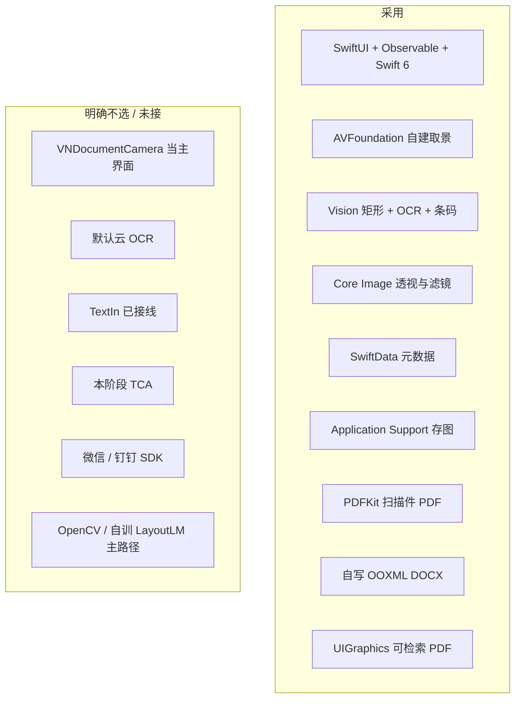

# 03 技术选型

部署目标：**iOS 18.0+**，真机优先（相机、Vision 矩形、暗光在模拟器上不可信）。  
设备：能装 iOS 18 的 iPhone。扫描与「文本」不依赖云；还原当前亦不依赖云（TextIn stub 预留）。

接手：[00](00-getting-started.md) · 架构：[02](02-architecture.md)

---

## 1. 决策总表

| 问题 | 选择 | 不选 | 原因 |
| --- | --- | --- | --- |
| UI | SwiftUI + `@Observable` | UIKit 主界面 | 状态驱动；系统分享一等公民 |
| 取景 | 自建 `AVCaptureSession` | 只用 `VNDocumentCameraViewController` | 证件蒙版、页条、自动拍、品牌框 |
| 框检测 | Vision 矩形（+ 文档分割辅助切边） | OpenCV | 无第三方体积 |
| 拍照 | `AVCapturePhotoOutput` | 视频帧当成品 | 全分辨率 |
| 透视 / 滤镜 | Core Image | 手写 Metal 主路径 | 够用、好维护 |
| OCR | `VNRecognizeTextRequest` 本机 | 默认云 OCR | 隐私、无密钥 |
| 条码 | `VNDetectBarcodesRequest` | 当 OCR 字符串 | 还原裁成 figure |
| 文档库 | SwiftData 元数据 | 图进库 / JSON 目录 | 查询与体积平衡 |
| 扫描件导出 | PDFKit + ShareLink | 微信 SDK | 系统面板 |
| 可编辑 Word | 自写 ZIP STORE OOXML | Office SDK、整页截图 docx | 可控、可测 |
| 可检索 PDF | `UIGraphicsPDFRenderer` 文字+表+图 | 仅图片 PDF 冒充 | 与扫描件 PDF 分工 |
| 版面引擎（目标） | 本机启发式 → 可选 TextIn | 默认上传、LLM 整页重打数字 | 见 [06](06-document-reconstruction.md) |
| 架构套件 | 协议注入 | TCA | 体量不够先上框架 |
| 最低系统 | iOS 18 | 16/17 双通路 | Observation / SwiftData 成熟 |

---

## 2. 自建相机（摘要）

系统扫描页不能做证件窗与连拍页条。Session `photo` + 720p 视频帧检测；预览 `resizeAspectFill`，Quad 换算必须测。默认后置广角。细节见 [04](04-implementation-principles.md)。

---

## 3. 框检测与切边

- 实时：`VNDetectRectanglesRequest` + `QuadSmoother`（EMA + 稳定窗）。
- 静态 / 整理：可叠加文档分割等请求放宽边（见 `VisionEdgeDetector`）。
- 证件：蒙版先验 + IoU，避免检整张桌子。

---

## 4. 透视与增强

`CIPerspectiveCorrection` + `EnhancementRecipe` 五档。最长边封顶控体积。CI 原点左下，与 UIKit/Vision 转换易错，必须有单测。

---

## 5. OCR

- `recognitionLevel = .accurate`；中文优先语言列表；质量打分剔除 Latin 垃圾。
- 深色截图可反色再认；rendered vs original 择优。
- 「文本」对用户可见结果负责；还原另跑解析（可复用同一 Recognizer）。

---

## 6. 存储

SwiftData 实体 + `PageFileStore` 文件。删除级联；启动可 `sweep` 孤儿。不默认 CloudKit。

---

## 7. 导出三件套

| 产物 | 实现 | 用户入口 |
| --- | --- | --- |
| 扫描件 PDF | `PDFExportService` | 详情「分享」 |
| 可编辑 DOCX | `DocxExportService` + `ZipArchive` | 还原「导出 Word」 |
| 可检索 PDF | `SearchablePDFExportService` | 还原「可检索 PDF」 |

DOCX：段落、`w:tbl`、DrawingML 嵌 PNG（`word/media/`）。不是把 JPEG 改后缀。

---

## 8. 版面还原技术债（选型层面）

| 方案 | 状态 |
| --- | --- |
| OCR 盒子聚类成表 | 已实现，样张不稳 |
| 非文字连通域裁配图 | 已实现，练习册易只剩二维码 |
| Vision 条码 | 已实现 |
| 合合 TextIn | **stub**：`TextInDocumentParser`，无密钥不调用 |
| 多模态 VL 修补 | 协议 `ReconstructRepairing` 预留，无实现 |

本机几何**不能**替代专用版面模型；样张过关可能仍需云或更强的本机策略。产品底线：不把「文本」变成默认上传。

---

## 9. 并发与性能预算

| 组件 | 隔离 |
| --- | --- |
| `AVCameraSession` | actor |
| `VisionEdgeDetector` | actor |
| `ImagePipeline` | actor |
| `OnDeviceDocumentParser` 等 | actor |
| ViewModel | `@MainActor` |

检测 ≤15 fps 可丢帧；连拍只持 URL；缩略图约 360 px。

---

## 10. 风险

| 风险 | 缓解 |
| --- | --- |
| Quad 与预览错位 | `FrameMapper` 单测 + 真机校准 |
| 暗光无框 | 快门永不禁用 |
| Store 与文件漂移 | 事务 + sweep |
| 还原「像重排不像原页」 | 已知问题；改进聚类 / 阅读序 / 或接 TextIn |
| iOS 18 only | 产品接受 |

---

## 11. 与「对译」工程

同仓库另一产品。只复用纪律（分层、协议、String Catalog），不引入 Speech / Translation。目录：`scantool/Zhixia` vs `realtimeTranslatorOptimize/` 等。
