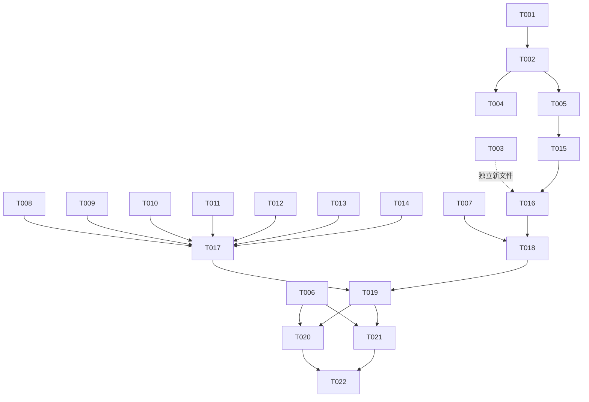

# Tasks: AI 工程师交接与项目 Agent 化（agent-handover）

**Input**: Design documents from `/Users/tanwei/Documents/code/ios/scantool/spec/agent-handover/`
**Prerequisites**: plan.md（已批准）、spec.md（已批准）
**Verification Scope**: build-only（Phase 3 选择门已确认）

**Organization**: 按 User Story 分组；US2（checkpoint commit）因横跨全程，拆为实现前置（T002）与收尾（T019），在描述中标注归属。

## Format: `[ID] [P?] [Story] Description`

- **[P]**: 可并行（不同文件、无未完成依赖）
- **[Story]**: 归属 User Story
- 描述含确切文件路径

## Path Conventions

- 本仓库为既有 iOS 项目，**无 `src/`/`tests/`**；产物路径约定：交接文档在 `docs/`（编号体系 00~12）、Agent 入口与脚本在仓库根（`AGENTS.md`/`Makefile`）、SDD 工件在 `spec/agent-handover/`、实施日志在 `/tmp/agent-handover-logs/`
- 全部任务使用仓库根相对路径描述

---

## Phase 1: Setup（事实锚点）

- [x] T001 基线事实采集：`mkdir -p /tmp/agent-handover-logs/`；实测全仓 `@Test` 计数（预期 357）、测试文件数、Swift 文件数；`git log --oneline -10` 提交风格采样；`git status --porcelain` 全量清单复核；`.gitignore` 覆盖检查（`.DS_Store`/`DerivedData`）；全部结果落 `/tmp/agent-handover-logs/baseline-facts.md`——本周期一切文档数字的唯一事实锚点

---

## Phase 2: Foundational（干净基线，阻塞后续）

**⚠️ T002 必须先于一切文件修改完成**——后续任务要编辑的文件（README、docs/09、wysiwyg-crop 验收文档等）当前都含两周期未提交改动，必须先固化到 C1，否则两段 commit 无法按文件切分。

- [x] T002 分文件暂存并提交 C1 代码基线（US2/FR-002）：暂存 wysiwyg-crop + wps-parity-layout 两周期全部产物（`Zhixia/`、`ZhixiaTests/`、`spec/wysiwyg-crop/`、`spec/wps-parity-layout/`、`spec/overlay-frame-visibility/` 修改件、`docs/09-project-handbook.md` 既有更新、`docs/11-wps-parity-research.md`、`docs/fixtures/`、两个 docx 样张），**排除** `spec/agent-handover/` 与 `spec/feature.json`；commit message 按 `git log` 既有风格；hash 记录到 `/tmp/agent-handover-logs/commit-c1.txt`（交接文档将引用）

**Checkpoint**: 工作区只剩本周期新产物，代码基线可追溯

---

## Phase 3: User Story 1 - 真机复测结论落盘（Priority: P1）🎯

**Goal**: 复测结论逐字 + 归因落盘，三处记录一致
**Independent Test**: 逐字原文、归因映射（A→R4、B→R5）、复测行追加可检索

- [x] T003 [P] [US1] 新建 `spec/agent-handover/device-retest-20260926.md`：①用户三条反馈逐字照录（含原文表述）②测试环境（新安装包 = 当前工作区构建，含两周期全部改动）③归因映射表（Case A→R4 折起部分修复未达效；Case B→R5 双候选振荡修复未达效 + 跟踪态手动拍成片含左页大半；总体→WPS 对标未达）④与上轮验收 ✗ 记录对照（同因复发非新问题）⑤定性与去向（交接文档卡点 P0 / 路线图 P0）
- [x] T004 [US1] `spec/wysiwyg-crop/device-acceptance.md` 结果表**追加**复测行（2026-09-26 新包复测：Case A ✗ 仍含折起部分；Case B ✗ 实线框仍跳 + 手动拍成片含左页大半），标注「R4/R5 修复未达效」，不改动历史 ✗ 记录
- [x] T005 [US1] `docs/09-project-handbook.md` §6 卡点清单更新：Case A/B 复测结论（R4/R5 修复未达效）置为当前卡点条目，链接 `spec/agent-handover/device-retest-20260926.md`

**Checkpoint**: US1 完成——复测结论三处（周期工件/验收文档/卡点清单）落盘一致

---

## Phase 4: User Story 3 - AGENTS.md + Makefile（Priority: P1）

**Goal**: Agent 冷启动入口 + 命令封装实跑可用
**Independent Test**: `make help`/`make doctor`/`make test-only` 实跑通过；AGENTS.md 六节齐备

- [x] T006 [P] [US3] 新建 `Makefile`：6 target——`help`（目标清单）、`test`（全量单测 + 自动 xcresulttool 计数）、`test-only T=<类名>`（局部）、`smoke`（build + 模拟器 boot/install/launch + 存活检查）、`device-build`（`generic/platform=iOS` + `CODE_SIGNING_ALLOWED=NO`）、`doctor`（环境自检：Xcode 版本/DEVELOPER_DIR/iPhone 17 Pro 存在/Busy 只提示 `xcrun simctl erase all` 不自动执行）；`DEVELOPER_DIR ?= /Volumes/DevDisk/Applications/Xcode.app/Contents/Developer` 可覆盖；`OTHER_SWIFT_FLAGS="-disable-sandbox"` 固化；实跑 `make help` + `make doctor` + `make test-only T=<快速测试类>` 验证
- [x] T007 [P] [US3] 新建 `AGENTS.md`（≤150 行，六节）：①项目一句话 + 关键事实表（bundle id `com.david.Zhixia`/测试基线 357/纯离线/iOS 18+ Swift 6）②必读顺序（`docs/12-handover.md` → `docs/09` → `docs/00`）③命令速查（make 6 target + `withKnownIssue` 计数陷阱解读）④铁律清单（ServiceProtocols 协议签名不变/既有断言零修改/纯离线/模拟器条码恒 0 假绿/expected failure 日志陷阱/capture-reconstruct 侧改动先读对应 spec）⑤SDD 工作流说明（`spec/` 目录 + `feature.json` + 五阶段）⑥当前状态指针（复测结论与卡点位置）

**Checkpoint**: US3 完成——一条命令跑测试，Agent 入口可用

---

## Phase 5: User Story 4 - 文档-代码一致性同步（Priority: P1）

**Goal**: 9 篇过期文档全部与实测一致
**Independent Test**: 关键数字 grep 比对 `baseline-facts.md` 实测值

- [x] T008 [P] [US4] `README.md`：132→357、测试文件数更新、能力现状补两周期新事实（流式默认档/档位选择器/墨迹哨兵/通路日志/漫画条修复/v1 表格聚类器退役/裁剪门禁与候选粘滞）、「当前最大卡点」更新为 Case A/B 复测结论、「后续方向」表刷新
- [x] T009 [P] [US4] `docs/05-roadmap.md`：更新日期、现状总览刷新、周期史补 6 周期（scan-fidelity/scan-edge-accuracy/live-edge-crop/overlay-frame-visibility/wysiwyg-crop/wps-parity-layout）、真机清单加 Case A/B 复测行
- [x] T010 [P] [US4] `docs/00-getting-started.md`：§7 怎么测加 Makefile 用法（`make test`/`make test-only`）、过期陈述修正
- [x] T011 [P] [US4] `docs/02-architecture.md`：§2 工程结构与代码对齐（`FlowParagraphSplitter`/`InkTextReconciler`/`InkRegionProvider`/`GoldenWorksheetEndToEndTests` 新文件入册、`OnDeviceTableCluster` 休眠标注）
- [x] T012 [P] [US4] `docs/06-document-reconstruction.md`：§12 已知问题更新（"wrong bus!" 定案为检索假阴性/段落收敛 32∈42±30%/流式默认档/哨兵只记日志不阻断）
- [x] T013 [P] [US4] `docs/10-project-summary.md`：§4 SDD 周期史补全 8 周期、§6 已知限制对齐当前状态
- [x] T014 [P] [US4] `docs/11-wps-parity-research.md`：追加「周期 1 实施后真机复测（2026-09-26）」闭环段：三项结论 + R4/R5 关联 + 下一周期建议
- [x] T015 [US4] `docs/09-project-handbook.md` §0 速览/§5 已实现功能/§7 后续方向对齐（§6 已在 T005 完成；与 T005 同文件顺序执行）

**Checkpoint**: US4 完成——文档无过期陈述

---

## Phase 6: User Story 5 - 交接文档（Priority: P2）

**Goal**: docs/12-handover.md 四要素单入口，每项可下钻
**Independent Test**: 单独阅读可回答「项目是什么/卡在哪/下一步/从哪开始」

- [x] T016 [US5] 新建 `docs/12-handover.md` 五节：①项目全貌（定位/架构分层一句话/质量现状 357/8 周期一览表）②当前卡点（P0 Case A R4、P0 Case B R5、P1 WPS 对标剩余差距、P1 L1 真机通路疑案、P2 几何兜底老系统与工程债——每项含现象/根因/证据链接/复测状态/建议方向）③路线图（P0 裁剪质量 → P1 真机取证与对标收尾 → P2 老系统兜底与工程债 → P3 云通路）④AI 工程师上手路径（读什么/跑什么命令/改什么前看什么铁律/怎么开 SDD 周期）⑤证据索引（spec/ 8 周期表 + docs 索引）；代码基线引用 T002 的 C1 hash；依赖 T002/T003/T005~T015 产出的事实

**Checkpoint**: US5 完成——交接文档单入口可下钻

---

## Phase 7: Polish（交叉校验与收尾提交）

- [x] T017 [P] 全文档数字一致性校验：grep `README.md`/`AGENTS.md`/`docs/*.md` 中的测试数/文件数/周期数，逐一比对 `/tmp/agent-handover-logs/baseline-facts.md` 实测值，修正偏差
- [x] T018 [P] 链接有效性校验：`AGENTS.md` 与 `docs/12-handover.md` 全部相对链接指向存在的文件与锚点
- [ ] T019 提交 C2（US2/FR-002 收尾）：暂存本周期全部产物（`AGENTS.md`/`Makefile`/`docs/12-handover.md`/全量文档同步/`spec/agent-handover/`/`spec/feature.json`），commit 按 `git log` 既有风格，确认 `git status` 干净

---

## Phase 8: Verification

<!-- verification_scope: build-only -->

**Purpose**: 脚本实跑回归 + 交接验收终检（纯文档周期无 UI 验证）

- [ ] T020 实跑 `make test`：全绿 357 = 356 passed + 1 expected failure + 0 failed——同时证明 Makefile 可用且文档周期未破坏代码
- [ ] T021 实跑 `make smoke` + `make device-build`：模拟器装机启动 pid 存活 + 真机目标编译 BUILD SUCCEEDED
- [ ] T022 交接验收终检（SC-001~005 逐条）：①文档数字与实测一致 ②复测结论三处互链可检索 ③C1/C2 两 commit 落盘、工作区干净、交接文档引用的 C1 hash 正确 ④交接文档四要素齐备且任意卡点 ≤2 跳下钻到证据

---

## 📊 Dependency Graph



## Dependencies & Execution Order

### Phase Dependencies

- **Setup（T001）**: 无依赖，立即开始
- **Foundational（T002）**: 依赖 T001 的 status 清单与 .gitignore 复核；**阻塞全部后续**（后续编辑的文件都含未提交改动）
- **User Stories（US1/US3/US4）**: 均依赖 T002；US1 与 US3 与 US4 之间无相互依赖可并行
- **US5（T016）**: 汇聚性任务，依赖 T002（hash）、T003/T005（复测事实）、T008~T015（同步后事实）
- **Polish（T017~T019）**: 依赖各 US 完成；T019 收尾提交
- **Verification（T020~T022）**: 依赖 T019（在干净工作区上验证）

### User Story Dependencies

- **US1（P1）**: T003 独立新文件可先行；T004/T005 依赖 T002
- **US3（P1）**: T006/T007 并行，不依赖任何 US（仅依赖 T001 事实）
- **US4（P1）**: T008~T014 七篇并行；T015 依赖 T005（同 `docs/09` 文件顺序执行）
- **US5（P2）**: T016 必须最后做（汇聚事实）
- **US2**: T002 最先、T019 最后——横跨全程的骨架

### Within Each User Story

- 先落事实（复测记录/基线数据），再改引用它的文档
- 同文件任务严格排序（T005 → T015）
- 每个故事以 Checkpoint 收口，独立可验

## ⚡ Parallel Execution Guide

| Phase | Tasks | Required Files | Execution Notes |
|---|---|---|---|
| Setup→Foundational | T001→T002 | 全仓 | 严格串行；T002 分文件暂存需 T001 的 status 清单 |
| US1 | T003 ∥ (T004→T005) | 三处不同文件 | T003 新文件独立；T004/T005 都依赖 T002 |
| US3 | T006 ∥ T007 | Makefile/AGENTS.md | 不同文件可并行；实跑验证各自做 |
| US4 | T008~T014 全并行，T015 在 T005 后 | 8 篇不同文档 | 互不冲突；T015 与 T005 同文件需排序 |
| US5 | T016 | docs/12-handover.md | 单任务汇聚，待 US1/US3/US4 完成 |
| Polish | T017 ∥ T018 → T019 | 校验只读 + git | 校验并行；提交最后 |
| Verification | T020~T022 | 只读 + 实跑 | T020/T021 可并行，T022 终检 |

## Parallel Example: User Story 4

```text
# 七篇文档互不冲突，可同时开工：
Task: "T008 [P] [US4] README.md 数字与能力现状同步"
Task: "T009 [P] [US4] docs/05-roadmap.md 周期史与真机清单同步"
Task: "T010 [P] [US4] docs/00-getting-started.md §7 加 Makefile 用法"
Task: "T011 [P] [US4] docs/02-architecture.md 工程结构对齐"
Task: "T012 [P] [US4] docs/06-document-reconstruction.md §12 已知问题更新"
Task: "T013 [P] [US4] docs/10-project-summary.md 周期史补全"
Task: "T014 [P] [US4] docs/11-wps-parity-research.md 复测闭环段"
# 完成后串行收尾：
Task: "T015 [US4] docs/09-project-handbook.md §0/§5/§7 对齐（等 T005 同文件）"
```

## Implementation Strategy

### MVP First（US2 + US1：T001~T005）

1. T001 基线事实 → T002 C1 代码基线提交
2. T003~T005 复测结论三处落盘
3. **STOP and VALIDATE**: 复测结论可检索、工作区只剩新产物——用户的「记录结论」诉求与交接风险消除已独立交付

### Incremental Delivery

1. Setup + Foundational → 干净基线（MVP 前半）
2. + US1 → 复测结论落盘（MVP 达成）
3. + US3 → Agent 入口与命令可用
4. + US4 → 文档全量同步
5. + US5 → 交接文档交付（用户核心交付物完成）
6. + Polish/Verification → 校验、C2 提交、终检收官

## Notes

- **任务总数**: 22（Setup 1 · Foundational 1 · US1 3 · US3 2 · US4 8 · US5 1 · Polish 3 · Verification 3）
- **Per-story**: US1=3 · US2=2（T002/T019，置于 Foundational/Polish，描述标注 FR-002）· US3=2 · US4=8 · US5=1
- [P] 任务 = 不同文件且无未完成依赖；[Story] 标签映射 spec.md 用户故事
- 同文件顺序约束仅有两处：T005→T015（docs/09）、T001→T002（事实→提交）
- 本周期**零应用代码改动**：`Zhixia/` 与 `ZhixiaTests/` 只读；357 测试基线是「周期未破坏代码」的回归证据
- 每个 Checkpoint 可停下独立验收；避免：模糊任务、同文件并行、跨故事破坏独立性的依赖
