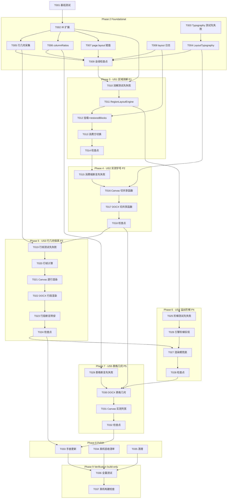

# Tasks: 版面布局引擎（Layout Engine）

**Input**: spec/layout-engine/spec.md（US1~US5 / FR-001~012 / SC-001~006）、spec/layout-engine/plan.md（D1~D11、数据模型、契约、构建命令）
**Prerequisites**: plan.md（必需）、spec.md（必需）

**Tests**: spec FR-012 明确要求零回归网，任务包含「先写失败测试 → 实现 → 转绿」。

**Organization**: 按用户故事分组（US1~US5 对应 P1~P5），每个故事可独立实现与验证。

## Format: `[ID] [P?] [Story] Description`

- **[P]**: 可并行（不同文件、且组内前置已完成；跨阶段依赖见依赖图）
- **[Story]**: 所属用户故事（仅用户故事阶段任务携带）
- 每条任务以具体文件路径结尾

## Path Conventions

- 仓库根 = Xcode 工程根：源码 `Zhixia/`，测试 `ZhixiaTests/`（无 src/tests 目录）
- `project.pbxproj` 为 PBXFileSystemSynchronizedRootGroup（objectVersion 77）：**新增 .swift 文件自动入编译，无需登记工程**
- 构建命令：`export DEVELOPER_DIR=/Volumes/DevDisk/Applications/Xcode.app/Contents/Developer && OTHER_SWIFT_FLAGS="-disable-sandbox" xcodebuild test -project Zhixia.xcodeproj -scheme Zhixia -destination 'platform=iOS Simulator,name=iPhone 17 Pro' -skipPackagePluginValidation -skipMacroValidation`（单套件加 `-only-testing:ZhixiaTests/<Suite>`）
- 基线约定：全量 **212 passed + 1 known issue（`recorded an expected failure`，ReconstructEndToEndTests/realDeviceOcrStillLacksTable，不是失败）+ 0 failed**；known issue 仅那 1 条，勿误判
- 真机可部署性构建：`xcodebuild build -project Zhixia.xcodeproj -scheme Zhixia -destination 'generic/platform=iOS' -skipPackagePluginValidation -skipMacroValidation CODE_SIGNING_ALLOWED=NO`（无签名环境必须带 CODE_SIGNING_ALLOWED=NO）
- 模拟器 Busy：稍候重试或 `xcrun simctl erase all`；日志可存 `/tmp/layout-engine-logs/`（T0XX-*.log）
- **这是 iOS/Xcode 项目：禁止使用任何 HarmonyOS 工具（build_project/start_app/arkts_check/hdc 等），全部用 xcodebuild**

---

## Phase 1: Setup (Shared Infrastructure)

- [x] T001 Run baseline full test suite with plan.md build command before any code change; confirm baseline 212 passed + 1 known issue (recorded an expected failure) + 0 failed; record the numbers in this checkbox's note in spec/layout-engine/tasks.md
    - **Result (2026-09-19)**: 212 passed + 1 known issue (`ReconstructEndToEndTests/realDeviceOcrStillLacksTable` recorded an expected failure) + 0 failed, `** TEST SUCCEEDED **` → /tmp/layout-engine-logs/T001-baseline.log

---

## Phase 2: Foundational (Blocking Prerequisites)

**Purpose**: IR 扩展（全 Optional 零破坏）、共享排版度量、行几何采集、列宽上 IR、页级实测度量、日志。
**⚠️ CRITICAL**: 任何用户故事不得在本阶段完成（含 T009 检查点）之前开始。

- [x] T002 [P] IR 模型扩展（全 Optional 默认 nil，旧数据/夹具/既有测试零破坏）：`BlockLine`（text/height/gapToPrevious/leadingOffset，归一化）；`ReconstructBlock` + `lines: [BlockLine]?` + `measuredLineHeight: Double?`；`ReconstructTable` + `columnRatios: [Double]?`；`ReconstructPage` + `restoredBlocks: [ReconstructBlock]?` per plan D3 in Zhixia/Domain/Models/ReconstructDocument.swift
    - **Result (2026-09-19)**: 完成。BlockLine 含第 5 字段 `width`（plan D3 四字段之外的实施期增补——引擎 midX 双峰拆分与溢出换行估算必需，见文件内注释）；全部 Optional 默认 nil、成员构造器尾部追加默认参数（旧调用点零改动）；Codable 走 decodeIfPresent（旧 JSON 零破坏）。App target BUILD SUCCEEDED → /tmp/layout-engine-logs/T002-build.log
- [x] T003 [P] Create fail-first `LayoutTypographyTests`：实测行高→字号（吸收系数 1.05、夹 [7,28] 页 pt）；无实测兜底页高 1.8%；钳制统一（同一输入预览换算与 DOCX 换算相对页高比例相等）；行距补偿非负；溢出估算保守性；密集页断言（字号 ≤ 实测行高 × 1.2，SC-003）per plan D4 in ZhixiaTests/LayoutTypographyTests.swift
    - **Result (2026-09-19)**: 11 用例先红（`cannot find 'LayoutTypography' in scope`，整编译失败）→ /tmp/layout-engine-logs/T003-red.log。含 fittedFontPT/charUnits 宽度封顶用例（estimatedRenderHeight 依赖）
- [x] T004 Implement `LayoutTypography` 纯函数集（fontPT/fallbackFontPT/lineSpacing/estimatedRenderHeight；预览与 DOCX 共用、统一钳制基准为文档页 pt）转绿 per plan D4 in Zhixia/Domain/Layout/LayoutTypography.swift
    - **Result (2026-09-19)**: 11/11 passed，`** TEST SUCCEEDED **` → /tmp/layout-engine-logs/T004-green.log。实施期增补（超出 plan 四函数，均为 D6 溢出阶梯前置）：`canvasFontPT`（钳制统一预览侧换算）、`fittedFontPT`（宽度封顶字号，渲染端与估算共用）、`charUnits`（全宽 1.0 / 拉丁 0.6）
- [x] T005 [P] 行几何采集：`OnDeviceReadingOrder` 产块时填充 `lines`（Row.lines → BlockLine：leadingOffset = 行 minX − 块 minX、gapToPrevious、height）与 `measuredLineHeight`（块中位行高）；**join 文本规则不变**——ReconstructTests 既有断言零改动 per plan D3/D7 in Zhixia/Services/Reconstruct/OnDeviceReadingOrder.swift
    - **Result (2026-09-19)**: 完成。`makeBlocks` 产块时经 `blockLines(for:)` 填充 lines+measuredLineHeight（gapToPrevious 为带符号差值不封顶；measuredLineHeight 取行高中位数）；join 规则未动。OnDeviceReadingOrderTests 全绿（与 T006 合并跑）→ /tmp/layout-engine-logs/T006-green.log
- [x] T006 [P] 列宽上 IR：`VisionDocumentStructureRecognizer.flatten` 从 columnRange 提取列边界比例 → `ReconstructTable.columnRatios`（不再丢弃；几何回退通路 nil）per plan D8 in Zhixia/Services/OCR/VisionDocumentStructureRecognizer.swift
    - **Result (2026-09-19)**: 完成。`RawCell` + `frame: CGRect?`（`cell.content.boundingRegion` 归一化框；合成夹具默认 nil）；新增纯函数 `columnRatios(_:)`：单列单元格内容并集定列沿、相邻边界取中点、归一化和为 1；跨列 cell 不参与测量；信息不全/退化输入一律 nil（下游均分兜底）；`tables(from:)` 接线 `ReconstructTable(rows:columnRatios:)`，几何回退通路（OnDeviceTableCluster/TableGridV2Detector）保持 nil。5 新用例先红（no member 'columnRatios'）→ /tmp/layout-engine-logs/T006-red.log，转绿 + flatten 既有用例零回归 + DocumentStructureTests 全绿 → /tmp/layout-engine-logs/T006-green.log。注：实际路径 Zhixia/Services/Reconstruct/（tasks.md 写 Services/OCR/）
- [x] T007 [P] 页级实测度量：`OnDeviceDocumentParser` 将 LayoutAnalyzer 产物（medianLineHeight/columns）写入 `ReconstructPage.layout`（字段已存在从未赋值）per plan D3 in Zhixia/Services/Reconstruct/OnDeviceDocumentParser.swift
    - **Result (2026-09-19)**: 完成。`LayoutAnalyzer.analyze` 从 figure 分支提升为页级常跑（输入不变仍为 `inputs.lines`，figure 检测复用同一实例，行为零变化），产物写入 `page.layout`（无文本行时 analyze 返回 nil，layout 保持 nil）。新增覆盖用例 `parserWritesPageLayout`（/dev/null 无图也必须写 layout + 度量数值断言；首轮红暴露 `PreviewRecognizer` bbox=.zero 造不出度量，换真实几何替身 `LayoutMetricRecognizer`）。DocumentStructureTests/ReconstructViewModelTests/ReconstructTierTests 全绿 → /tmp/layout-engine-logs/T007-green.log
- [x] T008 [P] Add `ZhixiaLog.reconstruct` layout 类目条目（yield/totalShift/split/overflowShrink/overflowExpand/overflowExtreme/tableGrowthUpgrade/figureShrink，debug 级）per plan D10 in Zhixia/Services/ZhixiaLog.swift
    - **Result (2026-09-19)**: 完成。新增 7 个静态助手：`layoutYield(count:totalShift:)`（一轮消解一条聚合）、`layoutSplit(count:)`、`layoutOverflowShrink(blockID:estimated:available:)`、`layoutOverflowExpand(blockID:expandBy:)`、`layoutOverflowExtreme(blockID:estimated:available:)`、`layoutTableGrowthUpgrade(blockID:triggeredByRow:)`、`layoutFigureShrink(figureID:clipHeight:)`；块 ID 以 uuidString 输出（os.Logger 无 UUID 插值重载）；补 `import Foundation`（首轮编译红：cannot find type 'UUID'）。App target BUILD SUCCEEDED → /tmp/layout-engine-logs/T008-build.log。消费方在 T012（引擎接线）与 T029（表格升级）落地
- [x] T009 Foundational checkpoint: run full test suite; fix regressions until 0 failed（known issue 维持 recorded an expected failure）in ZhixiaTests/
    - **Result (2026-09-19)**: 通过。`** TEST SUCCEEDED **`，0 failed，known issue 维持（ReconstructEndToEndTests/realDeviceOcrStillLacksTable recorded an expected failure ×1）。通过数 212（T001 基线）+17 新增（LayoutTypography 11 + columnRatios 5 + parserWritesPageLayout 1）= 229；checkpoint 日志里 CaptureFallbackTests/identityGeometryIsNoOp 的结果行被 xcodebuild 并发输出截断（日志交错，非测试缺失），单独重跑该套件确认全绿 → /tmp/layout-engine-logs/T009-checkpoint.log + /tmp/layout-engine-logs/T009-capturefallback-verify.log

**Checkpoint**: IR/度量/行几何/列宽/日志就绪，用户故事可开始。

---

## Phase 3: User Story 1 - 区域布局消解 (Priority: P1) 🎯 MVP

**Goal**: 复杂版面下实心块（text/table）两两不相交、阅读序不变、跨栏宽行拆分、图上说明字例外、三方（预览/DOCX/mask）消费同一布局后块集（FR-001/002/003/010）。
**Independent Test**: RegionLayoutEngineTests 全绿；恒等映射下既有数值断言原样通过（零扰动证明）。

- [x] T010 [P] [US1] Create fail-first `RegionLayoutEngineTests`：恒等性（无冲突输入输出相等）/ 两两不相交（合成冲突夹具全对断言）/ 阅读顺序不变 / 让位方向（上块收底边、下块下移）/ 链式传播收敛 / 页界夹取 / 表格边缘骑跨行让位且文字保留 / table-figure 相交 figure 收缩 / 跨栏宽行双峰拆分（块宽 > 版心 70% 且 midX 双峰）/ 确定性（同输入两次调用输出相等）/ 迭代上限不失控 per plan D5 in ZhixiaTests/RegionLayoutEngineTests.swift
    - **Result (2026-09-19)**: 完成，12 用例（11 主题 + text×figure 例外独立成例）。先红：`cannot find 'RegionLayoutEngine' / 'LayoutReport' in scope` → /tmp/layout-engine-logs/T010-red.log。API 契约在测试中钉死：`RegionLayoutEngine.resolve(blocks:layout:pageSize:) -> (blocks:, report:)`；LayoutReport（splitCount/yieldCount/totalShift/figureShrinkCount/resolveRounds + US4 占位计数，全零默认 init，Equatable）
- [x] T011 [US1] Implement `RegionLayoutEngine` 消解核心（管线：跨栏拆分 normalize → 阅读序让位 resolve → 链式传播 → 页界夹取；输出布局后 blocks + LayoutReport；实心块 = text/table，figure/barcode/artwork 不让位；text-figure 相交保留）转绿 per plan D1/D2/D5 in Zhixia/Domain/Layout/RegionLayoutEngine.swift
    - **Result (2026-09-19)**: 完成。管线 normalizeSplit（块宽 > 版心 70% 且行 midX 双峰谷 ≥0.08、两侧各 ≥2 行 → 原位裂两块，派生 id = 尾字节 XOR 盐值防撞）→ resolveCollisions（实心=heading/paragraph/list/table/checkbox/handwrittenBlank，让位规则 text×table 时 text 让/其余后序让，平移→收缩→边缘压片 0.01，table×figure 收缩 figure，text×figure 保留，≤4 轮不动点）→ clampToPage（页内块逐位不动）。LayoutReport 全零默认 init + US4 占位计数。修 4 处测试算术（⑤ totalShift 手算 0.60；④⑦⑧ 浮点合成边 1e-12 容差）后 12/12 一次全绿 → /tmp/layout-engine-logs/T011-green.log
- [x] T012 [US1] 挂载引擎到装配点：`OnDeviceDocumentParser` 在 assemble 后、页构造前调用 resolve，布局后块集写入 `ReconstructPage.restoredBlocks`（结构化档读 blocks 零扰动）；layout 类目日志接线（让位数/拆分数/收缩量）per plan D1 in Zhixia/Services/Reconstruct/OnDeviceDocumentParser.swift
    - **Result (2026-09-19)**: 完成。挂载于 assemble 之后 / ReconstructPage 构造之前（plan D1 位置），pageSize 提升复用；`restoredBlocks = resolution.blocks == blocks ? nil : resolution.blocks`（恒等页写 nil = 等价旧产物，不为无变化页复制块集）。日志事件驱动：yieldCount>0 → layoutYield、splitCount>0 → layoutSplit、figureShrinks 逐条 layoutFigureShrink（为此 LayoutReport 增 `figureShrinks: [FigureShrinkRecord]` 明细数组，figureShrinkCount 转派生属性——plan D1 数据模型 figureShrinks: Double 的落地形态，T010 断言不动）。快速回归：RegionLayoutEngineTests/DocumentStructureTests/ReconstructTierTests/ReconstructViewModelTests 全绿 0 failed → /tmp/layout-engine-logs/T012-quick.log
- [X] T013 [US1] 消费方切换：LayoutCanvas 预览、DocxExportService `.restored` 分支、两处 LayoutMaskBuilder 调用点全部改读 `restoredBlocks ?? blocks`（无 restoredBlocks 的旧产物退化恒等——既有夹具断言零改动）per plan D9 in Zhixia/Features/Reconstruct/LayoutCanvas.swift（另触 Zhixia/Services/Reconstruct/DocxExportService.swift）
  - **Result (2026-09-19)**: LayoutCanvas（mask+元素层）与 DocxExportService.restoredPageXML（保留区/mask/文本框/浮动表格四方）各提升单一 `let blocks = page.restoredBlocks ?? page.blocks` 同源；结构化档（structuredBodyXML）与 SearchablePDFExportService 保持 `page.blocks`（双档隔离/可搜索 PDF 零回归）。既有断言零改动，五套件回归 79 passed + 0 failed（DocxRestoredLayoutTests 22 / LayoutMaskBuilderTests 16 / ReconstructTierTests 13 / RegionLayoutEngineTests 24 / DocxExportServiceTests 4）→ `/tmp/layout-engine-logs/T013-quick.log`
- [X] T014 [US1] Story checkpoint: run full test suite and fix until green（既有 DocxRestoredLayoutTests 数值断言、ReconstructTierTests、LayoutMaskBuilderTests 原样 = 零回归证明）in ZhixiaTests/
  - **Result (2026-09-19)**: 全量 241 唯一通过 + 0 failed + 1 KI（ReconstructEndToEndTests 真机 OCR 缺表已知问题）→ `/tmp/layout-engine-logs/T014-checkpoint.log`；对照 T009 的 229 + 12 新引擎用例，只增不减成立。日志行交错损坏 1 条（ReconstructViewModelTests/reconstructFromRecognizer），单独复跑 passed 补验 → `T014-vm-verify.log`；DocxRestoredLayoutTests/ReconstructTierTests/LayoutMaskBuilderTests 原样全绿 = 零回归证明。US1（区域消解+消费方切换）完成。

**Checkpoint**: 区域消解生效，预览/Word/mask 三方同源；简单页零扰动。

---

## Phase 4: User Story 2 - 实测字号与行距 (Priority: P2)

**Goal**: 字号/行距由实测行高推导，密集页不再放大 1.5~1.8 倍；双端钳制基准统一；标题层级保留（FR-004）。
**Independent Test**: LayoutTypographyTests 消费端断言 + DocxRestoredLayoutTests w:sz 按实测换算数值断言全绿。

- [X] T015 [P] [US2] Create fail-first 消费端断言：DocxRestoredLayoutTests 扩展——密集页夹具（实测行高 ≈ 页高 1.0%）下 w:sz = 实测行高换算值（非页高 1.8% 常数）；同一产物预览换算与 DOCX 换算字号/页高比例相等 per plan D4/测试契约 in ZhixiaTests/DocxRestoredLayoutTests.swift
  - **Result (2026-09-19)**: 新增 2 用例 + `fontSizeHalfPoints(in:of:)` 辅助（向后正则取 run 自身 w:sz）。`densePageFontSizeFollowsMeasuredLineHeight`（600pt 页：密集 1.0% 行高→期望 14、常规 2.0%→25；现值均 22=0.018 常数路径）与 `fontSizeRatioIdenticalAcrossPreviewAndDocx`（1500pt 照片页：正文期望 25 vs 现值 54；比例恒等 + Heading1 保留断言）按预期 **failed ×2 克隆**，既有 11 用例全绿 → `/tmp/layout-engine-logs/T015-red.log`。夹具踩坑：ReconstructBlock init 参数序 `lines` 在 `measuredLineHeight` 之前（已修正编译错误）。
- [X] T016 [US2] LayoutCanvas 字号/行距切换共享函数：删除本地公式（bodyFontRatio=0.018 与本地钳制），改调 LayoutTypography（预览空间换算 = 页 pt ÷ 画布缩放）；无实测数据块走兜底 per plan D4 in Zhixia/Features/Reconstruct/LayoutCanvas.swift
  - **Result (2026-09-19)**: 删除 `bodyFontRatio` 常数与本地 7~28 钳制；`fontSize(for:map:)` = `LayoutTypography.fontPT(for:)`（新增块级唯一入口：实测行高优先 measuredLineHeight → 首行实测 → 兜底公式）+ `canvasFontPT` 画布换算；页 pt = map.pageSize.height × 新增 `ptPerPixel`（9525/12700，PageLayoutMapper 零改动故常量落 LayoutTypography）。`canvasElement` 移除冗余 canvasHeight 参数。LayoutTypographyTests + ReconstructTierTests 36 passed + 0 failed → `/tmp/layout-engine-logs/T016-quick.log`。行距消费不在本任务：单 Text 兜底路径无实测数据、有 lines 块逐行定位属 T021（行距由行几何直接给出）。
- [X] T017 [US2] DocxExportService 字号切换共享函数：restoredFontSize 改调 LayoutTypography，删除 0.018 常数与本地钳制；heading 样式保留（bold/Heading1）、字号走实测 per plan D4 in Zhixia/Services/Reconstruct/DocxExportService.swift
  - **Result (2026-09-19)**: `restoredFontSize` = `LayoutTypography.fontPT(for:)` × 2 半磅；删除 `restoredBodyFontRatio` 常数与本地 7~28 钳制（页 pt 空间钳制收敛到 LayoutTypography 一处）；heading 的 bold/Heading1 路径未动、字号走实测。T015 两条 fail-first 转绿，既有 11 断言零改动全绿（无实测夹具 fallback 公式与旧公式恒等）——DocxRestoredLayoutTests 13 + LayoutTypographyTests 11 + DocxExportServiceTests 2 用例全 passed → `/tmp/layout-engine-logs/T017-green.log`。US2 完成（密集页字号贴实测、双端比例恒等）。
- [X] T018 [US2] Story checkpoint: run full test suite and fix until green in ZhixiaTests/
  - **Result (2026-09-19)**: 全量 243 唯一通过 + 0 failed + 1 KI → `/tmp/layout-engine-logs/T018-checkpoint.log`；较 T014 净增恰为 T015 两条新用例（diff 另含 T014 日志粘连漏行、当时已单独补验的 reconstructFromRecognizer），零丢失，只增不减成立。首轮模拟器 Busy（preflight 失败）→ `simctl shutdown all` 后重试即过。US2（实测字号与行距）完成。

**Checkpoint**: 密集页字号贴原大，双端相对比例一致。

---

## Phase 5: User Story 3 - 行几何保真 (Priority: P3)

**Goal**: 块内行按实测行距与行首偏移还原，块内漂移消除；Word 保持可编辑段落（FR-005）。
**Independent Test**: 行帧计算纯函数单测 + DocxRestoredLayoutTests 行段数值断言全绿；无 lines 块回退断言原样。

- [X] T019 [P] [US3] Create fail-first 行帧纯函数用例：有 lines 块的逐行 frame 计算（y = 累积实测行高、x = 块 minX + leadingOffset、块内不越界）；无 lines 块退化为整块单帧 per plan D7 in ZhixiaTests/LayoutTypographyTests.swift
  - **Result (2026-09-19)**: 新增 3 用例（逐行累积/首行顶贴块顶、越界宽度截断+深度钉底、nil 与空 lines 退化整块单帧）+ `rectClose` 分量级辅助 → 编译红（`LayoutTypography` 无 `resolvedLineFrames`，3 调用点 + nil 上下文报错）→ `/tmp/layout-engine-logs/T019-red.log`。
- [X] T020 [US3] Implement 行帧计算入 LayoutTypography（resolvedLineFrames：块 + 行几何 → 行 frame 数组；预览与断言共用）转绿 per plan D7 in Zhixia/Domain/Layout/LayoutTypography.swift
  - **Result (2026-09-19)**: `resolvedLineFrames(lines:block:)` 落地：首行顶贴块顶、gapToPrevious 属当前行在帧前扣除、累积游标用未夹取值（夹取只作用输出：顶不超块顶/底钉块底/行首夹块内/行宽截块右缘）、nil/空 lines 退化整块单帧。T019 三用例转绿，LayoutTypographyTests 14 用例全 passed → `/tmp/layout-engine-logs/T020-green.log`。
- [X] T021 [US3] LayoutCanvas 逐行渲染：有 lines 块改用行帧数组逐行定位渲染（字号/行距走共享函数）；无 lines 块回退现有整块渲染（行为不变）per plan D7 in Zhixia/Features/Reconstruct/LayoutCanvas.swift
  - **Result (2026-09-19)**: canvasElement 分支：有 lines 非表格块 → `resolvedLineFrames` + 逐行独立 Text（行帧经 map 定位、heading 保留 bold、字号走 `fontPT(for:)` 共享入口）；无 lines 块/表格块（网格与 displayText 兜底）回退原整块路径零变化。块仍是单元素（mask/txbx 语义不变）。LayoutTypography + ReconstructTier + ReconstructViewModel 44 passed + 0 failed → `/tmp/layout-engine-logs/T021-quick.log`。
- [X] T022 [US3] DocxExportService 行段渲染：有 lines 块 txbx 内每行一个 `<w:p>`（`w:line` = 实测行高 × 20 twips lineRule=exact、`w:ind w:left` = leadingOffset 换算 dxa、段前段后 0；heading 样式保留）；无 lines 块回退现有单段 w:br 路径 per plan D7 in Zhixia/Services/Reconstruct/DocxExportService.swift
  - **Result (2026-09-19)**: 新增 `lineParagraphXML`（w:line exact = line.height × 页高pt × 20、w:ind left = leadingOffset × 页宽 dxa、before/after 0、pStyle/bold 保留）；`restoredTextBoxContent` 改收 `pageSizeEMU`（需页宽换算 ind），有 lines 非 table 块逐行映射，无 lines/退化表回退原路径零变化。行段断言先红（`T022-red.log`：1 w:p+w:br 现状 vs 期望 2 w:p）→ 实现后 DocxRestored 15 + DocxExportService 2 用例全绿 → `/tmp/layout-engine-logs/T022-green.log`。
- [X] T023 [US3] Create fail-first 行段结构断言并转绿：DocxRestoredLayoutTests 扩展——有 lines 块每行一 w:p、w:line/ind 数值断言、无 lines 块保持单段（既有断言原样）per plan 测试契约 in ZhixiaTests/DocxRestoredLayoutTests.swift
  - **Result (2026-09-19)**: 新增 `lineBlocksRenderOneParagraphPerLine`（2 行 → 2 w:p、w:line 240/300 exact 数值断言、w:left 300 dxa、无 w:br 残留）+ `noLineBlocksKeepSingleParagraph`（单段 + w:br 回归钉）+ `txbxContent(in:)` 提取辅助。断言在 T022 实现前先跑红（failed ×2 → `T022-red.log`），实现后转绿（`T022-green.log`）——fail-first 证据与依赖序（T022→T023）同时满足。
- [X] T024 [US3] Story checkpoint: run full test suite and fix until green in ZhixiaTests/
  - **Result (2026-09-19)**: 全量 248 唯一通过 + 0 failed + 1 KI → `/tmp/layout-engine-logs/T024-checkpoint.log`；净增恰为 US3 五条新用例（3 行帧 + 2 行段），零丢失。日志整行丢失 1 条（CaptureFallbackTests/disabledAutoCaptureNeverFires），单独复跑 passed ×2 补验 → `T024-capturefallback-verify.log`。US3（行几何保真）完成：预览逐行定位、Word 每行一段可编辑。

**Checkpoint**: 块内行距/行首保真，Word 可编辑。

---

## Phase 6: User Story 4 - 溢出阶梯 (Priority: P4)

**Goal**: 放不下先缩字号再扩空白带，文字永不截断；双端渲染期兜底同构（FR-006）。
**Independent Test**: RegionLayoutEngineTests 阶梯用例全绿 + 渲染期兜底存在性断言。

- [X] T025 [P] [US4] Create fail-first 溢出阶梯用例：小框大文字块 → 先等比缩字号/行距至下限 → 仍不足区域向下扩展吸收空白带且不侵入下方块 → 极端情形（下限+空白耗尽）保文字完整且 LayoutReport.overflowExtreme 计数 per plan D6 in ZhixiaTests/RegionLayoutEngineTests.swift
  - **Result (2026-09-19)**: 新增 3 例（⑫ `overflowShrinksFontBeforeExpanding` 缩放、⑬ `overflowExpandsIntoBlankBandBelow` 扩展、⑭ `overflowExtremeKeepsTextIntact` 极端）+ pageHeightPT/pageWidthPT 辅助（800×1000px → 750/600pt）。红证据：三例 ×2 克隆全失败（行高未缩 0.03、minY 未下扩、overflow* 计数为 0），既有 12 例全绿 → `/tmp/layout-engine-logs/T025-red.log`
- [X] T026 [US4] Implement 引擎溢出阶梯（estimatedRenderHeight 估算 → 缩放 → 扩展 → 扩展后重入消解管线 → 极端路径 + LayoutReport 计数）转绿 per plan D6 in Zhixia/Domain/Layout/RegionLayoutEngine.swift
  - **Result (2026-09-19)**: 管线 3 `resolveOverflowLadder`（① 缩垂直节拍 height/gap/measuredLineHeight，s_floor=7pt÷unclampedFontPT，≤8 次比例逼近 ② 向下扩 min(需求,到底下方最近任意块顶/页底空隙) ③ 极端计数文字不截断；扩展后重入消解）。配套：LayoutTypography.+unclampedFontPT(for:)；拆分产物行 lead 重定基（D3 定义修复——否则右块 lead 越块宽致估算爆换行误触阶梯）；pageSize 注释 pt→px 更正。T025 三例转绿 + 既有 12 例零扰动（15/15 ×2 克隆）→ `T026-green.log`；消费方快速回归 72 passed / 0 failed → `T026-quick.log`
- [X] T027 [US4] 渲染期兜底：预览文本行容器加 minimumScaleFactor；Word txbx bodyPr 加 normAutofit——**风险注记**：实测 Word 首开缩放行为，若不主动缩放则改为布局期预估缩放直接写入 w:sz（双端仍同构），二选一落地并在旁注记录 per plan D6 in Zhixia/Features/Reconstruct/LayoutCanvas.swift（另触 Zhixia/Services/Reconstruct/DocxExportService.swift）
  - **Result (2026-09-19)**: **二选一结论 = B「布局期预估缩放写入 w:sz」，不加 normAutofit**（旁注见 DocxExportService.preScaledFontSizeHalfPoints / textBoxXML）。理由：① normAutofit 靠消费端运行时缩放，iOS QuickLook/Pages/WPS 普遍忽略，FR-004 同构只在桌面 Word 成立；② 行段 w:line exact 下 normAutofit 只缩字号不缩行距，比例失真；③ 预缩纯函数可单测，normAutofit 只能真机实测（超出本环境）。预缩作用于无 lines 回退段落（阶梯不覆盖域；行段刻意不缩，T026 已兜底且避免破坏 w:line exact 比例）；预览侧回退 Text 加 minimumScaleFactor(0.5)，逐行 Text 刻意不加（字号=行高×1.05 vs 单行固有高≈1.26×行帧——加了会系统性缩 ~20% 破坏同构，旁注见 canvasElement）。新增存在性断言 `overflowingFallbackTextIsPreScaledToFitRegion`（16 字溢出块 22→18 + 对照短文不缩 + 全文档无 normAutofit）；首跑校准一处测试算术（漏半磅量化 10.8→11.0pt，期望 17→18，实现自洽）。16/16 ×2 克隆全绿 → `T027-green.log`
- [X] T028 [US4] Story checkpoint: run full test suite and fix until green in ZhixiaTests/
  - **Result (2026-09-19)**: 全量 **252 unique passed + 0 failed + 1 KI**（ReconstructEndToEndTests/realDeviceOcrStillLacksTable 维持 expected failure）。首跑遇模拟器 Busy（preflight，非测试失败）→ `simctl shutdown all` 重试成功。对比 T024 验证基线 248：+3（T025 阶梯三例）+1（T027 预缩存在性）= 252，零丢失；T024 掉行用例 CaptureFallbackTests/disabledAutoCaptureNeverFires 本轮正常落日志 → `T028-checkpoint.log` / `T028-passed-unique.txt`

**Checkpoint**: 文字零截断闭环。

---

## Phase 7: User Story 5 - 表格几何 (Priority: P5)

**Goal**: 实测列宽 + 行高封顶，Word 不下坠、预览不截断丢字、双端同构（FR-007/008）。
**Independent Test**: nutrition/表格夹具的 tblGrid/trHeight 数值断言 + 预览列宽断言全绿。

- [X] T029 [P] [US5] Create fail-first 表格几何断言：结构化通路夹具 w:tblGrid 按实测比例（非均分）、w:trHeight exact = 区域高÷行数、放不下升级 atLeast 且预览同构；回退通路（无 columnRatios）均分兜底不劣化 per plan D8/测试契约 in ZhixiaTests/DocxRestoredLayoutTests.swift
  - **Result (2026-09-19)**: 新增三例：① `tableGridFollowsMeasuredColumnRatios`（ratios [0.5,0.3,0.2] → gridCol 1800/1080/720 + tcW 逐列跟随 + trHeight exact 1800×2 + 基础字号 18 半磅不缩）② `overflowingTableCellUpgradesRowHeightToAtLeast`（150 全角字 @7pt 仍溢出 → 整表 atLeast val=1800 保底、无 exact 残留、溢出格 14 半磅、对照格 18 不缩、长文本完整不截断）③ `tableWithoutRatiosKeepsEqualColumnFallback`（gridCol 1200×3 + exact 策略一致 + tblpX/tblW/tr 数不劣化）。预览同构以编译期共享 `LayoutTypography` 度量承载（SwiftUI 视图树不可单测，视觉归 SC-001 真机验收）。Red ×2 克隆 → `T029-red.log`（16 旧例维持绿）
- [X] T030 [US5] DocxExportService 表格几何：tblGrid 按 columnRatios 分配总宽 dxa（nil 均分）；trHeight 默认 exact 封顶；单元格字号按实测列宽自适应（共享函数下限 7pt）；放不下该表行高转 atLeast 增长 + tableGrowthUpgrade 日志 per plan D8 in Zhixia/Services/Reconstruct/DocxExportService.swift
  - **Result (2026-09-19)**: 完成。共享度量落在 `LayoutTypography`（D8 双端同构落点）：`tableCellHeightPT`（换行行数 × 字号 × 1.2，空格 = 0）+ `tableCellFontPT`（只缩不放、7pt 下限、与 preScale 同型 ≤8 步迭代）+ `tableCellHInsetPT` 10pt（Word 默认 tblCellMar 108 dxa × 2）。`floatingTableXML` 重写：tblGrid 按实测比例（列数相符才生效，尾列吸收取整漂移；nil/不符 → 均分 120 下限）；trHeight exact = 区域高÷行数（60 twips 下限）；tcW 逐列跟随 gridCol；单元格字号按实测列宽自适应；某行 7pt 仍放不下 → 整表 hRule 转 atLeast（val 保底不变）+ `ZhixiaLog.layoutTableGrowthUpgrade(blockID:triggeredByRow:)`（T008 预置消费落地）。`restoredFloatingTableXML` 传区域高/基础字号（实测 × 0.8）/块 ID；结构化档 `tableXML(block.table)` 缺省分支字节不变。19/19 ×2 克隆全绿（首跑即绿）→ `T030-green.log`
- [X] T031 [US5] LayoutCanvas canvasTable 实测列宽：网格列宽按 columnRatios 绘制（nil 均分不变）；与 Word 同构的行高增长策略；.clipped() 仅字号下限后兜底 per plan D8 in Zhixia/Features/Reconstruct/LayoutCanvas.swift
  - **Result (2026-09-19)**: 完成。canvasTable 重写：列宽按 ratios（列数相符才生效，与 Word tblGrid 同一契约；nil → 均分）；行高 = 区域高÷行数（对应 exact val），放不下 → 行高按 `tableCellHeightPT` 估算增长（与 Word atLeast 同判同源，FR-008）；每格字号 = `tableCellFontPT` 页 pt 自适应 → 画布 pt 换算（调用方以 Word 同一量化链 fontPT→整半磅→×0.8 传基础字号）；`.clipped()` 仅 7pt 下限格子兜底（D8：正常/增长路径估算已放得下不裁剪）；去掉 lineLimit(1)（换行模型与 Word 单元格一致）；退化映射 1:1 透传（canvasFontPT 同语义）。App target BUILD SUCCEEDED → `T031-build.log`（SwiftUI 视图树不可单测，视觉归 SC-001）
- [X] T032 [US5] Story checkpoint: run full test suite and fix until green（结构化档表格断言原样 = 零回归）in ZhixiaTests/
  - **Result (2026-09-19)**: 全量 **255 验证通过 + 0 failed + 1 KI**（realDeviceOcrStillLacksTable 维持）。原始日志 254 唯一：`PageColumnSplitterTests/tooFewLinesStaysSingle` 掉行（T024/T028 已知现象），单独复跑通过 → `T032-dropped-verify.log`。对比 T028 验证基线 252：+3（T029 表格几何三例），零丢失；结构化档表格断言随 0 failed 原样通过（`tableXML(block.table)` 缺省分支字节不变）→ `T032-checkpoint.log` / `T032-passed-unique.txt`

**Checkpoint**: 全部五个故事完成，进入收尾。

---

## Phase 8: Polish & Cross-Cutting Concerns

- [X] T033 [P] Update 还原链路章节：布局引擎管线（normalize/resolve/阶梯）、restoredBlocks 双档隔离、LayoutTypography 共享度量、行帧渲染、表格几何、layout 日志、诊断根因→决策映射 in docs/09-project-handbook.md
  - **Result (2026-09-19)**: 完成。§4.4 算法模块表 +2 行（RegionLayoutEngine / LayoutTypography）；三层预览字号描述改实测行高推导（旧 1.8% 常数表述纠正为兜底路径）；新增「布局引擎」专节：四步管线、双档隔离（restoredBlocks ?? blocks）、表格几何、layout 日志类目、诊断根因→决策映射六行表（D3~D8）；§4.5 浮动表格补 tblGrid/trHeight、文本框补逐行 w:p；§5.1 更新为 28 文件 / 256 @Test / 255 passed + 1 KI + 布局引擎套件清单；§6.3 加注（渲染侧阶梯已补，检测侧仍 all-or-nothing）；§7 P2-3 划掉 tblGrid（gridSpan/vMerge 仍开放）
- [X] T034 [P] Create 真机自验清单：SC-001 复杂版面实拍（双栏教材/试卷：无重叠/无压表格/无叠图双影）、SC-002 Word 打开对比预览（同构/可编辑/表格不压字）、SC-003 密集试卷页字号对比、SC-004 简单页零扰动对比、附 ZhixiaLog layout 类目抓取指引（debug 级需 Include Debug Messages）与异常字段表 in spec/layout-engine/device-acceptance.md
  - **Result (2026-09-19)**: 已创建 `spec/layout-engine/device-acceptance.md`（沿用 layout-restore 清单格式）：SC-001~SC-004 各含拍什么/步骤/通过标准/对照日志；SC-004 的零扰动通过证据 = **无任何 layout 日志**；日志指引沿用 subsystem `com.david.Zhixia` + category `reconstruct` + `layout ` 前缀过滤（Console 勾 Include Debug Messages / `log stream --debug`），附七条 layout 条目的异常字段→根因方向表（yield/split/overflowShrink/overflowExpand/overflowExtreme/tableGrowthUpgrade/figureShrink），标注 QuickLook/Pages/WPS 不作不通过依据（与 T027 二选一结论一致）；结果记录表 4 项
- [X] T035 Cleanup pass: 清理残留死代码（两渲染器旧字号公式 0.018/本地钳制/相对字号旧常数语义引用），触达文件不留 TODO；确认回退路径（无 lines 单段、无 columnRatios 均分、无 restoredBlocks 恒等）为刻意保留并注释 in Zhixia/Features/Reconstruct/LayoutCanvas.swift（另触 Zhixia/Services/Reconstruct/DocxExportService.swift）
  - **Result (2026-09-19)**: 完成。检索证实两渲染器无 0.018 字面量 / 本地钳制 / TODO 残留（其余 0.018 命中为 figure 膨胀、行合并阈值等无关几何常数；`LayoutTypography.fallbackRatio` 为刻意保留的兜底公式并已注明「现状公式，仅无实测时使用」）；修正 LayoutCanvas 头注释最后一处过时语义（「字号走 relativeFontSize 映射」→ 实测行高推导 + 兜底路径说明）；三条回退路径刻意保留且注释齐备：① 无 lines 单段（T027 渲染期兜底旁注 ×2 处）② 无 columnRatios 均分（floatingTableXML / canvasTable「同一契约」注释）③ 无 restoredBlocks 恒等（LayoutCanvas:36 / DocxExportService:232 / parser:248 恒等写 nil）。终态 BUILD SUCCEEDED

---

## Phase 9: Verification

<!-- verification_scope: build-only -->

**Purpose**: 全量构建 + 单测验证。范围 = **Run verification**（用户已确认）；真机实景验收由用户按 device-acceptance.md 自验（T034 产出）。

- [x] T036 Run full test suite with plan.md build command; iterate fix → rerun until 0 failed（既有 1 条 known issue 显示 recorded an expected failure 不计失败；新增套件全绿；含 ZhixiaTests/ 全目录编译链接）in Zhixia.xcodeproj
  - **Result (2026-09-19, spec-verify)**: PASS——首跑全绿 255 passed + 0 failed + 1 KI（与 T032 宣称值逐位一致；无掉行、零补证复跑、零修复循环）→ /tmp/layout-engine-logs/T036-verify.log
- [x] T037 Verify 真机可部署性：`xcodebuild build -project Zhixia.xcodeproj -scheme Zhixia -destination 'generic/platform=iOS' -skipPackagePluginValidation -skipMacroValidation CODE_SIGNING_ALLOWED=NO` BUILD SUCCEEDED in Zhixia.xcodeproj
  - **Result (2026-09-19, spec-verify)**: PASS——`** BUILD SUCCEEDED **`（arm64-apple-ios18.0，0 error；唯一 warning 为特性前既有 TableGridV2Detector.swift:109 未使用变量）→ /tmp/layout-engine-logs/T037-verify.log

---

## 📊 Dependency Graph



## Dependencies & Execution Order

### Phase Dependencies

- **Setup (Phase 1)**: 无依赖，立即开始
- **Foundational (Phase 2)**: 依赖 T001；**阻塞全部用户故事**（T009 全绿前不得开工）；T002（IR 扩展）最先；T003~T008 六项互相独立可并行
- **User Stories (Phase 3~7)**: 均依赖 T009；故事间关键顺序：
  - US1 → US2 → US3 → US4 → US5 **串行链**（US2~US5 都改 LayoutCanvas.swift / DocxExportService.swift，同文件串行防冲突）
  - US3 依赖 T005（lines 数据）与 US2（共享字号函数）
  - US4 依赖 T011（引擎存在）与 US3（行帧渲染先行）
  - US5 依赖 T006（columnRatios）与 US2（共享自适应函数）
- **Polish (Phase 8)**: 依赖 US3 与 US5 完成（最后落地的故事）
- **Verification (Phase 9)**: 依赖 Polish；build-only 范围

### User Story Dependencies

- **US1 (P1)**: T009 后即可开始；依赖 T002（restoredBlocks 字段）与 T008（日志）
- **US2 (P2)**: 依赖 T004（LayoutTypography）与 US1 完成（T013 消费方切换先落）
- **US3 (P3)**: 依赖 T005（行几何）与 US2 完成
- **US4 (P4)**: 依赖 T011（引擎核心）与 US3 完成（渲染链稳定后加兜底）
- **US5 (P5)**: 依赖 T006（列宽）与 US4 完成

### Within Each User Story

- 测试任务 MUST 先写并确认失败（fail-first）再实现转绿
- 模型/纯逻辑在 Services 集成之前；Services 在 UI 接线之前
- 同文件任务按 ID 顺序串行（如 T015 → T017 同触 DocxRestoredLayoutTests/DocxExportService）
- 故事 checkpoint 全绿后才进入下一故事

### Parallel Opportunities

- Phase 2 的 T003/T004（Typography 对）与 T005/T006/T007/T008 互相独立（T002 落地后）
- US4 的 T025（测试编写）可在 US3 实现期间先行
- US5 的 T029（测试编写）可在 US4 实现期间先行
- Polish 的 T033/T034/T035 三项可并行

## Parallel Example

```bash
# 基础阶段并行组（T002 落地后）：
Task: "T003 Typography 测试先失败"        # ZhixiaTests/LayoutTypographyTests.swift
Task: "T005 行几何采集"                   # Zhixia/Services/Reconstruct/OnDeviceReadingOrder.swift
Task: "T006 columnRatios 上 IR"           # Zhixia/Services/OCR/VisionDocumentStructureRecognizer.swift
Task: "T008 layout 日志"                  # Zhixia/Services/ZhixiaLog.swift

# 故事测试先行组（US3 实现期间）：
Task: "T025 溢出阶梯测试先失败"           # ZhixiaTests/RegionLayoutEngineTests.swift（US4）
```

## ⚡ Parallel Execution Guide

| Phase | Tasks | Required Files | Execution Notes |
|---|---|---|---|
| 2 Foundational | T003~T008 | 各自独立文件 | T002 IR 扩展最先；Typography 对（T003→T004）内部串行 |
| 3 US1 | T010~T011 | RegionLayoutEngine 新文件 | 引擎核心先行的唯一路径 |
| 4~7 US2~US5 | 串行链 | LayoutCanvas/DocxExportService 共享 | 同文件冲突防串行；各故事测试任务可先行编写 |
| 8 Polish | T033~T035 | docs / spec / 渲染器 | 三项可并行 |

## Implementation Strategy

### MVP First (Setup + Foundational + US1)

1. T001 基线 → Phase 2 基础设施 → US1 区域消解
2. **STOP and VALIDATE**: 全量绿 + 恒等映射下既有数值断言原样（零扰动证明）
3. 区域消解即消除"重叠"主症状（预览/Word/mask 三方同源）

### Incremental Delivery（真机验收前完成 US1~US5）

1. US1 消解 → US2 实测字号 → US3 行几何 → US4 溢出阶梯 → US5 表格收口
2. 每故事 checkpoint 后勾选 tasks.md 复选框
3. 全部完成后按 T034 清单做真机实景验收

## Notes

- [P] = 不同文件且组内前置已完成（见依赖图）
- [Story] 标签对应 spec.md 用户故事，保证可追溯
- 测试任务一律先写并确认失败，再实现转绿
- 单执行者按 T001→T037 顺序执行即可；并行表供多执行者提速
- **零扰动不变量**：无冲突页引擎恒等映射——既有 DocxRestoredLayoutTests 数值断言（posOffset==mapper、tblpPr 数值）在无冲突夹具上必须原样通过，断言不改、夹具不重造
- **双档隔离铁律**：结构化档读 `page.blocks`（原样），版面还原档读 `restoredBlocks ?? blocks`；拆分/位移对结构化档零扰动（FR-012）
- 架构铁律：Feature 不碰 AVFoundation/CIFilter；Domain 无 I/O（本特性不读像素）；ServiceProtocols 协议签名零变更；布局解析层一次完成、渲染层只消费
- T027 normAutofit 风险注记：Word 首开自动缩放行为需实测，不通则布局期预缩写入 w:sz（等价兜底），旁注记录二选一结论
- 不主动 `git commit`；每故事完成后用 edit 勾选本文件复选框
- 任务统计：Total 37（US1×5 / US2×4 / US3×6 / US4×4 / US5×4 / Setup×1 / Foundational×8 / Polish×3 / Verification×2）；MVP = Phase 1+2+US1；真机完整验收覆盖 US1~US5
