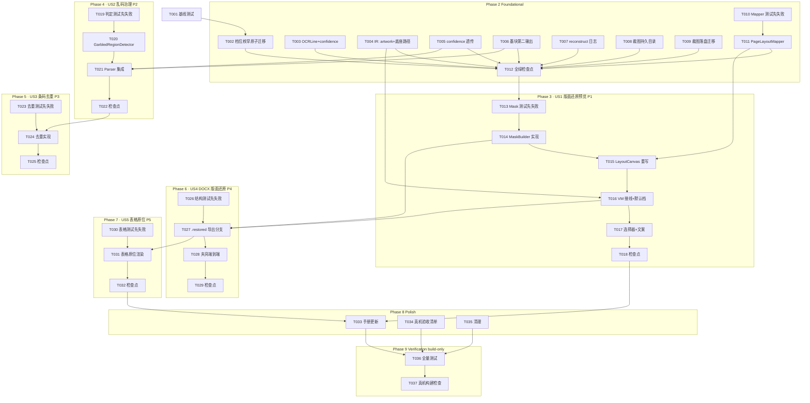

# Tasks: 版面还原（Layout Restore）

**Input**: spec/layout-restore/spec.md（US1~US5 / FR-001~014 / SC-001~006）、spec/layout-restore/plan.md（D1~D10、契约、构建命令）
**Prerequisites**: plan.md（必需）、spec.md（必需）

**Tests**: spec **FR-013 明确要求**回归网，任务包含「先写失败测试 → 实现 → 转绿」。

**Organization**: 按用户故事分组（US1~US5 对应 P1~P5），每个故事可独立实现与验证。

## Format: `[ID] [P?] [Story] Description`

- **[P]**: 可并行（不同文件、且组内前置已完成；跨阶段依赖见依赖图）
- **[Story]**: 所属用户故事（仅用户故事阶段任务携带）
- 每条任务以具体文件路径结尾

## Path Conventions

- 仓库根 = Xcode 工程根：源码 `Zhixia/`，测试 `ZhixiaTests/`（无 src/tests 目录）
- `project.pbxproj` 为 PBXFileSystemSynchronizedRootGroup（objectVersion 77）：**新增 .swift 文件自动入编译，无需登记工程**
- 构建命令：`export DEVELOPER_DIR=/Volumes/DevDisk/Applications/Xcode.app/Contents/Developer && OTHER_SWIFT_FLAGS="-disable-sandbox" xcodebuild test -project Zhixia.xcodeproj -scheme Zhixia -destination 'platform=iOS Simulator,name=iPhone 17 Pro' -skipPackagePluginValidation -skipMacroValidation`（单套件加 `-only-testing:ZhixiaTests/<Suite>`）
- 基线约定：全量 **165 passed + 1 known issue（`recorded an expected failure`，不是失败）+ 0 failed**；known issue 仅那 1 条，勿误判
- 模拟器条码检测恒空 → 条码相关断言用注入替身，真机验收另测
- 模拟器 Busy：稍候重试或 `xcrun simctl erase all`

---

## Phase 1: Setup (Shared Infrastructure)

- [X] T001 Run baseline full test suite with plan.md build command before any code change; confirm baseline 165 passed + 1 known issue (recorded an expected failure) + 0 failed; record the numbers in this checkbox's note in spec/layout-restore/tasks.md
  - **基线实测（2026-09-18）**：TEST SUCCEEDED · **165 passed** · **0 failed** · **1 known issue**（`ReconstructEndToEndTests/realDeviceOcrStillLacksTable()` recorded an expected failure）——与约定一致

---

## Phase 2: Foundational (Blocking Prerequisites)

**Purpose**: 档位枚举迁移（原子）、IR 模型扩展、置信度透传、墨块第二输出、裁图持久化、坐标映射纯函数、日志。
**⚠️ CRITICAL**: 任何用户故事不得在本阶段完成（含 T012 检查点）之前开始。

- [X] T002 [P] 档位枚举原子迁移 per plan D1/D8：`R2OutputTier` + `.restored`、− `.anchored`/`.background`、`selectable = [.restored, .structured]`（默认暂保持 `.structured`，US1 完成时切换）；同步迁移全部引用保编译——DocxExportService switch 收敛（`.restored` 暂走 structured 渲染并注明 US4 替换）、ReconstructTierTests 用例迁移、ReconstructView 选择器逻辑 in Zhixia/Services/ServiceProtocols.swift（另触 Zhixia/Services/Reconstruct/DocxExportService.swift、ZhixiaTests/ReconstructTierTests.swift、Zhixia/Features/Reconstruct/ReconstructView.swift）<!-- done 2026-09-18: 另迁移 ReconstructTests（删 docxAnchoredTierUsesAnchor/docxBackgroundTierUsesBehindDoc）与 ExportSafetyTests（删 docxAnchoredUsesEMUUnits/docxBackgroundIsPerPage），由 T026 DocxRestoredLayoutTests 接手 -->
- [X] T003 [P] Extend `OCRLine` with `confidence: Double = 1.0`（默认值向后兼容，既有夹具/测试零改动）per plan D8 in Zhixia/Domain/Models/OCRPageText.swift
- [X] T004 [P] Extend `ReconstructBlockKind` + `.artwork` 与 `ReconstructPage` + `baseImageRelativePath: String?`（nil = 无底座退化白底）per plan D2/D8 in Zhixia/Domain/Models/ReconstructDocument.swift
- [X] T005 [P] Implement Vision confidence 透传至 OCRLine（两轮识别择优路径同步透传选中候选的 confidence）per plan D4 in Zhixia/Services/OCR/VisionTextRecognizer.swift
- [X] T006 [P] Extend InkFigureDetector 第二输出「被文字覆盖墨块」区域列表（既有 figures 判据与 maxTextCoverage=0.35 不动）；同步扩展合成图用例 in Zhixia/Domain/Figure/InkFigureDetector.swift（另触 ZhixiaTests/InkFigureDetectorTests.swift）<!-- 新增 Output(figures + textCoveredInkRegions) + detect(_:)；boxes() 薄封装；+2 用例 -->
- [X] T007 [P] Add structured `ZhixiaLog.reconstruct` 类目条目 `tier/baseImage/mask/artwork/dedup` per plan D10 in Zhixia/Services/ZhixiaLog.swift
- [X] T008 [P] Provide reconstruct 裁图持久目录（文档级、随文档生命周期，非 temporaryDirectory）per plan D2 in Zhixia/Services/Persistence/PageFileStore.swift <!-- reconstructCropDirectory(document:page:) → files/<doc>/reconstruct/<page>/ -->
- [X] T009 [P] Parameterize 裁图落盘目录并迁移调用方（OnDeviceDocumentParser 的 figure/barcode 裁图改落持久目录；结构化档缺图隐患根治）per plan D2 in Zhixia/Services/Reconstruct/NormalizedImageCrop.swift（另触 Zhixia/Services/Reconstruct/OnDeviceDocumentParser.swift）<!-- NormalizedImageCrop.writePNG(from:visionBox:to:)；parser init + cropDirectory 闭包（默认=旧 tmp 路径，既有测试零改动）；AppEnvironment.makeReconstructParser(documentID:) 按文档接线；DocumentView 改用工厂 -->
- [X] T010 [P] Create fail-first `PageLayoutMapperTests`：归一化 bbox ↔ 画布像素 / DOCX EMU 映射数值断言、Vision y 翻转集中、恒等、可逆、极端宽高比 per plan D6/D7 in ZhixiaTests/PageLayoutMapperTests.swift <!-- 已确认先失败（cannot find PageLayoutMapper）再转绿 -->
- [X] T011 Implement `PageLayoutMapper` 纯函数（PageLayoutMap 值类型：缩放+偏移+y 翻转标记；预览与 DOCX 共用）转绿 in Zhixia/Domain/Layout/PageLayoutMapper.swift <!-- 14 用例全绿 -->
- [X] T012 Foundational checkpoint: run full test suite; fix regressions until 0 failed（known issue 维持 recorded an expected failure）in ZhixiaTests/ <!-- 2026-09-18: TEST SUCCEEDED, 176 passed + 1 expected failure(known issue) + 0 failed（基线 165 − T002 迁移删除 4 + T006 新增 2 + T010 新增 14）；日志 /tmp/layout-restore-logs/T012-checkpoint.log -->

**Checkpoint**: 模型/枚举/持久化/映射就绪，用户故事可开始。

---

## Phase 3: User Story 1 - 版面还原档预览：底座+绝对定位 (Priority: P1) 🎯 MVP

**Goal**: 预览呈现整页底座 + 覆盖层 + 元素原位；默认档位切 `.restored`；结构化档零回归（FR-001/002/006）。
**Independent Test**: LayoutMaskBuilderTests + PageLayoutMapperTests 全绿；夹具页在版面还原档下 VM/画布层不崩溃、底座路径注入正确。

- [X] T013 [P] [US1] Create fail-first `LayoutMaskBuilderTests`：文本/表格块 → 外扩 1~2% 覆盖矩形；白纸页 → 白填充；合成带色底 → 环带 median RGB 近似；矩形不越页界；figure/barcode/artwork 区域不进 mask per plan D3 in ZhixiaTests/LayoutMaskBuilderTests.swift <!-- 8 用例全绿 -->
- [X] T014 [US1] Create `LayoutMask` 值类型（rects + colors，Sendable+Equatable）与 `LayoutMaskBuilder`（块级 bbox 外扩 + 环带逐通道 median 填充；读像素循 InkFigureDetector 先例）转绿 per plan D3 in Zhixia/Domain/Layout/LayoutMaskBuilder.swift（另建 Zhixia/Domain/Layout/LayoutMask.swift）
- [X] T015 [US1] Rewrite `LayoutCanvas` 为三层渲染：底座 aspect-fit（下采样）→ LayoutMask 覆盖矩形层 → 元素原位层（文本 relativeFontSize 映射、表格绘制；figure/barcode/artwork 不绘制透出底座）；坐标经 PageLayoutMapper；对外接口不变 per plan D6 in Zhixia/Features/Reconstruct/LayoutCanvas.swift
- [X] T016 [US1] Wire ViewModel：默认档位切 `.restored`；切档不重跑 parse（复用同一次产物重渲染）；parse 产物注入 baseImageRelativePath（来自 PageFileStore rendered 图）+ tier/baseImage 日志 per plan D2/D9 in Zhixia/Features/Reconstruct/ReconstructViewModel.swift
- [X] T017 [P] [US1] Restore 档位选择器（两项可见）+ 接入新版画布 + xcstrings 档位名条目「版面还原」/"Restored Layout"（双语完整）in Zhixia/Features/Reconstruct/ReconstructView.swift（另触 Zhixia/Localizable.xcstrings）<!-- 2026-09-18：displayName 改 String(localized:) 走 reconstruct.tier.restored/structured 键；补齐 reconstruct.tier 空条目；tierHint/tierBackgroundMissingImage 旧 A/B/C 文案更新为双档 -->
- [X] T018 [US1] Story checkpoint: run full test suite and fix until green（结构化档断言保持原样 = 零回归证明）in ZhixiaTests/ <!-- 2026-09-18: TEST SUCCEEDED, 184 passed + 1 expected failure(known issue) + 0 failed（T012 基线 176 + LayoutMaskBuilder 8）；修复 ReconstructTierTests 两条未随默认档 .restored 迁移的切档用例方向；日志 /tmp/layout-restore-logs/T018-checkpoint.log -->

**Checkpoint**: 版面还原档预览可用（MVP），结构化档行为不变。

---

## Phase 4: User Story 2 - 乱码区域治理 (Priority: P2)

**Goal**: 无法识别为纯文本的区域 → `.artwork` 块保留原像素、乱码文本剔除；正常文本零误杀（FR-003/004）。
**Independent Test**: GarbledRegionDetectorTests 双门控矩阵全绿。

- [X] T019 [P] [US2] Create fail-first `GarbledRegionDetectorTests`：低置信+墨块重叠 → 判定 artwork；仅低置信无墨块（生僻小字）→ 保留文本；仅墨块+高置信（图上说明字）→ 保留文本；低信号行空间聚类合并；GarbledRegionJudgement 携带双门控证据值 per plan D4 in ZhixiaTests/GarbledRegionDetectorTests.swift <!-- 已确认先失败（cannot find GarbledRegionDetector）再转绿；11 用例。信号门控取「低置信 ∧ 低质量」双低与门（plan D4 原文"或"会让低置信但识别正确的模糊段落被误删——正常密集文本块本身就在 textCoveredInkRegions 里；FR-004 误杀趋零优先，偏差已记录） -->
- [X] T020 [US2] Create `GarbledRegionDetector`（双门控：confidence/OCRTextQuality 阈值 ∧ InkFigureDetector 被覆盖墨块证据；阈值参数化；保守性单测钉死）转绿 per plan D4 in Zhixia/Domain/Layout/GarbledRegionDetector.swift <!-- Thresholds(maxConfidence=0.5, maxQualityScore=0, clusterGap=0.02, minInkOverlap=0.3)；高置信行/识别正确行永不剔除已钉死 -->
- [X] T021 [US2] Integrate into parser：低信号行+墨块证据 → 生成 `.artwork` 块、该区域文字行从文字层剔除、不进覆盖 mask（LayoutMaskBuilder 已按 kind 排除）；artwork 判定日志（行数/证据值）per plan D4 in Zhixia/Services/Reconstruct/OnDeviceDocumentParser.swift <!-- InkFigureDetector 改一次 detect 双输出；artwork 优先于重叠 figure（单份表示）；结构化档 DOCX/预览忽略 artwork 块（plan D9，另触 DocxExportService/ReconstructView）；ZhixiaLog.reconstructArtwork 已接 -->
- [X] T022 [US2] Story checkpoint: run full test suite and fix until green in ZhixiaTests/ <!-- 2026-09-18: TEST SUCCEEDED, 196 passed + 1 expected failure(known issue) + 0 failed（T018 185 + Garbled 11）；日志 /tmp/layout-restore-logs/T022-checkpoint.log -->

**Checkpoint**: 艺术字/乱码区域按图保留，正常文本无误杀。

---

## Phase 5: User Story 3 - 条码/二维码单份表示 (Priority: P3)

**Goal**: 同一码在还原结果与导出中恰好一份（FR-005）。
**Independent Test**: BarcodeDedupTests 全绿（替身注入条码，模拟器条码恒空的既有约定不变）。

- [X] T023 [P] [US3] Create fail-first `BarcodeDedupTests`：figure↔barcode 交叉去重（IoU>0.5 或包含）；URL 降级文本与已检条码 bbox 相交 → 并入不另出块；单份表示计数断言 per plan D5 in ZhixiaTests/BarcodeDedupTests.swift <!-- 2026-09-18: 6 用例先红（removingBarcodeOverlaps 不存在，/tmp/layout-restore-logs/T023-failfirst.log）；条码断言全用注入替身（模拟器 Vision 恒空）；另需按新契约改写 ReconstructV2Tests 两条通道 1 断言（T024 落地） -->
- [X] T024 [US3] Implement 去重：`FigureRegionsV2.barcodeFigures` 通道移除；URL 降级并入条码说明；dedup 扩展 figure↔barcode 交叉；dedup 前后计数日志 per plan D5 in Zhixia/Domain/Figure/FigureRegionsV2.swift（另触 Zhixia/Services/Reconstruct/OnDeviceDocumentParser.swift） <!-- 通道整体移除（occupied 仅作墙）；parser 增加 removingBarcodeOverlaps 兜底 + URL 并入（近邻容差 dx0.03/dy0.05，payload==URL 不重复追加）；ZhixiaLog.reconstructDedup 已接；ReconstructV2Tests 旧断言 nutritionFindsBarcodeFigure/nutritionFigureCoversBarcode 合并为 nutritionBarcodeIsNotAFigureAnymore（新契约：条码由 .barcode 块单份表示） -->
- [X] T025 [US3] Story checkpoint: run full test suite and fix until green in ZhixiaTests/ <!-- 2026-09-18: TEST SUCCEEDED, 201 passed + 1 expected failure(known issue) + 0 failed（T022 196 + BarcodeDedup 6 − 旧通道测试 2 + 新契约 1）；日志 /tmp/layout-restore-logs/T025-checkpoint.log -->

**Checkpoint**: 一个二维码一份表示（预览+导出）。

---

## Phase 6: User Story 4 - DOCX 版面还原导出 (Priority: P4)

**Goal**: 导出 Word 与预览同构：动态页面尺寸 + 底图衬底 + 覆盖 shape + 浮动文本框 + srcRect 浮动图；多页 section 正确；导出零 tmp 依赖（FR-007/009/010）。
**Independent Test**: DocxRestoredLayoutTests OOXML 结构断言全绿。

- [X] T026 [P] [US4] Create fail-first `DocxRestoredLayoutTests`：每页独立 sectPr 且页面宽高比随原图；底图 behindDoc 引用 baseImageRelativePath；浮动文本框（wps:txbx）存在且内含可编辑段落；图片元素引用同一底图 + a:srcRect 裁剪（每页 media 单图）；覆盖矩形 shape；控制字符清洗不回归 per plan D7 in ZhixiaTests/DocxRestoredLayoutTests.swift <!-- 2026-09-18: 7 用例先红（5 failed + 2 条经结构化回退偶然通过），/tmp/layout-restore-logs/T026-failfirst.log；含 MiniZip（ZipArchive 只写 stored，测试端逐 local header 解析）与 RestoredBaseImage 白 JPEG 辅助；T027 落地后 7 用例全绿 -->
- [X] T027 [US4] Implement `.restored` 导出分支（替换 T002 的临时 structured 回退）：动态 sectPr + 底图衬底（复用 EMU/y 翻转部件）+ LayoutMask 覆盖 shape + 浮动文本框（PageLayoutMapper 换算坐标）+ srcRect 浮动图 + 多页独立 section per plan D7 in Zhixia/Services/Reconstruct/DocxExportService.swift <!-- 2026-09-18: 每页承载段落（行高 exact 10）挂全部浮动对象，z 序 = 发射顺序（底图 behindDoc 最低 → mask shape → srcRect 保留区 → 文本框最高）；非末页分节段落藏 sectPr、末页 body 级；EMU 定位/y 翻转全走 PageLayoutMapper；mask 仅在有底座时构建（与 LayoutCanvas 同构）；字号 = 页高pt×1.8%×relativeFontSize 夹 7~28（同构预览）；media 扩展名保持原样（jpg 不转 png），contentTypes 改按实际扩展名声明；结构化档 imageDrawingXML 重构为共用 registerImageMedia（.png 路径行为不变）；表格过渡期进 txbx（US5/T031 换 w:tblpPr）；日志 /tmp/layout-restore-logs/T027-green.log -->
- [X] T028 [US4] Add 夹具驱动的端到端导出用例（真实样张 fixture → parse → .restored docx：结构断言 + 元素坐标与预览映射一致性断言）per plan 测试契约 in ZhixiaTests/DocxRestoredLayoutTests.swift <!-- 2026-09-18: nutrition-mango 真实样张 + 固化真实 OCR（FixtureRecognizer 替身）走完整 parse → .restored 导出；断言 sectPr 随原图（13035×15360 twips）、底图 media 字节 == baseImageRelativePath 原文件（jpg 单图）、w:tbl/正文进 txbx、文本框 posOffset 与 PageLayoutMapper 对同一 bbox 输出逐位相等（导出=预览定位的链路级证明）；日志 /tmp/layout-restore-logs/T028-green.log -->
- [X] T029 [US4] Story checkpoint: run full test suite and fix until green（结构化档导出断言原样 = 零回归）in ZhixiaTests/ <!-- 2026-09-18: TEST SUCCEEDED, 209 passed + 1 expected failure(known issue) + 0 failed（T025 基线 201 + DocxRestoredLayoutTests 8：T026 结构 7 + T028 端到端 1）；结构化档断言（ReconstructTests/ExportSafetyTests/ReconstructEndToEndTests 结构化通路）全数原样通过 = 零回归；日志 /tmp/layout-restore-logs/T029-checkpoint.log -->

**Checkpoint**: Word 打开与预览同构、文字可编辑、多页正确。

---

## Phase 7: User Story 5 - 表格原位保真 (Priority: P5)

**Goal**: 表格位于原始位置（预览 overlay + DOCX 浮动表格），内容与结构化档一致（FR-008）。
**Independent Test**: 表格定位与双档内容一致性用例全绿（nutrition 夹具）。

- [X] T030 [P] [US5] Add fail-first 表格用例：DOCX `w:tblpPr` 浮动定位数值断言；表格行列内容双档一致（同一 parse 产物两档 rows 相等）；nutrition 夹具端到端 per plan D7/测试契约 in ZhixiaTests/DocxRestoredLayoutTests.swift <!-- 2026-09-18: +3 用例先红（tablesFloatInPlaceViaTblpPr/nutritionFixtureTableFloatsInPlace 缺 w:tblpPr；tableRowsAreIdenticalAcrossTiers 经 txbx 过渡路径偶然先绿），/tmp/layout-restore-logs/T030-failfirst.log；数值锚点：bbox (0.1,0.4,0.6,0.3) @400×800 → tblpX=600/tblpY=3600/tblW=3600 dxa、txbxContent==0；另把 2 处旧 behindDoc="1" 计数断言改为 baseAnchorCount 探针（按 BaseImage 锚点过滤）——T031 起 mask/crop 与底图同处 behindDoc 层，裸计数必失效 -->
- [X] T031 [US5] Complete 表格原位渲染：LayoutCanvas 表格 overlay 精修（行列绘制与 bbox 对齐）+ DOCX `w:tblpPr` 浮动表格实现 per plan D7 in Zhixia/Services/Reconstruct/DocxExportService.swift（另触 Zhixia/Features/Reconstruct/LayoutCanvas.swift） <!-- 2026-09-18: ① z 层重设计——原生浮动表格在 Word 文本层、渲染于 behindDoc=0 形状之下，故 mask/crop 全部移入 behindDoc 层：底图→crop→mask（mask 外扩盖保留区边缘=预览同构）→文本层（承载段落+浮动表格）→文本框（最前）；② 原生浮动表格 restoredFloatingTableXML：tblpX/tblpY=Mapper EMU÷635（horzAnchor/vertAnchor 显式 page），tblW 随 bbox dxa+fixed 布局，单元格字号=正文×0.8 下限 7pt，body 级元素跟在承载段落后；③ tableXML 加 totalWidth/size/position 可选参（缺省走旧模板，结构化档字节不变）；④ 无行列退化表退回文本框 displayText；⑤ LayoutCanvas canvasTable：行高=boxHeight/行数、cellFont 随行高自适应、行 .clipped() 网格恰好铺满 bbox；11 用例全绿，/tmp/layout-restore-logs/T031-green.log -->
- [X] T032 [US5] Story checkpoint: run full test suite and fix until green in ZhixiaTests/ <!-- 2026-09-18: TEST SUCCEEDED, **212 passed** + 1 expected failure(known issue) + 0 failed（T029 基线 209 + US5 新增 3）；结构化档断言原样通过 = 零回归（tableXML 缺省走旧模板字节不变）；日志原始 grep 唯一名得 211 系 xcodebuild 并发日志把 nutritionFixtureTableFloatsInPlace 的完成行截断所致（' passed on 片段实测 212、' failed on 0）；日志 /tmp/layout-restore-logs/T032-checkpoint.log -->

**Checkpoint**: 全部五个故事完成，进入收尾。

---

## Phase 8: Polish & Cross-Cutting Concerns

- [X] T033 [P] Update 还原链路章节：版面还原档模型（底座/覆盖/artwork）、双门控判定、条码去重、srcRect 复用、裁图持久目录、reconstruct 日志、PageLayoutMapper/GarbledRegionDetector/LayoutMaskBuilder 新模块 in docs/09-project-handbook.md <!-- 2026-09-18: §4.4 IR 补 baseImageRelativePath/artwork + 模块表补墨块双输出/双门控/条码单份/PageLayoutMapper/LayoutMaskBuilder 六行 + 版面还原档管线小节（三层预览/底座注入/artwork/裁图持久化/日志）；§4.5 A/B/C 三档表改双档表 + .restored 五层 z 结构说明；另做三处一致性修正：§5 三档行→双档行（+乱码治理/条码单份两行）、§5.1 测试计数 83→213（212 passed + 1 expected failure）、§6.5 标题 未解决→已解决（推倒重来）附更新注记 -->
- [X] T034 [P] Create 真机自验清单：SC-001 实拍「二维码+图片+艺术字」页（码恰 1 个/图原位/无乱码块）、SC-002 Word 打开对比预览（文字可编辑/表格原位）、SC-003 双栏教材夹具对照、SC-005 纯文本页双档对比不劣化、附 ZhixiaLog.reconstruct 日志抓取指引 in spec/layout-restore/device-acceptance.md <!-- 2026-09-18: SC-001/002/003/005 逐项（拍什么/步骤/通过标准/对照日志字段）+ Console.app 与 log stream/collect 双抓取指引（reconstruct 类目为 debug 级，必须 Include Debug Messages）+ 关注字段表（tier/baseImage/mask/artwork/dedup 异常表现）+ 结果记录表；SC-004 引 T032 检查点、SC-006 顺带观察不单列 -->
- [X] T035 Cleanup pass: 迁移后残留死代码清理（旧 B/C 画布分支、未用 import、注释失效引用），触达文件不留 TODO in Zhixia/Features/Reconstruct/LayoutCanvas.swift <!-- 2026-09-18: 清查通过，零残留无需改动——①旧 B/C 画布分支已随 T015 整体重写消失（ReconstructView 预览 switch 仅 .restored/.structured 两 case）；②LayoutCanvas/DocxExportService/DocxRestoredLayoutTests 的 import 全部在用（ImageIO/SwiftUI/UIKit、CoreGraphics/Foundation/ImageIO）；③触达文件 grep TODO/FIXME 零命中；④ServiceProtocols/测试文件中 .anchored/.background 字样均为刻意保留的迁移历史注记（设计档案非死代码） -->

---

## Phase 9: Verification

<!-- verification_scope: build-only -->

**Purpose**: 全量构建 + 单测验证。范围 = **Run verification**（用户已确认）；真机实景验收由用户按 device-acceptance.md 自验（T034 产出）。

- [X] T036 Run full test suite with plan.md build command; iterate fix → rerun until 0 failed（既有 1 条 known issue 显示 recorded an expected failure 不计失败；新增套件全绿；含 ZhixiaTests/ 全目录编译链接）in Zhixia.xcodeproj <!-- 2026-09-18: spec-verify PASS——TEST SUCCEEDED, 212 passed + 1 expected failure(realDeviceOcrStillLacksTable) + 0 failed，零修复循环；' passed on' 片段计数与用例名去重双核实 212；日志 /tmp/layout-restore-logs/T036-verify.log -->
- [X] T037 Verify 真机可部署性：`xcodebuild build -project Zhixia.xcodeproj -scheme Zhixia -destination 'generic/platform=iOS' -skipPackagePluginValidation -skipMacroValidation`（无签名环境加 `CODE_SIGNING_ALLOWED=NO`）BUILD SUCCEEDED in Zhixia.xcodeproj <!-- 2026-09-18: spec-verify PASS——BUILD SUCCEEDED（CODE_SIGNING_ALLOWED=NO），零修复循环；日志 /tmp/layout-restore-logs/T037-verify.log -->

---

## 📊 Dependency Graph



## Dependencies & Execution Order

### Phase Dependencies

- **Setup (Phase 1)**: 无依赖，立即开始
- **Foundational (Phase 2)**: 依赖 T001；**阻塞全部用户故事**（T012 全绿前不得开工）；T002 为原子迁移（四文件同改保编译）
- **User Stories (Phase 3~7)**: 均依赖 T012；故事间关键顺序：
  - US1 → US4 串行（US4 的坐标源/底座注入依赖 T015/T016）
  - US2 → US3 串行（两者都改 OnDeviceDocumentParser.swift，T021 先落）
  - US4 → US5 串行（表格浮动渲染依赖 .restored 分支存在，T027 先落）
  - US2/US3 与 US1 可并行（不同文件）；US5 依赖 US4
- **Polish (Phase 8)**: 依赖 US1 与 US5 完成（最后落地的故事）
- **Verification (Phase 9)**: 依赖 Polish；build-only 范围

### User Story Dependencies

- **US1 (P1)**: T012 后即可开始；依赖 T011（Mapper）与 T004（底座路径字段）
- **US2 (P2)**: T012 后即可开始；依赖 T005（confidence）与 T006（墨块第二输出）；与 US1 正交可并行
- **US3 (P3)**: 依赖 US2 完成（同文件 OnDeviceDocumentParser.swift 串行）
- **US4 (P4)**: 依赖 US1 完成（T015 画布/T016 底座注入/T014 Mask 为导出同构输入）
- **US5 (P5)**: 依赖 US4 完成（T027 分支存在后叠加浮动表格）

### Within Each User Story

- 测试任务 MUST 先写并确认失败（fail-first）再实现转绿
- 模型/纯逻辑在 Services 集成之前；Services 在 UI 接线之前
- 同文件任务按 ID 顺序串行（如 T026 → T028 同为 DocxRestoredLayoutTests.swift）
- 故事 checkpoint 全绿后才进入下一故事

### Parallel Opportunities

- Phase 2 的 T003~T010 八项互相独立（T002 原子迁移除外，建议最先做）
- US1 ∥ US2：T013/T014/T015 与 T019/T020/T021 文件不相交（T021 触 parser，US1 不触）
- US3 的测试 T023 可在 US2 实现期间先行编写
- 全部 [P] 标记任务在组内前置完成后可并行

## Parallel Example

```bash
# 基础阶段并行组 1（T002 落地后）：
Task: "T003 OCRLine +confidence"          # Zhixia/Domain/Models/OCRPageText.swift
Task: "T004 IR artwork+底座路径"          # Zhixia/Domain/Models/ReconstructDocument.swift
Task: "T007 reconstruct 日志"             # Zhixia/Services/ZhixiaLog.swift

# 故事并行组（T012 后）：
Task: "T013 Mask 测试先失败"              # ZhixiaTests/LayoutMaskBuilderTests.swift（US1）
Task: "T019 判定测试先失败"               # ZhixiaTests/GarbledRegionDetectorTests.swift（US2）
```

## ⚡ Parallel Execution Guide

| Phase | Tasks | Required Files | Execution Notes |
|---|---|---|---|
| 2 Foundational | T003~T010 | 各自独立文件 | T002 原子迁移最先；其余八项可并行；T010→T011 串行 |
| 3 US1 ∥ 4 US2 | T013~T015, T019~T021 | Mask/Mapper/画布 vs 判定器/parser | 两故事文件不相交，可双线推进 |
| 5 US3 | T023 | BarcodeDedupTests.swift（新） | 测试可在 US2 实现期间先行编写 |
| 6 US4 | T026 | DocxRestoredLayoutTests.swift（新） | 可在 US1 收尾期间先行编写 |
| 8 Polish | T033~T035 | docs / spec / LayoutCanvas.swift | 三项可并行 |

## Implementation Strategy

### MVP First (Setup + Foundational + US1)

1. T001 基线 → Phase 2 基础设施（T002 原子迁移最关键）→ US1 版面还原预览
2. **STOP and VALIDATE**: 全量绿 + 结构化档断言原样通过（零回归证明）
3. 预览即可体验版面还原（导出仍为结构化渲染的临时回退）

### Incremental Delivery（真机验收前完成 US1~US5）

1. US1 预览 → US2 乱码治理 → US3 去重（还原质量三连）→ US4 Word 同构 → US5 表格收口
2. 每故事 checkpoint 后勾选 tasks.md 复选框
3. 全部完成后按 T034 清单做真机实景验收

## Notes

- [P] = 不同文件且组内前置已完成（见依赖图）
- [Story] 标签对应 spec.md 用户故事，保证可追溯
- 测试任务一律先写并确认失败，再实现转绿
- 单执行者按 T001→T037 顺序执行即可；并行表供多执行者提速
- T002 是原子任务：四文件必须同批修改保编译，不可拆行提交中间态
- 不主动 `git commit`；每故事完成后用 edit 勾选本文件复选框
- 架构铁律：Feature 不碰 AVFoundation/CIFilter；Domain 读像素仅循 InkFigureDetector 先例；协议签名零变更（D8）
- 任务统计：Total 37（US1×6 / US2×4 / US3×3 / US4×4 / US5×3 / Setup×1 / Foundational×11 / Polish×3 / Verification×2）；MVP = Phase 1+2+US1；真机完整验收覆盖 US1~US5
