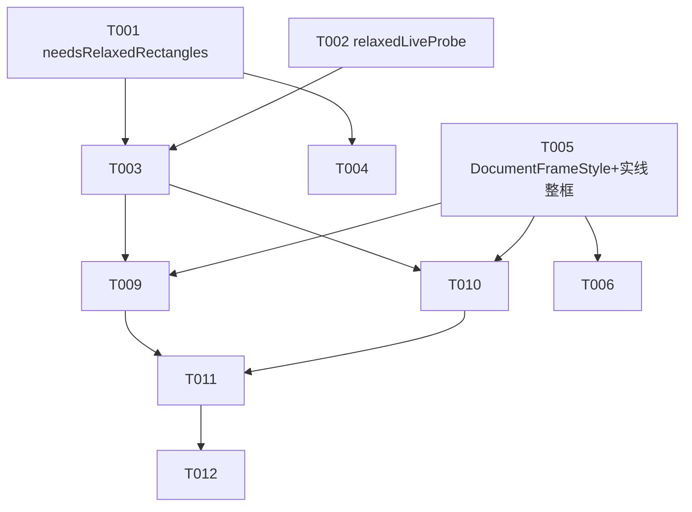

# Tasks: live-edge-crop（取景实线边框与折页书可靠裁切）

**Input**: Design documents from `spec/live-edge-crop/`
**Prerequisites**: plan.md（D1~D6）、spec.md（US1~US4 / FR-001~007 / SC-001~005）

**Tests**: spec SC-002/SC-005 明确要求测试覆盖（基线 280 只增不减、替身/纯函数可测面全覆盖）——各故事含测试任务。

## Format: `[ID] [P?] [Story] Description`

- **[P]**: 可并行（不同文件、无未完成依赖）
- **[Story]**: 所属用户故事

## Path Conventions

- 源码：`Zhixia/`（仓库根）；测试：`ZhixiaTests/`；特性文档：`spec/live-edge-crop/`
- 构建/测试命令：`export DEVELOPER_DIR=/Volumes/DevDisk/Applications/Xcode.app/Contents/Developer && OTHER_SWIFT_FLAGS="-disable-sandbox" xcodebuild test -project Zhixia.xcodeproj -scheme Zhixia -destination 'platform=iOS Simulator,name=iPhone 17 Pro' -skipPackagePluginValidation -skipMacroValidation`（模拟器 Busy 时先 `xcrun simctl erase all`）

---

## Phase 1: Foundational (Blocking Prerequisites)

**Purpose**: 门控纯函数与日志通道——US1 的前置

**⚠️ CRITICAL**: US1 实现开工前本阶段必须完成（US2/US3/US4 无前置依赖，可先行）

- [x] T001 [P] `DetectionStrategy` 新增纯函数 `needsRelaxedRectangles(rectangles:segmented:) -> Bool`：仅当严格候选无可信项（复用 `needsDocumentSegmentation` 判定口径）且 `segmented == nil` 时返回 true，修改 `Zhixia/Services/Vision/VisionEdgeDetector.swift`
- [x] T002 [P] `ZhixiaLog` 新增单行日志 API `relaxedLiveProbe(triggered:candidates:)`（复用既有 OSLog 通道风格，命名可微调），修改 `Zhixia/Services/ZhixiaLog.swift`

**Checkpoint**: 门控与日志就绪，US1 可接入

---

## Phase 2: User Story 1 - 折页厚书实时边框可见（Priority: P1）🎯 MVP

**Goal**: live 三级检测兜底——严格矩形 → 条件文档分割 → 放宽矩形，候选统一择优
**Independent Test**: needsRelaxedRectangles 穷举单测全绿；放宽候选进池后两级面积兜底/包含降权语义不变

### Implementation for User Story 1

- [x] T003 [US1] `VisionEdgeDetector` 私有核心 live 分支接入第三级：`stillImage == false` 且 `needsRelaxedRectangles` 为 true 时执行 `detectRectangles(relaxed: true)`（复用 still 放宽参数集，零新参数），候选并入统一池经 `DetectionStrategy.select` 择优，触发与命中经 `relaxedLiveProbe` 记日志，修改 `Zhixia/Services/Vision/VisionEdgeDetector.swift`（依赖 T001、T002）
- [x] T004 [P] [US1] `EdgeDetectionStrategyTests` 扩展：`needsRelaxedRectangles` 触发组合穷举（strict空+seg无→true / strict有→false / strict空+seg有→false）+ 放宽候选进池后的择优语义（整幅误检仍受两级面积兜底管控、包含降权照常），修改 `ZhixiaTests/EdgeDetectionStrategyTests.swift`（依赖 T001）

**Checkpoint**: US1 独立可验——折页场景替身帧下三级兜底命中出框

---

## Phase 3: User Story 2 - 实线整框显示（Priority: P1）🎯 MVP

**Goal**: 整框连续实线（跟踪细实线替换虚线、锁定新增粗双线整框），角括号/压暗/证件模式不动
**Independent Test**: DocumentFrameStyleTests 实线性质（dash 恒空）与两态差异断言全绿

### Implementation for User Story 2

- [x] T005 [US2] 新增纯数据样式 `DocumentFrameStyle`（跟踪态：单线 2.5、seal 45%、dash 空；锁定态：双线暗描边约 5pt + 白面约 3pt、dash 空）并在 `EdgeOverlayView.documentEdgeOverlay` 消费：跟踪虚线 `[8,6]` → 连续细实线、锁定态新增整框绘制；四角括号、框外压暗、idCard 路径不动，修改 `Zhixia/Features/Capture/EdgeOverlayView.swift`
- [x] T006 [P] [US2] 新增 `DocumentFrameStyleTests`：两态 dash 均为空（实线性质）、锁定线宽粗于跟踪、双线/单线结构差异、样式仅作用于文档模式（idCard 守卫），新建 `ZhixiaTests/DocumentFrameStyleTests.swift`（依赖 T005）

**Checkpoint**: US2 独立可验——两态实线整框有测试锚点

---

## Phase 4: User Story 3 - 成片按书页边缘裁切（Priority: P1）🎯 MVP

**Goal**: 回退链 `detected ?? imageQuad ?? .fullImage` 语义零改动，测试钉死三分支
**Independent Test**: 替身快门链三分支测试全绿（重检成功→重检框 / 重检失败→live 框 / 双失败→全幅）

### Implementation for User Story 3

- [x] T007 [P] [US3] `CaptureViewModelTests` 扩展快门回退链三分支替身测试（替身 camera/detector：still 重检成功用重检框；still 失败且 live 有框用 live 框；双失败落 `.fullImage`），零源码改动，修改 `ZhixiaTests/CaptureViewModelTests.swift`

**Checkpoint**: US3 独立可验——回退链被测试锁定，防未来回归

---

## Phase 5: User Story 4 - 无框兜底路径不阻塞（Priority: P2）

**Goal**: 全幅可拍 + 预览四角调框/userAdjustedQuad 语义不回退
**Independent Test**: 既有 `CropCanvasLayoutTests` 与 Review 调框回归全绿；如有覆盖缺口补断言

### Implementation for User Story 4

- [x] T008 [P] [US4] 核对既有调框回归覆盖（`CropCanvasLayoutTests` + Review 相关测试）：确认全幅页可进裁切编辑、`userAdjustedQuad` 不被自动 refine 覆盖；若有缺口补最小断言，修改 `ZhixiaTests/CropCanvasLayoutTests.swift`（或按实际覆盖位置补充）

**Checkpoint**: US4 独立可验——兜底路径有回归保护

---

## Phase 6: Polish & Cross-Cutting Concerns

- [x] T009 记录三级检测兜底与实线整框到项目手册（检测链结构、门控条件、日志对照方法、已知限制：曲边贴合受矩形检测器物理上限约束），修改 `docs/09-project-handbook.md`（依赖 T003、T005）
- [x] T010 新建真机验收清单：SC-001（折页厚书数秒内出实线框、贴合可读区边缘）、SC-002（平整文档零回退：锁定/自动快门/提示/震动）、SC-003（看到框即拍摄成片按书页边缘裁切、折起部分切除）、SC-004（极端无框手动快门拍全幅 + 预览调框）、SC-005（Console 检索 `relaxedLiveProbe` 触发记录的步骤），新建 `spec/live-edge-crop/device-acceptance.md`（依赖 T003、T005）

---

## Phase 7: Verification

<!-- verification_scope: build-only -->

**Purpose**: 构建与部署验证（本周期验证范围为 build-only，无 UI 验证任务；真机折页效果由 device-acceptance 清单人工验收）

- [x] T011 全量构建 + 单元测试：`xcodebuild test -project Zhixia.xcodeproj -scheme Zhixia -destination 'platform=iOS Simulator,name=iPhone 17 Pro'`（含 `-skipPackagePluginValidation -skipMacroValidation`、`OTHER_SWIFT_FLAGS="-disable-sandbox"`、`DEVELOPER_DIR` 导入）；基线 280 用例（279 passed + 1 known issue + 0 failed）只增不减，失败则修复循环直至全绿
- [x] T012 部署验证：模拟器构建安装并启动（`xcrun simctl` boot/install/launch，bundle id `com.david.Zhixia`，确认 pid 存活）；generic 真机目标构建（`-destination 'generic/platform=iOS' CODE_SIGNING_ALLOWED=NO`）确认可编译

---

## Dependencies & Execution Order

### Phase Dependencies

- **Foundational (Phase 1)**: T001/T002 不同文件可并行——**阻塞 US1（T003/T004）**；不阻塞 US2/US3/US4
- **User Stories (Phase 2~5)**: US2/US3/US4 无前置依赖，可与 Foundational 并行开工；US1 依赖 Foundational 完成
- **Polish (Phase 6)**: T009/T010 依赖 US1（T003）与 US2（T005）完成（内容描述二者）
- **Verification (Phase 7)**: 依赖全部实现与 Polish 完成

### User Story Dependencies

- **US1 (P1)**: T003 依赖 T001+T002（同文件串行 T001→T003）；T004 仅依赖 T001，可与 T003 并行（不同文件）
- **US2 (P1)**: T005 无前置，可最先开工；T006 依赖 T005（同文件对：源码+测试）
- **US3 (P1)**: T007 完全独立（纯测试任务，锚定既有语义），任何时候可做
- **US4 (P2)**: T008 独立（回归核对+按需补测）

### Within Each User Story

- 源码先于测试（T005→T006）；US1 例外：T004 测的是 T001 的纯函数，可在 T003 之前完成（TDD 先行）
- 同文件任务串行：T001→T003（VisionEdgeDetector.swift）

## 📊 Dependency Graph



## ⚡ Parallel Execution Guide

| Phase | Tasks | Required Files | Execution Notes |
|---|---|---|---|
| Foundational | T001 / T002 | VisionEdgeDetector.swift / ZhixiaLog.swift | 不同文件，可并行 |
| 早期并行批 | T005、T007、T008 | EdgeOverlayView.swift / CaptureViewModelTests.swift / CropCanvasLayoutTests.swift | 三者互不依赖、不依赖 Foundational，可与 Phase 1 同时开工 |
| US1 测试 | T004 | EdgeDetectionStrategyTests.swift | 仅依赖 T001，与 T003 并行 |
| US2 测试 | T006 | DocumentFrameStyleTests.swift | 依赖 T005，随后即可 |
| Polish | T009 / T010 | 09-project-handbook.md / device-acceptance.md | 依赖 T003+T005，两者可并行 |

## Parallel Example: User Story 1

```bash
# Foundational 完成后，实现与测试并行发起：
Task: "T003 VisionEdgeDetector 三级兜底接入 → Zhixia/Services/Vision/VisionEdgeDetector.swift"
Task: "T004 门控穷举测试 → ZhixiaTests/EdgeDetectionStrategyTests.swift"

# 事实上 T005/T007/T008 可与 Phase 1 同时开工：
Task: "T005 实线整框+DocumentFrameStyle → Zhixia/Features/Capture/EdgeOverlayView.swift"
Task: "T007 快门回退链三分支测试 → ZhixiaTests/CaptureViewModelTests.swift"
```

## Implementation Strategy

### MVP First (看得见框)

1. Foundational（T001~T002）+ US1（T003~T004）+ US2（T005~T006）
2. **STOP and VALIDATE**: 三级兜底门控穷举全绿 + 实线样式断言全绿——折页场景替身帧出框、整框连续实线
3. 此时核心价值已可交付：折页厚书看得见实线框 → 敢按快门 → 成片按框裁

### Incremental Delivery

1. +US1 → 三级兜底（曲边命中率高）
2. +US2 → 实线整框（边界一目了然）
3. +US3/US4 → 回退链与兜底路径测试钉死（防回归）
4. +Polish → 手册 + 真机验收清单
5. +Verification → 构建/部署（build-only；真机效果对照清单人工验收）

### Parallel Team Strategy

- 单人串行推荐序：T001 → T002 → T003 → T004 → T005 → T006 → T007 → T008 → T009 → T010 → T011 → T012
- 双人并行：A 走检测链（T001→T003→T004），B 走显示与测试锚定（T005→T006→T007→T008），Polish 后续接手

## Notes

- [P] 任务 = 不同文件且无未完成依赖；同文件任务必须串行（T001→T003、T005→T006）
- 测试基线 280 用例（279 passed + 1 known issue + 0 failed）只增不减；known issue 豁免测试（`ReconstructEndToEndTests/realDeviceOcrStillLacksTable`）保持豁免
- 本轮**零源码改动**的任务：T007（纯测试锚定）、T008（回归核对）——这是 D5 的设计意图，不是遗漏
- `relaxedLiveProbe` 命名可在实施中微调（如 detectionRelaxed），保持单行 OSLog、可 Console 检索即可
- 每完成一个 Checkpoint 跑一次全量测试回归，避免问题堆积到 Verification 阶段
- 真机验收（折页厚书实拍）不在自动化范围——清单由 T010 产出，用户手持设备执行
