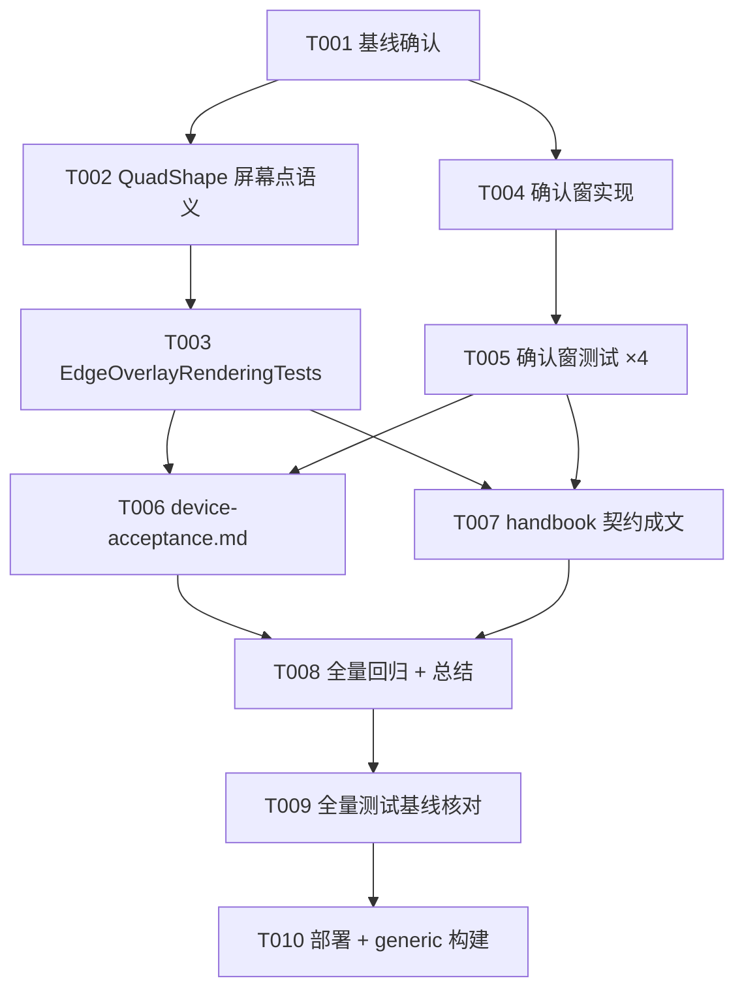

# Tasks: 取景整框可见性与锁定确认窗（overlay-frame-visibility）

**Input**: Design documents from `spec/overlay-frame-visibility/`
**Prerequisites**: plan.md（D1~D6）、spec.md（US1~US5 / FR-001~010）均已过评审门

**Tests**: 本周期测试为核心交付（spec US4/FR-009 明确要求钉死坐标契约与确认窗行为，基线只增不减）。

**Organization**: 任务按用户故事分组；US3（折页中止）无代码交付——由 US1+US2 联合缓解，验证归属 T006 验收协议与装机重测；US4（测试钉死）由 T003/T005/T008 落地。

## Format: `[ID] [P?] [Story] Description`

- **[P]**: 可并行（不同文件、无未完成依赖）
- **[Story]**: 所属用户故事
- 描述含精确文件路径

## Path Conventions

- 单工程 iOS 项目：源码 `Zhixia/`、测试 `ZhixiaTests/`、文档 `docs/`、周期文档 `spec/overlay-frame-visibility/`
- 构建命令（全部任务通用）：
  `export DEVELOPER_DIR=/Volumes/DevDisk/Applications/Xcode.app/Contents/Developer`
  `OTHER_SWIFT_FLAGS="-disable-sandbox" xcodebuild test -project Zhixia.xcodeproj -scheme Zhixia -destination 'platform=iOS Simulator,name=iPhone 17 Pro' -skipPackagePluginValidation -skipMacroValidation`
- 模拟器 Busy 时先 `xcrun simctl erase all` 再重试一次

## Phase 1: Setup

**Purpose**: 确认起点基线，无代码改动

- [X] T001 运行全量测试记录起点基线（预期 295 用例 = 294 passed + 1 known issue `ReconstructEndToEndTests/realDeviceOcrStillLacksTable` 豁免 + 0 failed），结果存 `/tmp/overlay-frame-visibility-logs/baseline.log`；若与预期不符，先停下核对再继续

---

## Phase 3: User Story 1 - 取景整框与框外压暗真正可见（Priority: P1）🎯 MVP

**Goal**: QuadShape 屏幕点语义修复后，文档模式跟随/锁定两态整框、框外压暗挖孔、idCard 检测框描边全部回到屏幕内（FR-001~004）。

**Independent Test**: `ZhixiaTests/EdgeOverlayRenderingTests.swift` 坐标契约用例全绿 + 既有全量测试不回归。

### Implementation for User Story 1

- [X] T002 [P] [US1] 修复 `Zhixia/Features/Capture/EdgeOverlayView.swift` 中 `QuadShape` 坐标语义：`path(in:)` 改为直接消费屏幕点（忽略 rect 参数、输出点=输入点），与 `CornerBracketsShape` 同约定；类型文档注释明确「输入为屏幕点空间（`OverlaySpaceMap.screenQuad` 产物）」契约（plan D1）；不改动 4 处调用点与 DocumentFrameStyle
- [X] T003 [US1] 新建 `ZhixiaTests/EdgeOverlayRenderingTests.swift`：QuadShape 屏幕点契约用例——① path 包围盒 == 输入 quad 包围盒（容差 < 0.5pt）；② path 与 rect 尺寸无关（不同 rect 输出恒等）；③ 顶点顺序保持 TL→TR→BR→BL 闭合（plan D3）

**Checkpoint**: US1 独立可测——整框/压暗/idCard 描边的坐标消费全部归位，契约测试钉死。

---

## Phase 4: User Story 2 - 自动快门前锁定态可见且可中止（Priority: P1）

**Goal**: 帧计数确认窗（默认 6 帧 ≈ 0.4s@15fps，可注入）——锁定视觉先呈现再自动拍；窗内解锁取消；suspicious 帧计数冻结；手动快门不受限（FR-005~007）。

**Independent Test**: `ZhixiaTests/CaptureViewModelTests.swift` 确认窗用例全绿（fake camera/detector 帧序列驱动，锁定需 ~9 稳定帧）。

### Implementation for User Story 2

- [X] T004 [P] [US2] 在 `Zhixia/Features/Capture/CaptureViewModel.swift` 实现锁定确认窗：新增私有 `lockedFrameCount` 与 init 注入参数 `autoCaptureHoldFrames: Int = 6`（带默认值，既有调用点零破坏）；`.locked` 分支锁定周期首帧清零、仅非可疑锁定帧计数 +1、达阈值且 `autoCapture && !didAutoCaptureThisLock && !suspicious` 才触发 `capture()`；searching/tracking 转换、`capture()` 复位段、`setMode()` 三处清零计数（plan D2 语义备注：suspicious 帧计数冻结不增不清零）
- [X] T005 [US2] 扩展 `ZhixiaTests/CaptureViewModelTests.swift` 确认窗 4 用例：① `autoCaptureWaitsForHoldFramesBeforeCapture`（阈值前不拍、达阈值拍）；② `holdWindowResetsOnUnlock`（窗内解锁不拍、重锁重新计数后拍）；③ `suspiciousLockFreezesHoldCount`（suspicious 帧不计入、清除后需再累计满窗才拍）；④ `manualCaptureDuringHoldWindowWorks`（窗内手动快门即时拍且复位计数）

**Checkpoint**: US2 独立可测——确认窗节奏行为穷举钉死，既有 CaptureViewModelTests（含 CaptureFallbackChainTests）断言零修改。

---

## Phase 5: User Story 5 - 真机验收协议（Priority: P1）

**Goal**: 本周期验收文档：以 live-edge-crop 清单为基线的重验协议 + SC-005 日志实时抓取流程（FR-010）。

**Independent Test**: 文档审阅——清单覆盖 US1/US2 新行为与折页中止场景，日志流程可照做。

### Implementation for User Story 5

- [X] T006 [P] [US5] 新建 `spec/overlay-frame-visibility/device-acceptance.md`：重验协议引用 `spec/live-edge-crop/device-acceptance.md` 的 SC-001~005 与 §0 日志抓取指引（Console.app 过滤 `subsystem:com.david.Zhixia category:capture` + Include Debug Messages，**测试期间实时抓取**）；新增本周期验收点——整框两态可见（SC-001/002 基线更新）、确认窗节奏与中止（≥0.4s 可感知、移开取消 ×3）、折页错误锁定可见可中止（US3 缓解验证）、压暗挖孔框内不变暗

---

## Phase 6: Polish & Cross-Cutting Concerns

**Purpose**: 契约成文与全量回归

- [X] T007 [P] 更新 `docs/09-project-handbook.md`：记载取景 overlay Shape 屏幕点坐标契约（QuadShape/CornerBracketsShape 同约定、`OverlaySpaceMap.screenQuad` 出参）与自动快门确认窗行为（0.4s 节奏、suspicious 冻结、复位点）——坐标契约跨两个周期无人发现的原因之一是未成文
- [X] T008 全量回归 + 基线核对：运行全部测试，确认用例总数 ≥ 295 只增不减、0 failed、known issue 豁免保持（US4/FR-009）；对照 plan D6 清单确认 QuadSmoother / DetectionStrategy / VisionEdgeDetector / OverlaySpaceMap / FOVLayout / 快门回退链零源码改动；输出实施总结（改动文件、新增用例数、基线变化），日志存 `/tmp/overlay-frame-visibility-logs/`

---

## Phase 7: Verification

<!-- verification_scope: build-only -->

**Purpose**: 构建、部署验证（真机人工验收由用户在 Phase 5 后按 device-acceptance.md 执行，不属本阶段）

- [X] T009 全量构建 + 单元测试：`export DEVELOPER_DIR=/Volumes/DevDisk/Applications/Xcode.app/Contents/Developer` 后 `OTHER_SWIFT_FLAGS="-disable-sandbox" xcodebuild test -project Zhixia.xcodeproj -scheme Zhixia -destination 'platform=iOS Simulator,name=iPhone 17 Pro' -skipPackagePluginValidation -skipMacroValidation`；基线 ≥ 295 用例只增不减、failed == 0、known issue `ReconstructEndToEndTests/realDeviceOcrStillLacksTable` 豁免保持；失败则修复循环直至全绿（模拟器 Busy 先 `xcrun simctl erase all`）
- [X] T010 部署验证：模拟器构建安装并启动（`xcrun simctl` boot/install/launch，bundle id `com.david.Zhixia`，确认 pid 存活）；generic 真机目标构建（`-destination 'generic/platform=iOS' CODE_SIGNING_ALLOWED=NO`）确认可编译

---

## Dependencies & Execution Order

### Phase Dependencies

- **Setup（Phase 1）**: 无依赖，立即开始；T001 是唯一入口（基线不符则全停下核对）
- **User Stories（Phase 3~5）**: T002 与 T004 不同文件、零交叉依赖，可完全并行；T003 依赖 T002、T005 依赖 T004（测试对象先定）
- **Polish（Phase 6）**: T007 依赖 T002/T004 完成（契约先落地再成文）；T008 依赖全部前置任务
- **Verification（Phase 7）**: 依赖 T008 通过；T009 → T010 顺序执行

### Within Each User Story

- 实现任务（T002/T004）先于其测试任务（T003/T005）——契约语义先定，测试随后钉死
- 单人串行推荐序：T001 → T002 → T003 → T004 → T005 → T006 → T007 → T008 → T009 → T010

### Parallel Opportunities

- T002 ∥ T004（不同源文件）；T006 ∥ T007（不同文档）
- 双人并行示例：A 线 T002→T003，B 线 T004→T005，汇合后 T006∥T007 → T008

---

## 📊 Dependency Graph



## ⚡ Parallel Execution Guide

| Phase | Tasks | Required Files | Execution Notes |
|---|---|---|---|
| US1 线 | T002 → T003 | EdgeOverlayView.swift、EdgeOverlayRenderingTests.swift | 先改语义后钉测试；不动 4 处调用点 |
| US2 线 | T004 → T005 | CaptureViewModel.swift、CaptureViewModelTests.swift | init 带默认值；既有用例断言零修改 |
| 验收/文档 | T006 ∥ T007 | spec/overlay-frame-visibility/device-acceptance.md、docs/09-project-handbook.md | 均依赖两条实现线完成，彼此可并行 |
| 收尾 | T008 → T009 → T010 | 全仓 | 严格顺序；T008 核对 D6 零改动清单 |

## Parallel Example: US1 线与 US2 线

```bash
# 双线并行（不同文件，无交叉依赖）：
Task A: "T002 [P] [US1] QuadShape 屏幕点语义修复 in Zhixia/Features/Capture/EdgeOverlayView.swift"
Task B: "T004 [P] [US2] 锁定确认窗实现 in Zhixia/Features/Capture/CaptureViewModel.swift"

# 各自完成后立即钉测试：
Task A: "T003 [US1] 新建 ZhixiaTests/EdgeOverlayRenderingTests.swift"
Task B: "T005 [US2] 扩展 ZhixiaTests/CaptureViewModelTests.swift"
```

## Implementation Strategy

### MVP First（US1 单故事交付）

1. T001 基线确认 → 2. T002 + T003（整框可见 = 本周期最大用户价值）→ 3. STOP 验证：坐标契约测试绿 + 全量无回归 → 4. 此时已可装机看整框效果

### Incremental Delivery

1. T001 → 2. US1（T002/T003）→ 3. US2（T004/T005）→ 4. US5 协议（T006）→ 5. 成文 + 回归（T007/T008）→ 6. Verification（T009/T010）→ 7. 装机重测（用户人工执行）

### 单人执行（本周期默认）

严格串行推荐序执行，每个 Checkpoint 全量回归（测试跑全量而非单文件），任何失败先修复再前进。

## Notes

- [P] = 不同文件、无未完成依赖
- US3（折页中止）无代码任务：plan D5 明确为 US1+US2 联合缓解，验收归属 T006 协议与装机重测；检测本体（曲面展平）超出范围（spec Assumptions）
- US4（测试钉死/基线）由 T003/T005/T008 三个任务共同落地
- 既有测试断言零修改（plan D6）——若某既有用例「必须改才能过」，说明实现偏离契约，停下核对而非改测试
- known issue `ReconstructEndToEndTests/realDeviceOcrStillLacksTable` 保持豁免（基线 295 = 294 + 1 + 0）
- 不 git commit（会话惯例）
- 装机重测（Verification 后）：签名构建（`DEVELOPMENT_TEAM=VV865TW6B3`）+ `devicectl` 安装 iPhone 13「菀墨」→ 用户按 `spec/overlay-frame-visibility/device-acceptance.md` 执行 → 结果回填验收文档与任务清单
