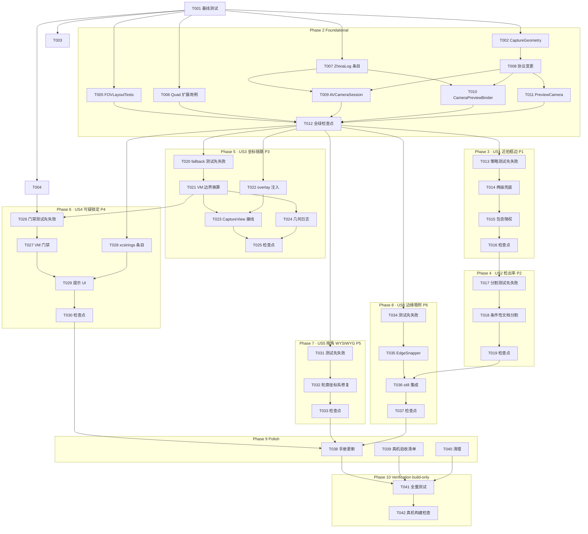

# Tasks: 扫描框边与成片裁剪精度修复（Scan Edge Accuracy）

**Input**: spec/scan-edge-accuracy/spec.md（用户故事 US1~US6 / FR-001~014）、spec/scan-edge-accuracy/plan.md（决策 D1~D10、契约、构建命令）
**Prerequisites**: plan.md（必需）、spec.md（必需）

**Tests**: 本特性测试为 spec **FR-014 明确要求**（回归网），任务包含「先写失败测试 → 实现 → 转绿」的测试任务。

**Organization**: 按用户故事分组（US1~US6 对应 P1~P6），每个故事可独立实现与验证。

## Format: `[ID] [P?] [Story] Description`

- **[P]**: 可并行（不同文件、且组内前置已完成；跨阶段依赖见依赖图）
- **[Story]**: 所属用户故事（仅用户故事阶段任务携带）
- 每条任务以具体文件路径结尾

## Path Conventions

- 仓库根 = Xcode 工程根：源码 `Zhixia/`，测试 `ZhixiaTests/`（无 src/tests 目录）
- `Zhixia.xcodeproj/project.pbxproj` 为 PBXFileSystemSynchronizedRootGroup（objectVersion 77）：**新增 .swift 文件自动纳入编译，无需手动登记工程**
- 全部构建/测试命令见 plan.md「构建与验证命令」：需 `export DEVELOPER_DIR=/Volumes/DevDisk/Applications/Xcode.app/Contents/Developer` 与 `OTHER_SWIFT_FLAGS="-disable-sandbox"`，模拟器 iPhone 17 Pro
- `withKnownIssue` 命中显示为 `recorded an expected failure`，**不是失败**，勿按 passed/failed 误判

---

## Phase 1: Setup (Shared Infrastructure)

- [X] T001 Run baseline full test suite with plan.md build command before any code change; confirm baseline 131 passed + 1 known issue (recorded an expected failure) + 0 failed; record the numbers in this checkbox's note in spec/scan-edge-accuracy/tasks.md
  - Baseline recorded 2026-09-17: **131 passed + 1 expected failure (known issue) + 0 failed** (Test-Zhixia-2026.09.17_23-40-51 xcresult)

---

## Phase 2: Foundational (Blocking Prerequisites)

**Purpose**: 全部用户故事共享的 Domain 值类型 / Quad 扩展 / 协议变更 / 日志条目。
**⚠️ CRITICAL**: 任何用户故事不得在本阶段完成（含 T012 全绿检查点）之前开始。

- [X] T002 [P] Create immutable value type `CaptureGeometry`（video/photo 竖屏宽高比两字段，Sendable + Equatable，由运行时测量值构造）per plan「Data Model」in Zhixia/Domain/CaptureGeometry.swift
- [X] T003 [P] Create stateless `FOVLayout`（同传感器中心裁切规则：两个竖屏归一化空间间的可逆四边形换算；宽高比相等时恒等；非法输入 ≤0 原样返回）per plan D2 in Zhixia/Domain/FOVLayout.swift
- [X] T004 [P] Extend Quad with pure functions `isSuspiciousForAutoCapture(edgeMargin:maxArea:)`（任一边距边 < 阈值或面积 ≥ 阈值 → 可疑）与 `containment(in:)`（包围盒交集面积 / 自身包围盒面积）per plan D5/D8；不得改动既有成员 in Zhixia/Domain/Models/Quad.swift
- [X] T005 [P] Create `FOVLayoutTests`：16:9→4:3 数值断言（竖屏视频→照片横向中心 75% 跨度 [0.125, 0.875]）、恒等、往返可逆、极端/非法宽高比 in ZhixiaTests/FOVLayoutTests.swift
- [X] T006 [P] Extend with Quad 扩展用例——可疑判定矩阵（触边/近满幅/正常/远离）与包含度（全含/部分/相离），既有 3 条用例原样保留 per plan 测试契约 in ZhixiaTests/QuadSmootherTests.swift
- [X] T007 [P] Add structured capture 类目日志条目 `geometry(video:photo:)`、`overlayProbe(...)`、`detectionTier(...)`、`suspiciousLock(...)` per plan D10 in Zhixia/Services/ZhixiaLog.swift
- [X] T008 Add protocol changes per plan「Contracts」：`CameraCapturing.geometry() async -> CaptureGeometry`（未配置 → 恒等默认组合）、`CameraPreviewAttaching.overlayTransform(forViewSize:) -> QuadSpaceTransform?`，并定义 `QuadSpaceTransform`（照片空间→屏幕逐轴缩放+偏移，轻量值类型，随协议定义）in Zhixia/Services/ServiceProtocols.swift
- [X] T009 [P] Implement `geometry()` 运行时测量（视频帧尺寸 / activeFormat 照片尺寸），快门时以 `CapturedPhoto.pixelSize` 复核并经 `ZhixiaLog.capture` 记录差异 per plan D2 in Zhixia/Services/Camera/AVCameraSession.swift
- [X] T010 [P] Implement `overlayTransform(forViewSize:)` 预览层探针（以全幅矩形探针用预览层坐标转换 API 标定出逐轴缩放与偏移；无有效预览层时返回 nil）per plan D3 in Zhixia/Services/Camera/CameraPreviewBinder.swift
- [X] T011 [P] Satisfy 新协议要求：`PreviewCamera` 返回恒等 `CaptureGeometry`（1:1 组合 → 换算恒等，保证既有测试语义不变）in Zhixia/App/PreviewSupport.swift
- [X] T012 Foundational checkpoint: run full test suite with plan.md build command; fix regressions until 0 failed（含既有 ZhixiaTests/CaptureViewModelTests.swift 全绿；known issue 维持 recorded an expected failure）in ZhixiaTests/

**Checkpoint**: 基础设施就绪，用户故事可开始（按优先级顺序）。

---

## Phase 3: User Story 1 - 近拍书籍框边正确 (Priority: P1) 🎯 MVP

**Goal**: 近拍（书占画面 ≥90%）时 live+still 检测锁定书的真实外框，内部矩形不再反超（FR-001/002/003）。
**Independent Test**: `EdgeDetectionStrategyTests` 全绿——二级兜底触发、包含降权改变择优、无包含关系时评分不变。

- [X] T013 [P] [US1] Create fail-first tests per plan 测试契约：(a) 一级 0.96 上限过滤为空 → 二级放宽放行近满幅候选并胜出；(b) 被完全包含的内部矩形经降权后输给包含它的外框；(c) 无包含关系时 score = 面积×居中×方正 决定结果、行为与现状一致 in ZhixiaTests/EdgeDetectionStrategyTests.swift
- [X] T014 [US1] Implement 候选面积两级兜底 per plan D4：一级维持 0.96；为空时二级放宽至 ≤1.0；两级择优规则一致；live `detect(frame:)` 与 still `detect(imageData:)` 双路径生效；经 `detectionTier` 记录触发层级 in Zhixia/Services/Vision/VisionEdgeDetector.swift
- [X] T015 [US1] Implement 包含关系降权 per plan D5：`containment(in:) ≥ 0.9` 的候选评分乘 ~0.35 后再择优；外框候选必胜；不得选出比降权前最优更小的框（FR-003）in Zhixia/Services/Vision/VisionEdgeDetector.swift
- [X] T016 [US1] Story checkpoint: run story suite via `-only-testing:ZhixiaTests/EdgeDetectionStrategyTests` and fix until green in ZhixiaTests/EdgeDetectionStrategyTests.swift

**Checkpoint**: 近拍场景候选策略修复完成，US1 可独立验证。

---

## Phase 4: User Story 2 - 一般书籍检出率提升 (Priority: P2)

**Goal**: live 路径条件性启用文档分割，圆角/低对比度书仍可整本框住（FR-004）。
**Independent Test**: `EdgeDetectionStrategyTests` 新增用例全绿；矩形候选存在时不触发分割（性能约束 D6）。

- [X] T017 [US2] Add fail-first live 分割用例：矩形检测为空 → 文档分割候选并入且可胜出；矩形候选存在 → 走既有路径不要求分割 in ZhixiaTests/EdgeDetectionStrategyTests.swift
- [X] T018 [US2] Implement live 条件性文档分割 per plan D6：仅当矩形检测无可信候选（无非退化、面积达标）时补跑 `VNDetectDocumentSegmentationRequest`，结果并入统一择优；保留 actor 忙时丢帧机制 in Zhixia/Services/Vision/VisionEdgeDetector.swift
- [X] T019 [US2] Story checkpoint: run story suite and fix until green in ZhixiaTests/EdgeDetectionStrategyTests.swift

**Checkpoint**: US1 与 US2 均可独立验证（检测器策略链稳定，可供 US6 集成）。

---

## Phase 5: User Story 3 - 坐标链路健壮化 (Priority: P3)

**Goal**: 照片空间成为唯一权威空间；overlay 探针映射；fallback 换算正确（FR-005/006/007/011）。
**Independent Test**: `FOVLayoutTests` + `CaptureFallbackTests` 全绿；模拟器虚线框与预览对齐（SC-003 现场项留待真机清单）。

- [X] T020 [P] [US3] Create fail-first tests：(a) 静态检测失败 → 回退 live 框先经 FOVLayout 视频→照片换算再入库（16:9 live quad → 4:3 照片 quad，横向跨度 [0.125, 0.875] 数值断言）；(b) overlay 探针为 nil → FrameMapper 以照片宽高比 aspect-fill 回退；(c) `geometry()` 不可用 → 恒等换算不崩溃不变形 in ZhixiaTests/CaptureFallbackTests.swift
- [X] T021 [US3] Convert live 检测结果在 ViewModel 边界换算到照片空间 per plan D1：取 `camera.geometry()`，ingestion 时 `FOVLayout.convert`；`imageQuad` 改存照片空间；fallback `detected ?? imageQuad ?? .fullImage` 天然空间一致；移除各消费点的事后换算 in Zhixia/Features/Capture/CaptureViewModel.swift
- [X] T022 [P] [US3] Make overlay 映射可注入 per plan D3：接受照片空间 quad + 可选 `QuadSpaceTransform`；nil 时回退 FrameMapper（照片宽高比 aspect-fill）；绘制逻辑本身不变 in Zhixia/Features/Capture/EdgeOverlayView.swift
- [X] T023 [US3] Wire probe 注入：在 overlay 构造点传入 `previewAttacher.overlayTransform(forViewSize:)` 与照片空间 quad in Zhixia/Features/Capture/CaptureView.swift
- [X] T024 [US3] Log geometry at 取景启动与快门时刻：视频/照片宽高比与探针映射参数经 `ZhixiaLog.capture` 的 `geometry(...)`/`overlayProbe(...)` 输出（FR-007）in Zhixia/Features/Capture/CaptureViewModel.swift
- [X] T025 [US3] Story checkpoint: run story suites and fix until green in ZhixiaTests/CaptureFallbackTests.swift（连同 ZhixiaTests/FOVLayoutTests.swift）

**Checkpoint**: 三空间对齐闭环（权威空间/探针映射/回退换算/诊断日志）。

---

## Phase 6: User Story 4 - 可疑锁定不自动拍 (Priority: P4)

**Goal**: 触边/近满幅锁定不自动拍并提示，正常锁定行为不变（FR-008）。
**Independent Test**: `CaptureFallbackTests` 自动快门门禁用例全绿（fake 时钟/偏好）。

- [X] T026 [P] [US4] Add fail-first 自动快门门禁用例：边距 <1.5% → 不自动拍；面积 ≥0.95 → 不自动拍；正常锁定 → 约 0.55s 自动拍（fake 时钟）；用户已显式关闭 autoCapture → 任何状态均不自动拍 in ZhixiaTests/CaptureFallbackTests.swift
- [X] T027 [US4] Implement 可疑锁定门禁 per plan D8：`.locked` 时对照片空间 quad 求 `isSuspiciousForAutoCapture`；可疑 → 抑制自动快门 + 置提示状态 + `suspiciousLock` 日志；正常 → 行为与现状一致；autoCapture 默认值保持开启 in Zhixia/Features/Capture/CaptureViewModel.swift
- [X] T028 [P] [US4] Add 可疑锁定提示条目（zh-Hans 与 en 值完整填写，不留空条目，如「再往后移一点，把书拍完整」/ "Move back a little to fit the whole page"）in Zhixia/Localizable.xcstrings
- [X] T029 [US4] Display 可疑锁定提示：将 VM 提示状态绑定到新文案，显示于取景状态区；既有「搜索中/已锁定」文案不变 in Zhixia/Features/Capture/CaptureView.swift
- [X] T030 [US4] Story checkpoint: run story suite and fix until green in ZhixiaTests/CaptureFallbackTests.swift

**Checkpoint**: 防误拍门禁上线，正常路径零行为变化。

---

## Phase 7: User Story 5 - 整理页拖角所见即所得 (Priority: P5)

**Goal**: 拖角模式轮廓、手柄、裁剪三者同坐标系（FR-009）。
**Independent Test**: `CropCanvasLayoutTests` 全绿（图像宽高比 ≠ 画布宽高比时轮廓与手柄重合）。

- [X] T031 [P] [US5] Create fail-first tests：aspect-fit 映射纯函数——图像宽高比 ≠ 画布宽高比 → 轮廓 quad 落在 fitted 显示矩形内（与手柄同坐标系）；相等时恒等；quad→屏幕 与手柄定位一致；拖动后成片与所见一致 in ZhixiaTests/CropCanvasLayoutTests.swift
- [X] T032 [US5] Fix 轮廓坐标系 per plan D9：四边形轮廓改在 aspect-fit 图像显示矩形内绘制（与拖角手柄/裁剪同坐标系）；映射抽为文件内纯函数；对外接口 image + quad Binding 不变 in Zhixia/Features/Edit/CropCanvas.swift
- [X] T033 [US5] Story checkpoint: run story suite and fix until green in ZhixiaTests/CropCanvasLayoutTests.swift

**Checkpoint**: 整理页所见即所得。

---

## Phase 8: User Story 6 - 边缘吸附 (Priority: P6)

**Goal**: still 路径检出框向外贴合真实书边，受限搜索 + 校验回退（FR-010）。
**Independent Test**: `EdgeSnapperTests` 全绿（合成图吸附恢复、无梯度回退、越界回退、非凸回退）。

- [X] T034 [P] [US6] Create fail-first tests：合成亮块图 + 内缩 1~3% 的框 → 吸附恢复真实边缘（误差 ≤ 短边 2%）；同色无梯度 → 返回原框；位移超出上限（短边 3~5%）→ 原框；结果非凸 → 原框 in ZhixiaTests/EdgeSnapperTests.swift
- [X] T035 [US6] Create `EdgeSnapper` per plan D7：不可变配置（最大位移比例/采样步数/校验阈值）+ 单一入口 `snap(quad:image:maxShiftRatio:)`；四边沿外法线亮度梯度采样取最强处外扩；四项校验（凸性/图像边界/最大位移/面积变化）任一失败返回原 quad；读像素循 `InkFigureDetector` 先例、无外部状态 in Zhixia/Domain/EdgeSnapper.swift
- [X] T036 [US6] Integrate 吸附仅入 still 路径 per plan D7：`detect(imageData:)` 候选择优后、返回前执行；证件模式比例窗匹配时跳过；live 路径不动；快门检测与整理页 refine（ReviewViewModel）均经此单点自动受益 in Zhixia/Services/Vision/VisionEdgeDetector.swift
- [X] T037 [US6] Story checkpoint: run story suites and fix until green in ZhixiaTests/EdgeSnapperTests.swift（连同 ZhixiaTests/EdgeDetectionStrategyTests.swift）

**Checkpoint**: 全部六个故事完成，进入收尾。

---

## Phase 9: Polish & Cross-Cutting Concerns

- [X] T038 [P] Update 扫描链路章节：权威照片空间、两级候选策略、live 条件分割、边缘吸附、可疑锁定门禁、新诊断日志、新 Domain 模块（FOVLayout/EdgeSnapper/CaptureGeometry）in docs/09-project-handbook.md
- [X] T039 [P] Create 真机自验清单：SC-001 近拍 10 次（≥9 完整）、SC-002 常规 10 次（≥8 一次锁对）、SC-003 模拟器对齐说明、SC-004 可疑不自动拍，附 `ZhixiaLog.capture` 日志抓取指引 in spec/scan-edge-accuracy/device-acceptance.md
- [X] T040 Cleanup pass: 清理被探针/注入取代的死分支，触达文件不留 TODO；FrameMapper 保留为文档化回退路径 in Zhixia/Services/Vision/FrameMapper.swift

---

## Phase 10: Verification

<!-- verification_scope: build-only -->

**Purpose**: 全量构建 + 单测验证。范围 = **Run verification**（用户已在验证方式选择门确认）；真机验收由用户按 device-acceptance.md 自验（T039 产出）。

- [X] T041 Run full test suite with plan.md build command; iterate fix → rerun until 0 failed（既有 1 条 known issue 显示 recorded an expected failure，不计失败；全部新测试套件通过；含 ZhixiaTests/ 全目录与 Zhixia.xcodeproj 编译链接）
  - Verified 2026-09-18: **165 passed + 1 expected failure (known issue) + 0 failed + 0 skipped**（Test-Zhixia-2026.09.18_01-09-42 xcresult，`** TEST SUCCEEDED **`）；新增 5 套件 32 用例全绿（FOVLayout 6 / EdgeDetectionStrategy 10 / CaptureFallback 7 / CropCanvasLayout 4 / EdgeSnapper 5）；修复循环 0 次，一次通过
- [X] T042 Verify 真机可部署性：`xcodebuild build -project Zhixia.xcodeproj -scheme Zhixia -destination 'generic/platform=iOS' -skipPackagePluginValidation -skipMacroValidation` 成功（用户经 Xcode GUI 安装到 iPhone；无模拟器 UI 部署任务——build-only 范围且模拟器相机无法行使扫描验收）
  - Verified 2026-09-18: **BUILD SUCCEEDED**（arm64 generic/platform=iOS）。首次运行因无 `com.david.Zhixia` provisioning profile 报签名错误，按预案加 `CODE_SIGNING_ALLOWED=NO` 后一次通过；仅 2 条既有警告（VisionTextRecognizer iOS 15 弃用 API、AppIntents 元数据跳过），均非本特性引入

---

## 📊 Dependency Graph



## Dependencies & Execution Order

### Phase Dependencies

- **Setup (Phase 1)**: 无依赖，立即开始
- **Foundational (Phase 2)**: 依赖 T001；**阻塞全部用户故事**（T012 全绿前不得开工）
- **User Stories (Phase 3~8)**: 均依赖 T012；故事间关键顺序：
  - US1 → US2 **严格串行**（同文件：VisionEdgeDetector.swift + EdgeDetectionStrategyTests.swift）
  - US4 依赖 US1 不直接依赖，但依赖 T004（可疑判定）与 T021（VM 内照片空间 quad）
  - US6 的 T034/T035 仅依赖基础阶段；T036 集成需在 US2 完成后（检测器稳定）
  - US5 完全独立（仅触 CropCanvas.swift）
- **Polish (Phase 9)**: 依赖全部预期完成的故事
- **Verification (Phase 10)**: 依赖 Polish；build-only 范围

### User Story Dependencies

- **US1 (P1)**: T012 后即可开始；不依赖其他故事
- **US2 (P2)**: 依赖 US1 完成（同文件串行：VisionEdgeDetector.swift + EdgeDetectionStrategyTests.swift）
- **US3 (P3)**: T012 后即可开始；不依赖 US1/US2（探针/换算与检测策略正交）
- **US4 (P4)**: 依赖 T004（Quad 可疑判定）与 T021（VM 内 quad 已是照片空间）；不依赖 US2/US3 其余部分
- **US5 (P5)**: T012 后即可开始；完全独立（仅触 CropCanvas.swift）
- **US6 (P6)**: T034/T035 仅依赖基础阶段；T036 集成需在 US2 完成后（检测器策略链稳定）

### Within Each User Story

- 测试任务 MUST 先写并确认失败（fail-first）再实现
- 纯逻辑/模型在服务集成之前
- 同文件的任务按 ID 顺序串行（如 T014 → T015）
- 故事 checkpoint 全绿后才进入下一故事

### Parallel Opportunities

- Phase 2 的 T002~T007 六项互相独立；T009~T011 在 T008 后三项并行
- 不同故事间可并行组：US3 的 T020/T022 ∥ US1 收尾；US5 全故事 ∥ US6 的 T034/T035
- 全部 [P] 标记任务在组内前置完成后可并行

## Parallel Example

```bash
# 基础阶段（T008 完成后）三项并行：
Task: "T009 geometry() 运行时测量"   # Zhixia/Services/Camera/AVCameraSession.swift
Task: "T010 overlayTransform 探针"   # Zhixia/Services/Camera/CameraPreviewBinder.swift
Task: "T011 PreviewCamera 恒等实现"   # Zhixia/App/PreviewSupport.swift

# US3 内部（T021 之前）两项并行：
Task: "T020 CaptureFallbackTests 先失败"  # ZhixiaTests/CaptureFallbackTests.swift
Task: "T022 EdgeOverlayView 注入映射"     # Zhixia/Features/Capture/EdgeOverlayView.swift
```

## ⚡ Parallel Execution Guide

| Phase | Tasks | Required Files | Execution Notes |
|---|---|---|---|
| 2 Foundational | T002~T007 | Domain 新文件 / Quad.swift / ZhixiaLog.swift / 测试扩展 | 六项互相独立可并行；T008 需等 T002 |
| 2 Foundational | T009~T011 | AVCameraSession.swift / CameraPreviewBinder.swift / PreviewSupport.swift | T008 完成后三项并行 |
| 3 US1 | T013 | EdgeDetectionStrategyTests.swift（新） | 可与 Phase 2 收尾并行（建议 T012 后） |
| 5 US3 | T020, T022 | CaptureFallbackTests.swift（新）/ EdgeOverlayView.swift | T021 之前可并行 |
| 6 US4 | T028 | Localizable.xcstrings | 与 T027 并行（不同文件） |
| 7 US5 + 8 US6 | T031, T034 | CropCanvasLayoutTests.swift / EdgeSnapperTests.swift（均新） | 两故事测试文件可并行 |
| 9 Polish | T038~T040 | docs / spec / FrameMapper.swift | 三项可并行 |

## Implementation Strategy

### MVP First (Setup + Foundational + US1)

1. T001 基线 → Phase 2 基础设施 → US1 近拍候选策略修复
2. **STOP and VALIDATE**: EdgeDetectionStrategyTests 全绿 + 全量不红
3. 真机可初步感受近拍改善（但 fallback 换算/overlay 对齐未修，完整验收需 US3）

### Incremental Delivery（建议真机验收前完成 US1~US4）

1. 基础设施 → US1 → US2（检测策略完整）→ US3（坐标根因修复）→ US4（防误拍）
2. US5 / US6 为体验增强，可随后增量交付
3. 每个故事 checkpoint 后勾选 tasks.md 对应复选框

## Notes

- [P] = 不同文件且组内前置已完成（见依赖图）
- [Story] 标签对应 spec.md 用户故事，保证可追溯
- 测试任务一律**先写并确认失败**，再实现转绿
- 单执行者按 T001→T042 顺序执行即可；并行表供多执行者提速
- 不主动 `git commit`（除非用户明确要求）；每故事完成后用 edit 勾选本文件复选框
- 构建命令速查：`export DEVELOPER_DIR=/Volumes/DevDisk/Applications/Xcode.app/Contents/Developer && OTHER_SWIFT_FLAGS="-disable-sandbox" xcodebuild test -project Zhixia.xcodeproj -scheme Zhixia -destination 'platform=iOS Simulator,name=iPhone 17 Pro' -skipPackagePluginValidation -skipMacroValidation`
- 任务统计：Total 42（US1×4 / US2×3 / US3×6 / US4×5 / US5×3 / US6×4 / Setup×1 / Foundational×11 / Polish×3 / Verification×2）；MVP = Phase 1+2+US1
