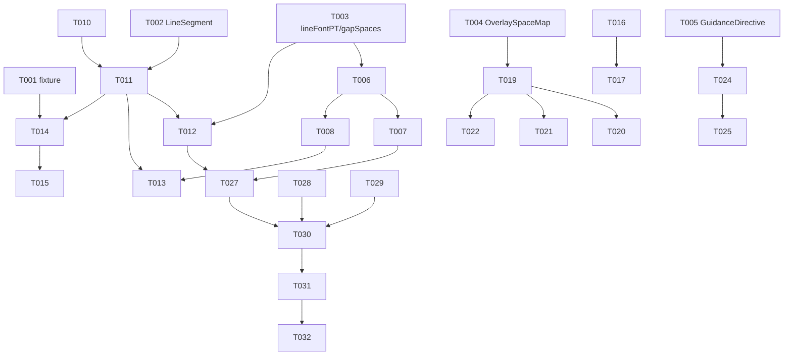

# Tasks: scan-fidelity（扫描保真：还原缺陷修复 + 取景边框可靠性）

**Input**: Design documents from `spec/scan-fidelity/`
**Prerequisites**: plan.md（D1~D8）、spec.md（US1~US6 / FR-001~012 / SC-001~006）

**Tests**: spec SC-006 明确要求 FR-001~FR-011 自动化测试覆盖——各故事含测试任务。

## Format: `[ID] [P?] [Story] Description`

- **[P]**: 可并行（不同文件、无未完成依赖）
- **[Story]**: 所属用户故事

## Path Conventions

- 源码：`Zhixia/`（仓库根）；测试：`ZhixiaTests/`；特性文档：`spec/scan-fidelity/`
- 构建/测试命令：`export DEVELOPER_DIR=/Volumes/DevDisk/Applications/Xcode.app/Contents/Developer && OTHER_SWIFT_FLAGS="-disable-sandbox" xcodebuild test -project Zhixia.xcodeproj -scheme Zhixia -destination 'platform=iOS Simulator,name=iPhone 17 Pro' -skipPackagePluginValidation -skipMacroValidation`（模拟器 Busy 时先 `xcrun simctl erase all`）

---

## Phase 1: Setup (Shared Infrastructure)

**Purpose**: 共享测试夹具（取证数据固化）

- [x] T001 将真机取证页（双栏英语练习册）的 OCR 分段几何固化为测试 fixture：对话行样本的分段 bbox（x/y/w/h 归一化）与文本（来源：本地 Vision 同参对照 108 行数据中的对话区段，含同排异高分段与相邻行样本），新建 `ZhixiaTests/DialogueRowFixture.swift`

---

## Phase 2: Foundational (Blocking Prerequisites)

**Purpose**: 数据模型与纯函数基座——所有故事的前置

**⚠️ CRITICAL**: 用户故事开工前本阶段必须完成

- [x] T002 [P] 新增 `LineSegment` 类型（text/offset/width，块相对基准）并为 `BlockLine` 添加可选字段 `segments: [LineSegment]?`（Codable 兼容旧存档），修改 `Zhixia/Domain/Models/ReconstructDocument.swift`
- [x] T003 [P] 新增行级字号推导 `lineFontPT(line:block:pageHeightPT:)`（行实测高 × 1.05，钳制 [7,28]，退化回退块级）与空隙占位换算 `gapPlaceholderSpaces(gapWidthNormalized:fontPT:pageWidthPT:)`（≥0.6 字符宽 → 空格数 round(空隙pt ÷ 0.25×字号)，下限 2 上限 60；否则 nil）纯函数，修改 `Zhixia/Domain/Layout/LayoutTypography.swift`
- [x] T004 [P] 新建照片空间→屏幕坐标纯函数模块 `OverlaySpaceMap`：`screenQuad(fromPhotoQuad:geometry:viewSize:)`（照片→视频走 `FOVLayout.convert` 逆换算 + 视频→屏幕 `.resizeAspectFill` 解析放置）与 `videoFramePlacement(geometry:viewSize:)`，新建 `Zhixia/Domain/OverlaySpaceMap.swift`
- [x] T005 [P] 新建引导判定纯函数模块：`GuidanceDirective` 枚举（backOff/closer/locked/searching）+ `evaluate(track:hysteresis:)`（suspicious 复用 `Quad.isSuspiciousForAutoCapture` 既有阈值；closer 面积滞回进入 <0.07 / 退出 >0.09），新建 `Zhixia/Domain/GuidanceDirective.swift`

**Checkpoint**: 纯函数基座就绪，各故事可并行开工

---

## Phase 3: User Story 1 - 行几何保真（Priority: P1）🎯 MVP

**Goal**: 预览与 Word 导出无行叠字——行级字号与行槽同源推导
**Independent Test**: 异构行高块（标题+正文混排 fixture）导出 DOCX 后逐行 w:sz ≤ w:line×1.05/20；预览同源

### Implementation for User Story 1

- [x] T006 [US1] `estimatedRenderHeight` 基准字号行级化（每行以 `lineFontPT` 为基准做 fittedFontPT 封顶，估算与渲染同字号），修改 `Zhixia/Domain/Layout/LayoutTypography.swift`（依赖 T003）
- [x] T007 [US1] DOCX 行段字号行级化：`lineParagraphXML` 的 `w:sz` 改由 `lineFontPT` 推导（每行一档），`w:line` exact 维持实测；无 `lines` 回退段落路径（块级+预缩）不变，修改 `Zhixia/Services/Reconstruct/DocxExportService.swift`（依赖 T003、T006）
- [x] T008 [US1] 预览逐行渲染字号行级化：`LayoutCanvas` 逐行 Text 字号改经 `canvasFontPT(lineFontPT(...))`，行帧 `resolvedLineFrames` 不变，修改 `Zhixia/Features/Reconstruct/LayoutCanvas.swift`（依赖 T006）
- [x] T009 [P] [US1] 新建行级字号测试：异构行高块逐行「字号 ≤ 行槽 × 1.05」性质断言、`lineFontPT` 退化回退、`gapPlaceholderSpaces` 阈值两侧与换算边界，新建 `ZhixiaTests/LineTypographyPerLineTests.swift`

**Checkpoint**: US1 独立可验——混排块不再叠字

---

## Phase 4: User Story 2 - 对话/填空行完整还原（Priority: P1）🎯 MVP

**Goal**: 同排分段合并为一行、按视觉位置排序、空隙渲染下划线占位
**Independent Test**: DialogueRowFixture 中的对话行产出行数=视觉行数、语序正确、分段间含下划线占位

### Implementation for User Story 2

- [x] T010 [US2] `sameRow` 判定重写为 y 跨度重叠率（`overlap ≥ 0.5 × min(a.height, b.height)`，与当前行并集 bbox 比较），行内 minX 排序保留，段落聚类阈值不变，修改 `Zhixia/Domain/OnDeviceReadingOrder.swift`
- [x] T011 [US2] `blockLines(for:)` 采集 `segments`：`row.lines` 逐 OCR 分段生成 `LineSegment`（offset=块相对 minX，width=分段宽），修改 `Zhixia/Domain/OnDeviceReadingOrder.swift`（依赖 T002、T010）
- [x] T012 [US2] DOCX 行段多 run 渲染：文本 run 间按分段空隙插入下划线空格 run（`<w:u w:val="single"/>`，空格数走 `gapPlaceholderSpaces`，`xml:space="preserve"`），修改 `Zhixia/Services/Reconstruct/DocxExportService.swift`（依赖 T003、T011）
- [x] T013 [US2] 预览分段定位渲染：行帧内按 `segment.offset − line.leadingOffset` 定位各段 Text，空隙处画基线下划线矩形（segments 为 nil 的旧行走整行文本路径不变），修改 `Zhixia/Features/Reconstruct/LayoutCanvas.swift`（依赖 T011、T008）
- [x] T014 [US2] 新建行聚类测试（fixture 驱动）：同排异高分段合并为一行、相邻视觉行不合并、行内分段 minX 序、无跨行串接、segments 采集正确性，新建 `ZhixiaTests/OnDeviceReadingOrderRowClusteringTests.swift`（依赖 T001、T011）

**Checkpoint**: US2 独立可验——对话行完整、空隙有下划线

---

## Phase 5: User Story 3 - 聚类稳定（Priority: P2）

**Goal**: 同页多次扫描的导出结构均合格（无碎片/无叠字/无乱序）
**Independent Test**: fixture 三组微扰变体（分段几何 ±5% 抖动）全部通过结构三项检查

### Implementation for User Story 3

- [x] T015 [US3] 追加稳定性测试：对 DialogueRowFixture 生成三组微扰变体（分段位置/高度 ±5% 随机但固定种子），断言每组的行聚类结果均满足「同行分段不拆散、相邻行不合并」，追加到 `ZhixiaTests/OnDeviceReadingOrderRowClusteringTests.swift`（依赖 T014）

**Checkpoint**: US3 独立可验——聚类对微扰稳定

---

## Phase 6: User Story 4 - 全文搜索可用（Priority: P2）

**Goal**: 重建完成后搜索 blob 回填 + 自动标题
**Independent Test**: 重建成功后 `onContentReady` 触发一次且 blob=识别全文；失败不触发

### Implementation for User Story 4

- [x] T016 [US4] `ReconstructViewModel` 暴露 `recognizedTextBlob`（pages 各块 text 以 "\n" 聚合）与 `onContentReady: ((String) -> Void)?`（`reconstruct()` 成功且 hasContent 时回调一次），修改 `Zhixia/Features/Reconstruct/ReconstructViewModel.swift`
- [x] T017 [US4] `DocumentView` 装配：重建入口把回调接到 `DocumentViewModel.applyOCRBlob`（与手动 OCR 页同路径；`ReconstructView` 增加回调传递），修改 `Zhixia/Features/Document/DocumentView.swift` 与 `Zhixia/Features/Reconstruct/ReconstructView.swift`（依赖 T016）
- [x] T018 [P] [US4] 追加回填链路测试：成功回调一次/blob 内容聚合正确/失败（hasContent=false）不触发，追加到 `ZhixiaTests/ReconstructTests.swift`

**Checkpoint**: US4 独立可验——重建后内容可搜、标题自动更新

---

## Phase 7: User Story 5 - 取景器边框可见且对齐（Priority: P1）🎯 MVP

**Goal**: 边框四角括号+外压暗实时可见，映射与书页边缘对齐（解析式映射）
**Independent Test**: OverlaySpaceMapTests 全组合通过；模拟器注入替身画布上 overlay 渲染正确

### Implementation for User Story 5

- [x] T019 [US5] `EdgeOverlayView` 映射接入解析链：入参改收 `CaptureGeometry`（videoAspect/photoAspect），`spaceProbe` 退役；视图 quad 经 `OverlaySpaceMap.screenQuad` 换算（y-down 全链不翻转），修改 `Zhixia/Features/Capture/EdgeOverlayView.swift`（依赖 T004）
- [x] T020 [US5] 边框视觉升级：框外压暗（reverseMask + QuadShape 填充黑，tracking 0.25 / locked 0.45）+ 四角 L 形粗括号（臂长 ≈ min(viewSize)×3%，线宽 4pt，白+暗描边）+ tracking 虚线整框；证件模式 idMask 路径不变，修改 `Zhixia/Features/Capture/EdgeOverlayView.swift`（依赖 T019）
- [x] T021 [US5] `CaptureView` 向 overlay 传递 `viewModel` 暴露的 `CaptureGeometry`（`CaptureViewModel` 若未暴露需一并透出），修改 `Zhixia/Features/Capture/CaptureView.swift`（依赖 T019）
- [x] T022 [US5] `CameraPreviewBinder.overlayTransform` 降级为诊断日志源：保留实现与协议签名，仅输出探针值与解析式值的比对日志（复用 `ZhixiaLog.overlayProbe` 通道），不再被 overlay 消费，修改 `Zhixia/Services/Camera/CameraPreviewBinder.swift`（依赖 T019）
- [x] T023 [P] [US5] 新建映射解析链测试：videoAspect ∈ {0.5625, 0.75, 1} × photoAspect ∈ {0.5625, 0.75, 1} 全交叉（恒等/中心子区间两个方向）+ y-down 约定回归 + 视频裁切与满屏两种 viewSize，新建 `ZhixiaTests/OverlaySpaceMapTests.swift`（依赖 T004）

**Checkpoint**: US5 独立可验——边框可见且映射有测试锚点

---

## Phase 8: User Story 6 - 方向感知引导提示（Priority: P3）

**Goal**: 四态提示（太近后退/太远靠近/对准/寻找）+ 面积滞回防闪烁
**Independent Test**: GuidanceDirectiveTests 四态穷举 + 滞回穿越序列通过

### Implementation for User Story 6

- [x] T024 [US6] `CaptureViewModel` 持有 `FarHysteresis` 滞回状态并以 `GuidanceDirective.evaluate` 推导，暴露 directive 供视图消费，修改 `Zhixia/Features/Capture/CaptureViewModel.swift`（依赖 T005）
- [x] T025 [US6] `CaptureView.hintText` 改为四态映射（backOff→capture.hint.suspicious / closer→capture.hint.tooFar / locked→capture.hint.locked / searching→capture.hint.search），`Localizable.xcstrings` 新增 `capture.hint.tooFar`（zh「靠近一点」/ en "Move closer"），修改 `Zhixia/Features/Capture/CaptureView.swift` 与 `Zhixia/Localizable.xcstrings`（依赖 T024）
- [x] T026 [P] [US6] 新建引导判定测试：四态穷举（suspicious 优先级最高）、面积滞回穿越序列（0.065→closer，0.08 保持，0.095→locked）、searching 态透传，新建 `ZhixiaTests/GuidanceDirectiveTests.swift`（依赖 T005）

**Checkpoint**: US6 独立可验——提示方向正确且不闪烁

---

## Phase 9: Polish & Cross-Cutting Concerns

**Purpose**: 既有断言更新、文档与真机验收清单

- [x] T027 更新既有 `DocxRestoredLayoutTests` 的 w:sz 断言至行级化语义（块级字号断言改为逐行字号断言；基线计数只增不减），修改 `ZhixiaTests/DocxRestoredLayoutTests.swift`（依赖 T007、T012）
- [x] T028 记录本轮修复与已知限制（OCR 字符级混淆 I/l/1 接受为已知限制，FR-012）到项目手册布局引擎/扫描保真章节，修改 `docs/09-project-handbook.md`
- [x] T029 新建真机验收清单：SC-001（同款练习册页 0 叠字/0 碎片/0 乱序+下划线）、SC-002（三扫全过）、SC-003（搜索命中+标题）、SC-004（边框可见对齐+overlayProbe 诊断对照步骤）、SC-005（四情形提示方向）、SC-006（基线核对），新建 `spec/scan-fidelity/device-acceptance.md`

---

## Phase 10: Verification

<!-- verification_scope: build+ui -->

**Purpose**: 构建、部署与逐故事 UI 验证

- [x] T030 全量构建 + 单元测试：`xcodebuild test -project Zhixia.xcodeproj -scheme Zhixia -destination 'platform=iOS Simulator,name=iPhone 17 Pro'`（含 `-skipPackagePluginValidation -skipMacroValidation`、`OTHER_SWIFT_FLAGS="-disable-sandbox"`、`DEVELOPER_DIR` 导入）；基线 255 passed + 1 known issue + 0 failed 只增不减，失败则修复循环直至全绿
- [x] T031 部署验证：模拟器构建安装并启动（`xcrun simctl` 安装 boot 启动）；如需 generic 设备构建加 `CODE_SIGNING_ALLOWED=NO` 验证可编译性
- [x] T032 逐用户故事 UI 验证：US1/US2/US3/US4 以还原预览截图与导出产物核验（无叠字/下划线占位/搜索命中）；US5/US6 相机链路在模拟器以注入替身画布验证 overlay 渲染与提示文案，真机部分对照 device-acceptance 清单

---

## Dependencies & Execution Order

### Phase Dependencies

- **Setup (Phase 1)**: 无依赖，立即开工（fixture 是 US2/US3 测试的前置）
- **Foundational (Phase 2)**: 依赖 Setup 完成（仅 T003 无 fixture 依赖，可与 T001 并行）——**阻塞全部用户故事**
- **User Stories (Phase 3~8)**: 全部依赖 Foundational 完成；还原侧（US1~US4）与拍摄侧（US5/US6）两条链无共享文件，可整链并行
- **Polish (Phase 9)**: T027 依赖 US1/US2 完成；T028/T029 无实现依赖可提前
- **Verification (Phase 10)**: 依赖全部实现与 Polish 完成

### User Story Dependencies

- **US1 (P1)**: Foundational 后即可开工——行级字号是 US2 预览渲染（T013）的伙伴但非前置（T013 显式依赖 T008）
- **US2 (P1)**: 依赖 T002（segments 模型）与 T010（聚类）；与 US1 在 `LayoutCanvas.swift`/`DocxExportService.swift` 有文件级先后（T012→T007 同文件，T013→T008 同文件）
- **US3 (P2)**: 依赖 US2 的聚类测试（T014）
- **US4 (P2)**: 仅依赖 Foundational——全链独立，可随时并行插入
- **US5 (P1)**: 仅依赖 T004——与还原侧整链并行
- **US6 (P3)**: 仅依赖 T005；T025 与 T021 同文件（CaptureView.swift）需先后

### Within Each User Story

- 模型/纯函数先于消费方（T002→T011、T003→T006/T012、T004→T019、T005→T024）
- Domain 先于 Service 先于 Feature
- 测试任务标注 [P]，可与实现并行或 TDD 先行

## 📊 Dependency Graph



## ⚡ Parallel Execution Guide

| Phase | Tasks | Required Files | Execution Notes |
|---|---|---|---|
| Foundational | T002/T003/T004/T005 | ReconstructDocument.swift / LayoutTypography.swift / OverlaySpaceMap.swift(新) / GuidanceDirective.swift(新) | 四任务不同文件，可全并行 |
| US1 测试 | T009 | LineTypographyPerLineTests.swift(新) | 与 T006~T008 实现并行（TDD 先行亦可） |
| US2 聚类 | T010 | OnDeviceReadingOrder.swift | 与 US1 实现并行（不同文件） |
| US4 测试 | T018 | ReconstructTests.swift | 与 T016/T017 并行 |
| US5 测试 | T023 | OverlaySpaceMapTests.swift(新) | 与 T019~T022 并行（仅依赖 T004） |
| US6 测试 | T026 | GuidanceDirectiveTests.swift(新) | 与 T024/T025 并行（仅依赖 T005） |
| US5 与还原侧 | T019~T023 vs T006~T018 | Capture/* vs Reconstruct/* | 两条链无共享文件，可整链并行 |

## Parallel Example: User Story 1

```bash
# Foundational 完成后，测试与实现并行发起：
Task: "T009 行级字号测试 → ZhixiaTests/LineTypographyPerLineTests.swift"
Task: "T006 estimatedRenderHeight 行级化 → Zhixia/Domain/Layout/LayoutTypography.swift"

# 同理 US5 整链与还原侧整链并行：
Task: "T019 EdgeOverlayView 解析式映射 → Zhixia/Features/Capture/EdgeOverlayView.swift"
Task: "T010 sameRow 跨度重叠率 → Zhixia/Domain/OnDeviceReadingOrder.swift"
```

## Implementation Strategy

### MVP First (还原侧核心)

1. 完成 Phase 1（fixture）+ Phase 2（纯函数基座）
2. 完成 US1（T006~T009）+ US2（T010~T014）
3. **STOP and VALIDATE**: 混排块无叠字 + 对话行完整（fixture 断言全绿）
4. 此时还原侧核心价值已可交付（Word 无叠字、无碎片、无乱序、下划线占位）

### Incremental Delivery

1. Setup + Foundational → 基座就绪
2. +US1 → 无叠字（MVP 之一）
3. +US2 → 对话行完整+下划线（MVP 之二）
4. +US5 → 边框可见（拍摄侧 MVP）
5. +US3/US4 → 稳定性与搜索
6. +US6 → 方向感知提示
7. Polish → 断言更新/手册/验收清单
8. Verification → 构建/部署/UI 验证

### Parallel Team Strategy

- 开发者 A：还原链（T006~T018 按依赖序）
- 开发者 B：拍摄链（T019~T026 按依赖序）
- 两人无共享文件；T027~T029 Polish 由先完成者接手

## Notes

- [P] 任务 = 不同文件且无未完成依赖；同文件任务必须串行（如 T007→T012、T008→T013、T021→T025）
- 既有测试基线 255 passed + 1 known issue + 0 failed 只增不减；`DocxRestoredLayoutTests` 的 w:sz 断言更新（T027）属语义修正，不算回退
- US5/US6 的相机链路在模拟器上无真实相机——UI 验证以注入替身画布为准（PreviewSupport/CaptureFallbackTests 已有替身基建），真机对齐核验在 device-acceptance 清单执行
- 每完成一个 Checkpoint 用 `xcodebuild test` 快速回归，避免问题堆积到 Verification 阶段
- 勾选格式统一 `- [x]`；实施子代理完成后以 tasks.md 复选框为进度真值
