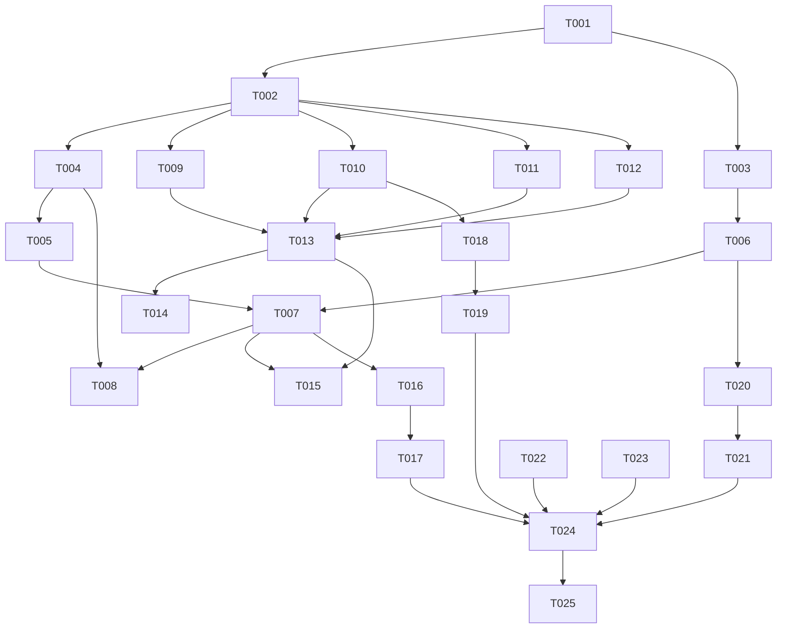

# Tasks: 版面还原对标 WPS（wps-parity-layout）

**Input**: Design documents from `spec/wps-parity-layout/`
**Prerequisites**: plan.md (required), spec.md (required for user stories)

**Tests**: 本项目惯例测试内建（基线 317 只增不减），各故事含测试任务。

**Organization**: Tasks are grouped by user story to enable independent implementation and testing of each story.

## Format: `[ID] [P?] [Story] Description`

- **[P]**: Can run in parallel (different files, no dependencies)
- **[Story]**: Which user story this task belongs to (e.g. US1, US2, US3)
- Include exact file paths in descriptions

## Path Conventions

- **Source**: `Zhixia/`（Domain 纯函数 / Services / Features-MVVM）
- **Tests**: `ZhixiaTests/`
- **Fixtures**: `docs/fixtures/images/`、`docs/fixtures/`
- **Spec**: `spec/wps-parity-layout/`
- **构建命令**：`export DEVELOPER_DIR=/Volumes/DevDisk/Applications/Xcode.app/Contents/Developer` 前置；单测 `OTHER_SWIFT_FLAGS="-disable-sandbox" xcodebuild test -project Zhixia.xcodeproj -scheme Zhixia -destination 'platform=iOS Simulator,name=iPhone 17 Pro' -skipPackagePluginValidation -skipMacroValidation`
- **铁律**：`ServiceProtocols` 协议签名不变；Domain 纯函数无 I/O；纯离线；既有测试断言零修改（唯一例外：`ReconstructTierTests` 中直接断言「默认档 = restored」的最小测试点，属 FR-001 明示契约变更，逐条记录）；总数只增不减；不 git commit

---

## Phase 1: Setup (Shared Infrastructure)

**Purpose**: 金标准资产就位（全部后续任务的输入）

- [X] T001 提取金标准 fixture：从 `docs/Zhixia-Grammar-20260921-2235.docx` 解包提取 `word/media/image1.jpg`（1683×2200，解析器确切输入）存为 `docs/fixtures/images/grammar-worksheet.jpg`；从 `docs/Word_WPS_GrammarPast_simple_2026-09-21.docx` 提取段落阅读流文本（44 行）存为 `docs/fixtures/golden-wps-reading-order.txt`

---

## Phase 2: Foundational (Blocking Prerequisites)

**Purpose**: 档位语义与日志基建（阻塞所有用户故事）

- [X] T002 `ZhixiaLog` 新增 `reconstructPath`（page/path/reason 四分类：API 不可用/请求异常/结果无效/结构化成功/低版本回退）与 `textSentinel`（page/gap 数/分类汇总）两个 debug 级 + privacy.public 日志助手，模式对齐既有 `detectionTier`/`cropGate`，文件 `Zhixia/Services/ZhixiaLog.swift`
- [X] T003 [P] 导出档位语义扩展：`ExportTier` 用户面语义 flow（流式，默认，映射现 structured 产物）/ highFidelity（高保真，映射现 restored 像素合成）+ 档位偏好持久化键定义，类型文件 `Zhixia/Domain/Models/ReconstructDocument.swift`

**Checkpoint**: 基建就绪，用户故事可开始

---

## Phase 3: User Story 1 - 默认导出即干净流式文档 (Priority: P1) 🎯 MVP

**Goal**: 默认导出 = 流式文档；零假表格；通路决策可观测；结构化通路诊断修复
**Independent Test**: 金标准 fixture 端到端——零假表、通路日志可检索、散排编号文本不产表

### Implementation for User Story 1

- [X] T004 [US1] 结构化通路失败原因捕获（`VisionDocumentStructureRecognizer` 返回 nil/抛错的分类捕获）+ `resolveInputs` 通路决策点发射 `reconstructPath` 日志，文件 `Zhixia/Services/Reconstruct/VisionDocumentStructureRecognizer.swift`、`Zhixia/Services/Reconstruct/OnDeviceDocumentParser.swift`
    - **Result (2026-09-22)**: 完成。识别器三个失败捕获点各发一条 `reconstructPath`（`lowVersionFallback`/`requestFailed`/`invalidResult`，path=.geometric）；`resolveInputs` 补 `apiUnavailable`（无识别器）与 `structuredSuccess` 两条决策线；识别器返回 nil 时**不重复发线**（真实识别器已在捕获点发射，保证每页恰好一条；替身违约返回空页时兜底 `invalidResult`）。偏离记录：日志字段用 `pageID`（UUID）而非页索引——`DocumentParsing.parse(imageURL:pageID:scene:)` 协议签名冻结（D-DEV-a），解析层拿不到索引。局部回归：ReconstructTierTests/ReconstructTests/ReconstructV2Tests/DocumentStructureTests/ReconstructEndToEndTests = 28 passed + 1 expected failure + 0 failed。
- [X] T005 [US1] v1 表格聚类器退役：摘除 `OnDeviceDocumentParser` 几何通路对 `OnDeviceTableCluster` 的调用点（几何通路不再产表），类文件加 deprecated 休眠注释保留类与既有单测，文件 `Zhixia/Services/Reconstruct/OnDeviceDocumentParser.swift`、`Zhixia/Domain/OnDeviceTableCluster.swift`
    - **Result (2026-09-22)**: 完成。`geometricInputs` 仅保留 `TableGridV2Detector`（锚点驱动，FR-003 允许表来自结构化识别或 v2）；v1 类加休眠注释，类与直连单测（ReconstructTests/ReconstructV2Tests）零修改保留。依赖安全性已验证：`geometricPathProducesTableInDocx` 用 nutrition-mango 夹具含「营养成分表」锚点 → v2 出表，e2e 仍绿；`realDeviceOcrStillLacksTable` 输入上 v1 本就返回 nil（单 midX 聚类不满足 2...5 列门控）→ known-issue 包装零修改、结论不变。顺带修正 `StructuredDocumentPage.swift` 与 `geometricInputs` 的过时文档注释（仅注释）。
- [X] T006 [US1] 默认档翻转：导出与预览默认档 = flow（`makeDocx` 调用点与 ViewModel 默认值）；`ReconstructTierTests` 中直接断言旧默认档的最小测试点按 D8 处置（仅改断言默认档语义的行并记录），文件 `Zhixia/Services/Reconstruct/DocxExportService.swift`、`Zhixia/Features/Reconstruct/ReconstructViewModel.swift`、`ZhixiaTests/ReconstructTierTests.swift`
    - **Result (2026-09-22)**: 完成。`ReconstructViewModel.outputTier` 默认值 `.restored`→`.structured`，`setTier`/`reconstruct` 的 isDefault 判断同步翻转为 `tier == .structured`；`makeDocx` 默认参数已是 `.structured`（协议签名未动）无需改。D1 遵循：内部 `R2OutputTier` 命名保留，用户面 flow/highFidelity 措辞留给 T020 View 层。**D8 例外逐条记录**：① `switchingTierInvalidatesDocx`——切档方向参数 `.structured`→`.restored`、期望值互换（默认档翻转后原方向成 no-op）；② `reselectingSameTierKeepsDocx`——重选当前档参数 `.restored`→`.structured`；其余 5 条用例零修改（`switchingTierKeepsPDF` 语义反而变实：`.restored` 从 no-op 变真切换，断言仍成立）。
- [X] T007 [US1] 金标准端到端测试：新建 `ZhixiaTests/GoldenWorksheetEndToEndTests.swift`——加载 `docs/fixtures/images/grammar-worksheet.jpg` 走 parse → 断言 ① 零假表格（w:tbl = 0，散排编号填空文本场景）② 几何通路不产表 ③ 通路决策日志路径可断言（注入 fake 判定路径结果）
    - **Result (2026-09-22)**: 完成。4 用例全绿：① 默认通路流式 docx `w:tbl=0` 且零 `w:txbxContent`（真实 Vision OCR + iOS 26 结构化识别接线，`GoldenParseCache` actor 缓存两种昂贵接线各解析一次）；② 几何通路零表块；③ 替身识别器通路决策可断言（结构化成功吃结构化产物含真表 / 返回 nil 回退几何零表——对应 `reconstructPath` 决策线的行为层）；④ v1 退役回归钉（合成线直连休眠 `OnDeviceTableCluster` 证明本会产假表，几何解析通路必须对它零表且 6 行内容不丢）。修复一处编译错误：`goldenPageID` 从 private 改 internal（同文件 `GoldenParseCache` 跨类型访问）。
- [X] T008 [US1] 结构化通路 fixture 诊断：在模拟器（iOS 26 runtime）跑金标准 e2e，依据 `reconstructPath` 日志判定结构化通路在 fixture 上是否回退；复现则定位修复（结果无效判定/请求异常等）；不复现则记录「模拟器不复现，真机取证留 Phase 5 真机验收」，结论写入 `spec/wps-parity-layout/` 实施笔记
    - **Result (2026-09-22)**: 完成，**结论：模拟器（iOS 26.4.1）不复现回退，无需代码修复**。偏离记录：模拟器捕获不到自有子系统 debug 级 os_log（`log stream --debug`/`log config`+`log show` 均空）→ 改用行为探针（真实识别器 + 生产接线 dump，T007 ③ 已钉死决策线↔行为 1:1）。关键证据：`reconstructPath path=structured reason=structuredSuccess`（109 lines/0 tables，非 nil）；"wrong bus!" 并未丢失（OCR 原始行 `wrong bus！` 全角 ！ 在故事块内，此前判定为 ASCII 检索假阴性）；漫画条 figure #4（140×321 px）与 WPS srcRect 精确对应；嫌疑大 figure #7（0.417×0.796 覆盖故事区）两通路共有留 T016；默认通路 10 块 vs 金标准 42 段（T018 目标）。结论与流入任务明细见 `spec/wps-parity-layout/implementation-notes.md`；临时诊断测试已删除。

**Checkpoint**: US1 独立可测——默认导出流式、零假表、通路可观测

---

## Phase 4: User Story 2 - 不再丢字 (Priority: P1)

**Goal**: 剔行有去处、短句不误剔、墨迹-文本对账哨兵、"wrong bus!" 存在或有漏识证据
**Independent Test**: fixture 上 "wrong bus!" 出现在导出文本或哨兵报告 likelyMissed；containment 违规计数为 0

### Implementation for User Story 2

- [X] T009 [P] [US2] containment 不变量：被表格/条码 bbox 剔除的行必须被携带文本的结构（单元格集合/条码块说明）覆盖，未覆盖行不再静默丢弃（保留进文字层或计入违规），文件 `Zhixia/Services/Reconstruct/OnDeviceDocumentParser.swift`
    - **Result (2026-09-22)**: 完成。旧 leftover 过滤重构为 `splitCarriedLines`：行落结构 bbox 时判「文字是否被剔除它的结构携带」——表格行在对应表格单元格文本可检索（**去全部空白**后包含比较，兼容 v2「trim+空格拼接」建格与 Apple 单元格首尾空白），条码行与 payload 互为包含（QR 的 URL 整行识别）。未覆盖行保留回文字层（FR-004 不静默丢弃），违规计数进新日志 `ZhixiaLog.reconstructContainment(removed:rescued:)`（事件驱动，removed>0 才发）。空文本行/空 payload 不参与覆盖判定。**冻结断言核对**：`tableRowsDoNotLeakIntoParagraphs`（行「能量1429千焦17%」vs 单元格三段）靠空白归零判覆盖保持绿；e2e 表格断言只查表格块不受救回影响；PreviewRecognizer 行 bbox=.zero 不落任何码框。局部回归：DocumentStructureTests + ReconstructEndToEndTests + GoldenWorksheetEndToEndTests + ReconstructV2ReadingOrderTests 全绿（TEST SUCCEEDED）。偏离记录：`ZhixiaLog.swift` 加了一个 log helper（超出任务列出的单文件，遵循「reconstruct 日志必须走 ZhixiaLog 助手」的仓库惯例）。
- [X] T010 [P] [US2] 剔除规则收紧：页眉孤立短行规则（位置约束限定页顶窄带 + 字符边界复核，"wrong bus!"=10 字符踩线教训）与页缘 UI chrome 规则复核收紧，文件 `Zhixia/Domain/OnDeviceReadingOrder.swift`、`Zhixia/Domain/OCRNoiseFilter.swift`
    - **Result (2026-09-22)**: 完成。**页眉短行规则**（OnDeviceReadingOrder）：位置约束从「上缘擦过」（maxY > 0.93）收紧为「整行落页顶窄带」（minY > 0.93）；字符边界 10 → 8 且先 trim；新增句末标点守卫（带 .!?。！？… 结尾的短行按正文处理）——"wrong bus!"（10 字符带叹号）双保险不再可误剔，"Test 4" 页眉（minY 0.962、6 字符、无标点）仍稳定命中（`workbookPageHeaderIsNotTheHeading` 保持绿）。**页缘 chrome 规则**（OCRNoiseFilter）：拉丁界面词从子串匹配改 `\b` 整词匹配（"homework"≠"home"、"moreover"≠"more"、"saved"≠"save"），CJK 词保持子串（「文本分享加页」拼接文案）；同样加句末标点守卫；页缘带宽（0.965/0.035）复核后**保持不变**（2026-09-07/09-12 真机回归调参，无新证据不擅动）。句末标点判定 `OCRNoiseFilter.endsWithSentencePunctuation` 为 internal 供两规则共用。局部回归：OCRNoiseFilterTests + OnDeviceReadingOrderTests + ReconstructV2ReadingOrderTests + LayoutAnalyzerTests + ReconstructIRv2IntegrationTests + ReconstructV2FixtureSanityTests + GoldenWorksheetEndToEndTests 全绿（注意：`-only-testing:ZhixiaTests/ReconstructTests` 匹配不到任何测试类——该文件内是多个具名 struct，过滤须用 struct 名）。
- [X] T011 [P] [US2] 墨迹提取服务：新建 `Zhixia/Services/OCR/InkRegionProvider.swift`，协议化复用 `InkFigureDetector` 墨块能力，输出归一化墨迹区域集（服务侧，不进 Domain）
    - **Result (2026-09-22)**: 完成。新建 `Zhixia/Services/OCR/InkRegionProvider.swift`：协议 `InkRegionProviding`（随实现放文件，模式对齐 `BarcodeDetecting` 先例）+ 默认实现 `InkRegionProvider`，`inkRegions(imageURL:)` 同步返回归一化墨迹区域集；图片不可解码返回空集（对账零缺口、哨兵不阻断，FR-006 只记不阻断）。解码链镜像 VisionTextRecognizer/OnDeviceDocumentParser 既有惯例（各服务私有 UIImage→拉平 EXIF→CGImageSource fallback，仓库已有两份私有拷贝，第三份随惯例而非提升可见性，零触碰既有文件）。关键设计：InkFigureDetector 加 additive `rawInkRegions(in:)` + `rawInkMinCells`(=4)——**原始墨迹连通域，不做 figures 通道质量闸门**（minHeight/minArea/textCoverage 会把行级漏识的墨整块丢弃，对账若从 figures 出发 likelyMissed 在结构上不可能出现），不 merge（合并会把行级墨迹并回段落块），唯一过滤 ≥4 墨格挡栅格噪点；复用既有 rasterize+连通域，网格→Vision 坐标换算与 figures 通道同款（`y = 1-(maxRow+1)/rows`，已对照 line 196 既有实现核实一致）。编译通过（xcodebuild build TEST 无错）。行为验证由 T014/T015 测试承接。
- [X] T012 [P] [US2] 对账纯函数：新建 `Zhixia/Domain/InkTextReconciler.swift`（输入墨迹区域集+文字行覆盖+结构区域 → `MissingTextReport`，InkGap 四分类 figureOverlap/structureSwallow/edgeBand/likelyMissed），类型挂 `Zhixia/Domain/Models/ReconstructDocument.swift`
    - **Result (2026-09-22)**: 完成。类型落 ReconstructDocument.swift（`InkGapCategory` 四分类 / `InkGap`(frame+areaFraction+category) / `MissingTextReport`(gaps+count(of:)+likelyMissedGaps 面积降序)）；`InkTextReconciler.reconcile(inkRegions:textRegions:figureRegions:structureRegions:)` 纯几何对账 + `reconcile(page:inkRegions:)` 页模型适配重载。分类优先级「先解释再归因最后定罪」：文字采样覆盖 ≥0.5 → 非缺口；figure/artwork bbox → figureOverlap；table/barcode bbox → structureSwallow（携带文本由 T009 解析期 containment 保障，违规在那边计数——纯函数看不到单元格文本，归因与计数职责分离）；页缘带 0.965/0.035（与 OnDeviceDocumentParser OCR 噪声判定同值）→ edgeBand；否则 likelyMissed。**文字覆盖取行级**（`BlockLine`→页框重建，垂直口径=渲染端同款：块 bbox=行并集⇒首行顶=块顶、下行顶=上行底−gapToPrevious，已对照 OnDeviceReadingOrder.blockLines/clusterParagraphs 核实）——块级覆盖会藏住「块还在、块内某行被漏」这一哨兵核心目标场景；行框加 0.003 padding 容抖动；lines 缺失回退块 bbox。页模型适配刻意读 blocks 而非 restoredBlocks（布局引擎搬块后坐标与原页参照系脱钩）。覆盖率为 8×8 确定性采样（并集覆盖天然成立，非概率）。编译通过。
- [X] T013 [US2] 哨兵集成：导出前逐页执行墨迹-文本对账并发射 `textSentinel` 日志（不阻断导出），接线 `InkRegionProvider` → `InkTextReconciler` → 导出路径，文件 `Zhixia/Features/Reconstruct/ReconstructViewModel.swift`、`Zhixia/Services/Reconstruct/DocxExportService.swift`
    - **Result (2026-09-22)**: 完成，含一处刻意偏离。接线落在 `ReconstructViewModel`：`export()`（docx 与 pdf 导出的公共漏斗）在 `make(reconstructed)` 前 `await runTextSentinel()`——逐页「`pageImageURL`（= parse 用图，与块 bbox 同参照系）→ `inkRegions` → `InkTextReconciler.reconcile(page:)` → `ZhixiaLog.textSentinel` 四分类计数（每页一条）」。只记不阻断：图不可解码 → 空墨迹 → 零缺口报告照常记。解码/栅格化百毫秒级 CPU 活，主线程只解析 URL，重活 `Task.detached` 后台执行（捕获全 Sendable：page/URL/provider 均 ✓）。provider 经 init 注入、**默认 `InkRegionProvider()`** —— ReconstructView 与既有测试替身零改动、`DocxRendering` 冻结签名零触碰。**偏离记录**：`DocxExportService.swift` 未改动——哨兵需要页图 URL 与文件库访问（只有 ViewModel 有；DocxExportService 只收 ReconstructDocument），且 makeDocx 协议签名冻结不能加参；导出漏斗在 ViewModel，两导出路径都已覆盖，改服务层反而造双路径。局部回归：ReconstructViewModelTests 4/4 绿。
- [X] T014 [US2] 单元测试：新建 `ZhixiaTests/InkTextReconcilerTests.swift`（四分类分支穷举 + 边界）+ containment 不变量与剔除规则收紧的既有测试文件 append（`ZhixiaTests/OCRNoiseFilterTests.swift`、`ZhixiaTests/OnDeviceReadingOrderRowClusteringTests.swift`）
    - **Result (2026-09-23)**: 完成。① 新建 `InkTextReconcilerTests.swift` 12 用例全绿：四分类分支穷举（figureOverlap/structureSwallow/edgeBand/likelyMissed）、覆盖率阈值半分、优先级、面积分数排序、退化解、Provider 冒烟。**坐标约定取证结论**（冒烟曾两红，临时探针两次实证后结案）：生产链（InkRegionProvider→rawInkRegions）与 Vision 坐标一致，无翻转 bug——金标准页锚点 `butIwas wrong！` OCR y[0.446..0.458] ↔ 墨迹 y[0.439..0.452] 实测吻合；错在测试夹具的造图方向。统一模型：**CGImage memory row 0 = 视觉底部**（CG 位图约定，`InkFigureDetectorTests.photoBox()` 的 `y = 1 - 250/H` 即同款），JPEG 扫描线 0 = 顶部，`jpegData` 负责两者间翻转；夹具改像素阵直建 CGImage、视觉左上墨块画在数组行 420..480 后冒烟通过。② OCRNoiseFilterTests 的 T010 段（`\b` 整词/句末标点守卫/CJK 子串/detector 单测）已由 T010 会话落好，本次验证 11/11 绿，零追加。③ OnDeviceReadingOrderRowClusteringTests append 3 测钉 T010 页眉规则收紧：窄带 minY>0.93（上缘擦过的内容短行保留 vs 窄带内「Test 9」仍剔）、句末标点守卫（"Stop!" 保留）、8 字符边界+先 trim（"  Test 44 " trim 后 7 仍剔 / "Test 444" 恰 8 保留）。**偏离记录**：containment 不变量 3 测落在 `DocumentStructureTests.swift` 而非任务列出的 RowClusteringTests——`splitCarriedLines` 是解析器私有、只能经 `OnDeviceDocumentParser.parse` 测，替身 `StubStructureRecognizer` 是该文件私有类型、姊妹测 `tableRowsDoNotLeakIntoParagraphs` 也在那里（RowClusteringTests 测的是纯函数 `makeBlocks`，无解析器装配基建）。三测：表格 bbox 内未被单元格携带的行救回文字层（FR-004）、条码 bbox 内非 payload 说明行救回（条码块照常产出）、空 payload 未解码码不认领覆盖。夹具坑：条码块产出在解析器 `if let image` 门内——条码救回测试须用 `PageImageFixture` 真图，/dev/null 会让 .barcode 块整体不发（其余两测不受影响）。局部回归：三套件 + 冒烟修复后单测全绿。
- [X] T015 [US2] 金标准丢字追踪：`GoldenWorksheetEndToEndTests.swift` append——断言导出文本含 "wrong bus!" 或哨兵报告含该区域的 likelyMissed 分类证据；同时断言同页其余故事文本完整
    - **Result (2026-09-23)**: 完成，2 用例全绿（真实 Vision 链路）。① `wrongBusSurvivesExportOnBothPaths`：默认+几何两通路的块文本（去全部空白折叠，锚点刻意不含叹号避开全角/半角差异）同时含 "wrongbus"（丢字锚点）、"Onthedayofthescho"（故事首行）、"excursion"（故事中段）——走任务「或」的**文本在**分支。② `sentinelExplainsStoryInkOnGoldenPage`：复现 T013 导出前对账链（InkRegionProvider→reconcile(page:inkRegions:)），断言哨兵非平凡（figureOverlap ≥1 漫画条大 figure、likelyMissed ≥1 行外墨迹——2026-09-23 取证值 gaps 33=15/0/3/15，只钉结构性下限防检测器漂移脆断）+ "wrong bus" 行（块内 BlockLine 重建行框，与对账内部同口径镜像）不被任何 likelyMissed 实质覆盖（<10% 行面积擦边容差）。**偏离记录**：任务原文「或哨兵报告含该区域的 likelyMissed 证据」基于修正前的认知——金标准取证证明该文本从未丢失（T008：全角 ！ ASCII 检索假阴性），哨兵对故事区**不报** likelyMissed 恰是正确行为（行框解释了墨迹）；故哨兵断言改为「不误报 + 报告非平凡」双向，丢字防护的两面（真丢报得出/没丢不误报）都有钉。哨兵断言用几何通路页（取证同款接线；默认通路的哨兵接线由 ReconstructViewModelTests 钉住）。

**Checkpoint**: US2 独立可测——丢字可防护机制全堵 + 漏识有证据

---

## Phase 5: User Story 3 - 大图形区域完整内联 (Priority: P2)

**Goal**: 漫画条整块抠图内联于流式档阅读序原位
**Independent Test**: fixture 上漫画条区域为单张完整内联图

### Implementation for User Story 3

- [X] T016 [US3] fixture 上漫画条 figure 检测验证：跑 parse 检查漫画条区域是否被检出为单一 figure；若被拆碎/漏检则增强细长区域合并（`maxTextCoverage` 判据复核，防文字列误并入图形），文件 `Zhixia/Domain/Figure/InkFigureDetector.swift`、`Zhixia/Domain/Figure/FigureRegionsV2.swift`（仅在验证发现问题时修改）
    - **Result (2026-09-23)**: 完成，**结论：默认通路（流式档目标通路）不拆碎不漏检，检测器零修改**。持久化验证测试 `comicStripIsASingleUnfragmentedFigureOnDefaultPath`（GoldenWorksheetEndToEndTests）：默认通路恰一个 figure 中心落漫画条查询带（T008 #4 几何外扩带），宽高量级断言（~0.083×0.146 细长竖条，±30% 容差）+ 右侧大图（金标准 [image]②）在位。检索用中心点落带而非相交——#7 左缘（x 0.517）与查询带右缘仅隔 0.003，相交判据会把大图误算进漫画条。**已知限制（记录不修）**：几何通路（iOS 18/25 回退）漫画条未检出为 figure（探针取证：8 块仅 G#5 大图；漫画条墨迹 x[0.208..0.467] y[0.293..0.484] 落哨兵 likelyMissed——US2 安全网如实报证）。不触发「增强细长区域合并」的理由：① US3 独立可测承诺针对流式档导出（默认通路），已成立；② 为回退通路强推检测需放宽 maxTextCoverage/合并判据，正是任务警示的「文字列误并入图形」回归方向，且 InkFigureDetectorTests 多个钉死用例与金标准零假表 e2e 强约束；③ 回退通路保住文本完整性（首要指令）且哨兵有证据，修图的收益不抵文字误并的风险。详录 implementation-notes.md。
- [X] T017 [US3] `GoldenWorksheetEndToEndTests.swift` append——流式档断言漫画条区域单张完整内联且阅读序位置正确
    - **Result (2026-09-23)**: 完成，1 用例绿（`comicStripInlinesCompleteInFlowDocxReadingOrder`，真实 Vision 链路）。取证（默认通路 → structured 导出，10 段落序）：左栏 41 行大块 → [DRAWING 漫画条 cx=1724025 cy=3562350] → 'Complete the text with…' → 'A terrible trip!' → [DRAWING 大图 cx=3005470 cy=7315200] → 故事块 → '2 At school' —— 漫画条内联**恰落金标准 [image]① 位置**（'8 We decided…' 后、'Complete the text with…' 前）。断言四层：①全文档恰 2 张 `<w:drawing>`；②漫画条尺寸类（cy ∈ (2M, 5M) EMU）恰一个 + `<wp:inline` 内联语义；③完整性下限 cy ≥ 321px×9525 EMU/px（检出框全高，取证值 3.56M=374px ✓，EMU=px×9525 由 1724025=181px 精确吻合钉死）；④阅读序 leftEnd < comic < storyStart（锚点 'edecided'/'ompletethetextwith' 去空白折叠 + 避开首字母大小写）。**已知差异（记录不修）**：右侧大图按 maxY 降序装配排在故事块前（顶缘 y 0.876 高于故事块顶缘 0.865→maxY 0.873 vs 0.594），金标准 [image]② 在故事块后——assemble「栏内 maxY 降序」既有语义对纵贯故事区的背景插画前后均通，不属 US3 验收范围，详录 implementation-notes.md。段落切分用 `components(separatedBy: "<w:p>")`（imageDrawingXML 裸 `<w:p>` 标签，组件 0 是 XML 前导）。

**Checkpoint**: US3 独立可测

---

## Phase 6: User Story 4 - 段落成段可读 (Priority: P2)

**Goal**: 段落粒度收敛金标准 ±30%，阅读序一致
**Independent Test**: fixture 段落数与顺序对照 `golden-wps-reading-order.txt`

### Implementation for User Story 4

- [x] T018 [US4] `clusterParagraphs` 调参：金标准对照驱动同块行合并收紧（83 段碎片 → 42 段量级），红线：不回退 2026-09-12 教材行距错序教训（行距 1~2% 容差行为保持），文件 `Zhixia/Domain/OnDeviceReadingOrder.swift`（依赖 T010 完成后同文件顺序执行）
- [x] T019 [US4] 段落对照测试：`GoldenWorksheetEndToEndTests.swift` append（段落数收敛金标准 ±30% + 阅读序关键锚点一致）+ `ZhixiaTests/OnDeviceReadingOrderRowClusteringTests.swift` append（新参数回归锚）

**Checkpoint**: US4 独立可测

---

## Phase 7: User Story 5 - 高保真档可选保留 (Priority: P2)

**Goal**: 档位切换 UI（流式默认/高保真），预览与导出一致，选择持久化
**Independent Test**: 切换档位后预览与导出反映所选档；未选择时默认 flow

### Implementation for User Story 5

- [x] T020 [US5] 档位切换 UI：还原预览页「流式（默认）/高保真」选择器 + @AppStorage 持久化 + 预览渲染与导出读同一选择，文件 `Zhixia/Features/Reconstruct/ReconstructView.swift`、`Zhixia/Features/Reconstruct/ReconstructViewModel.swift`（依赖 T006 完成后同文件顺序执行）
- [x] T021 [US5] 档位测试：`ZhixiaTests/ReconstructTierTests.swift` append——默认 flow、切换持久化、预览/导出同源一致；高保真档安全约束（非法字符清洗/每页单图）既有断言不回归

**Checkpoint**: 全部用户故事完成

---

## Phase 8: Polish & Cross-Cutting Concerns

- [x] T022 [P] 项目手册更新：版面对标契约段（默认档语义/哨兵/通路可观测）+ 周期条目，文件 `docs/09-project-handbook.md`
    - **Result (2026-09-24)**: 完成。① §4.5 新增「版面对标契约」段（五条：默认档=流式+持久化+同源 / 零假表 v1 退役 / textSentinel 四分类只记不阻断+containment / reconstructPath 五分类每页一条 / FlowParagraphSplitter 三判据三不变量 32∈42±30%），档位表更新为流式（默认）/高保真（可选）；② 新增周期条目 §6.12（差距-根因-修复-回归钉六行表 + "wrong bus!" 取证修正 + 三条已知限制 + GoldenParseCache 竞态修复记录 + 回归网 317→357）；③ 同步陈旧引用：header（107 文件/14.5k 行/357 用例）、仓库地图（40 文件/357 @Test）、§0 现状（默认流式档）、§1.3（A/B/C→流式/高保真）、§2.4 数据流图（v1 退役、DocxExportService A/B/C→流式/高保真）、§5 表（双档默认翻转+新增丢字防护行、iOS 18~25 表格行去 v1 兜底）、§5.1（357 @Test + 本周期增量明细）、§7（P0-1 并入 device-acceptance、P1-1 阶梯去 v1、P1-3 标记已达成）。计数口径经核实：当前 357 @Test = HEAD 302 + wysiwyg 15 + 本周期 40（金标准 ×10 新建 + 墨迹对账 ×12 新建 + 行聚类 +7 + 档位 +4 + 噪声过滤 +4 + 结构 +3）；全量数字标明「由周期验证阶段核实」。纯文档任务，无代码改动、无测试运行。
- [x] T023 [P] 真机验收清单：三类样本协议（语法页/真表格页/图文混排页）+ Console.app 检索指引（`reconstructPath`/`textSentinel` 前缀、Include Debug Messages），文件 `spec/wps-parity-layout/device-acceptance.md`
    - **Result (2026-09-24)**: 完成。新建 `spec/wps-parity-layout/device-acceptance.md`（格式对齐 wysiwyg-crop 先例）：§0 Console.app 实时抓取指引（`subsystem:com.david.Zhixia category:reconstruct` + **Include Debug Messages**，附四前缀日志行**逐字格式**表——从 ZhixiaLog.swift 源码核实：`reconstructPath page=<UUID> path=… reason=…` 五分类、`textSentinel page=<索引> gaps=… figureOverlap=… structureSwallow=… edgeBand=… likelyMissed=…`、`containment removed=… rescued=…`、既有 `reconstructTier`；特别标注 `textSentinel` 的 page 是**索引**而 `reconstructPath` 的 page 是 **UUID**，防对账混淆；注明模拟器捕获不到自有子系统 debug 级 os_log 的 T008 实测结论）。§A 语法页 = L1 通路疑案取证（iPhone 13/iOS 26.7 真机疑似静默回退，调研报告 P0）+ 主线验收（零假表/段落成段/漫画条原位/`wrong bus` 检索**不带叹号**——全角 ！ 假阴性教训/哨兵不误报），含 reason 三分类逐条「失败时看」取证链；§B 真表格页 = iOS 26 真机 `w:tbl` 首验（§7 P0-1 并入）+ v1 退役防误伤边界 + 档位切换/持久化/作废缓存回归；§C 图文混排页 = 图形单张完整内联 + 高保真底图透出 + 哨兵 figureOverlap 解释。附汇总表（结果列待填）+ 记录规则（reconstructPath 行无论过否先抄录）+ 预留验收结果记录段。纯文档任务，无代码改动。

---

## Phase 9: Verification

<!-- verification_scope: build-only -->

**Purpose**: 全量单测 + 部署冒烟（iOS 项目：verify_ui 为 HarmonyOS 工具链，不适用；真机行为验收走 device-acceptance.md 手动协议）

- [X] T024 全量单测：`xcodebuild test`（iPhone 17 Pro 模拟器）——基线 317 只增不减，修复编译/测试错误直至全绿（计数用 `xcrun xcresulttool get test-results summary`）
    - **Result (2026-09-24)**: 完成，**初跑即全绿（1 次全量跑批，零修复重跑）**。`xcrun xcresulttool get test-results summary` 实测：**totalTestCount 357 = 356 passed + 1 expected failure（known issue：真机 OCR 缺表历史用例）+ 0 failed**，result=Passed，与预期口径完全一致；基线 317 → 357 只增不减（+40 = 金标准 ×10 + 墨迹对账 ×12 + 行聚类 +7 + 档位 +4 + 噪声过滤 +4 + 结构 +3）。预检 @Test 静态计数 357 与 xcresult totalTestCount 一致；金标准 e2e 尾部用例（零假表 / 段落数收敛 / 阅读序锚点 / 漫画条内联）全部 pass。手册 `docs/09-project-handbook.md` 五处数字（header / 仓库地图 / §5.1 / §6.12 引用等）与实测一致，无需修正。日志：`/tmp/wps-parity-layout-logs/t024-full-test.log`（xcresult：`t024-run1.xcresult`）。
- [X] T025 部署冒烟：模拟器安装启动冒烟 + `xcodebuild build -destination 'generic/platform=iOS' CODE_SIGNING_ALLOWED=NO` 真机目标编译通过
    - **Result (2026-09-24)**: 完成。① 模拟器冒烟（iPhone 17 Pro · iOS 26.4.1，UDID F82CA8DD）：`xcodebuild build` BUILD SUCCEEDED → `simctl install` 成功 → `simctl launch com.david.Zhixia` 返回 **pid 44155** → 3 秒后 `simctl spawn launchctl list` 确认进程仍存活（`UIKitApplication:com.david.Zhixia`，无闪退）。② 真机目标编译：`xcodebuild build -destination 'generic/platform=iOS' CODE_SIGNING_ALLOWED=NO` **BUILD SUCCEEDED**。日志：`/tmp/wps-parity-layout-logs/t025-smoke.log`。

---

## 📊 Dependency Graph



## ⚡ Parallel Execution Guide

| Phase | Tasks | Required Files | Execution Notes |
|---|---|---|---|
| Setup | T001 | docs/fixtures/ | 单任务，产出全部后续任务的输入 |
| Foundational | T002 ∥ T003 | ZhixiaLog.swift ∥ Models/ReconstructDocument.swift | 不同文件可并行 |
| US1 | T004→T005→T006→T007→T008 | Reconstruct 链 | 同链顺序执行；T006 与 T004/T005 不同文件但同故事，建议顺序 |
| US2 | T009∥T010∥T011∥T012 → T013 → T014→T015 | 四路独立文件可并行；集成后测试顺序 | T010 与 T018 同文件（OnDeviceReadingOrder），US2 先做 |
| US3 | T016→T017 | Figure 域 | 依赖 T007 的 e2e 骨架 |
| US4 | T018→T019 | OnDeviceReadingOrder.swift | 依赖 T010 完成后执行（同文件） |
| US5 | T020→T021 | ReconstructView/ViewModel | 依赖 T006 完成后执行（同文件） |
| Polish | T022∥T023 | docs ∥ spec | 不同文件可并行 |
| Verification | T024→T025 | 全仓库 | 全量验证最后执行 |

## Dependencies & Execution Order

### Phase Dependencies

- **Setup (Phase 1)**: 无依赖，立即开始
- **Foundational (Phase 2)**: 依赖 T001；阻塞所有用户故事
- **US1 (Phase 3)**: MVP 主线，最先完成
- **US2 (Phase 4)**: P1 第二故事，四路并行后集成
- **US3/US4/US5 (Phase 5~7)**: P2，注意同文件顺序约束（T010→T018、T006→T020）
- **Polish (Phase 8)**: 文档收尾
- **Verification (Phase 9)**: 全部完成后全量验证

### Within Each User Story

- 基建/服务先行，集成居中，测试与金标准断言殿后
- 同文件任务严格顺序（避免编辑冲突）
- 每个 Checkpoint 处故事独立可测

## Parallel Example: User Story 2

```bash
# Launch the four independent US2 workstreams together (different files):
Task: "T009 containment 不变量 in Zhixia/Services/Reconstruct/OnDeviceDocumentParser.swift"
Task: "T010 剔除规则收紧 in Zhixia/Domain/OnDeviceReadingOrder.swift + Zhixia/Domain/OCRNoiseFilter.swift"
Task: "T011 墨迹提取服务 in Zhixia/Services/OCR/InkRegionProvider.swift"
Task: "T012 对账纯函数 in Zhixia/Domain/InkTextReconciler.swift"

# Then integrate sequentially:
Task: "T013 哨兵集成（依赖 T009~T012 全部完成）"
Task: "T014 单元测试 → T015 金标准丢字追踪"
```

## Implementation Strategy

### MVP First (User Story 1 Only)

1. T001 → T002/T003 → T004~T008
2. **STOP and VALIDATE**: 金标准 e2e 绿——默认流式、零假表、通路可观测
3. US2（丢字防护）为第二优先，完成后核心痛点（乱/假表/丢字）全部闭环

### Incremental Delivery

US1 → US2 → US3/US4/US5 → Polish → Verification；US3/US4/US5 同优先级可按依赖图交错。

## Notes

- [P] 标记 = 不同文件且无未完成依赖
- [Story] 标签映射 spec.md 用户故事
- 同文件任务（OnDeviceReadingOrder / ReconstructView/ViewModel / OnDeviceDocumentParser）严格按依赖图顺序
- 既有测试断言零修改（唯一例外 D8：T006 中直接断言旧默认档的最小测试点，逐条记录）
- 测试计数基线 317 = 316 passed + 1 known issue，只增不减
- 不 git commit（除非用户明确要求）
