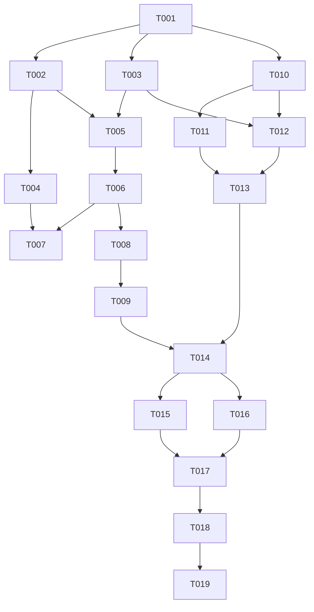

# Tasks: 所见即所得裁切（wysiwyg-crop）

**Input**: Design documents from `spec/wysiwyg-crop/`
**Prerequisites**: plan.md（D1~D6）、spec.md（US1~US5 / FR-001~010）
**测试基线**: 302 = 301 passed + 1 known issue + 0 failed，只增不减、既有断言零修改
**iOS 工程约束**: 禁用 build_project/start_app/verify_ui 等 HarmonyOS 工具；测试命令 `export DEVELOPER_DIR=/Volumes/DevDisk/Applications/Xcode.app/Contents/Developer` 后 `OTHER_SWIFT_FLAGS="-disable-sandbox" xcodebuild test -project Zhixia.xcodeproj -scheme Zhixia -destination 'platform=iOS Simulator,name=iPhone 17 Pro' -skipPackagePluginValidation -skipMacroValidation`；证据日志存 `/tmp/wysiwyg-crop-logs/`

## Format: `[ID] [P?] [Story] Description`

- **[P]**: 可并行（不同文件、无未完成依赖）
- **[Story]**: 归属用户故事；Setup/Foundational/Polish/Verification 无标签

## Path Conventions

- 单工程 iOS 项目：源码 `Zhixia/`、测试 `ZhixiaTests/`、文档 `docs/`、周期文档 `spec/wysiwyg-crop/`
- 构建命令（全部任务通用）：
  `export DEVELOPER_DIR=/Volumes/DevDisk/Applications/Xcode.app/Contents/Developer`
  `OTHER_SWIFT_FLAGS="-disable-sandbox" xcodebuild test -project Zhixia.xcodeproj -scheme Zhixia -destination 'platform=iOS Simulator,name=iPhone 17 Pro' -skipPackagePluginValidation -skipMacroValidation`
- 模拟器 Busy 时先 `xcrun simctl erase all` 再重试一次

## Phase 1: Setup (Shared Infrastructure)

- [X] T001 基线确认：全量测试 302 = 301 passed + 1 known issue（`ReconstructEndToEndTests/realDeviceOcrStillLacksTable` 豁免）+ 0 failed，记录至 /tmp/wysiwyg-crop-logs/baseline.log

## Phase 2: Foundational (Blocking Prerequisites)

- [X] T002 [P] 新增 `Zhixia/Domain/CropConsistencyGate.swift`：`CropDecision` 值类型 + `resolve(displayed:still:iouThreshold:)` 纯函数（默认 0.70，plan D1 契约：无呈现框用静帧 / 一致采纳精修 / 不一致呈现框优先）
- [X] T003 [P] 修改 `Zhixia/Services/ZhixiaLog.swift`：追加 `cropGate(displayedArea:stillArea:iou:acceptedStill:)` 与 `stickyOverride(iou:)` 助手（plan D4 契约，capture.debug + privacy.public）

## Phase 3: User Story 1 - 锁定框即裁切框 (Priority: P1) 🎯 MVP

**Goal**: 锁定态快门成片 = 锁定框（消除 Case A）
**Independent Test**: 折页书锁右页后快门，成片不含折起部分

- [X] T004 [P] [US1] 新增 `ZhixiaTests/CropConsistencyGateTests.swift`：5 用例（一致→静帧精修 / 不一致→呈现框优先 / 无呈现框→静帧直通 / 双 nil→nil / 阈值边界 0.69↔0.71）
- [X] T005 [US1] 修改 `Zhixia/Features/Capture/CaptureViewModel.swift`：`capture()` 入口快照 `imageQuad` 作呈现框（任何复位之前），文档模式经 `CropConsistencyGate.resolve` 替换 `detected ?? imageQuad ?? .fullImage` 链并记 `cropGate` 日志；idCard 与相册导入路径原链不动（FR-005）
- [X] T006 [US1] 追加 `ZhixiaTests/CaptureViewModelTests.swift`（append-only）：`CropGateAtShutterTests` 锁定组——锁定+静帧分歧→draft.quad == 锁定框（Case A 单测对应）、锁定+一致→draft.quad == 静帧精修框；新增 live 序列/still 结果可注入的 detector fake
- [X] T007 [US1] US1 检查点：全量测试全绿（新用例转绿、基线零回归），记录至 /tmp/wysiwyg-crop-logs/us1-checkpoint.log

## Phase 4: User Story 2 - 呈现框即裁切框·全状态统一 (Priority: P1)

**Goal**: 跟随态手动拍 = 呈现框；搜索态 = 静帧照旧（消除 Case B 抢拍裁错）
**Independent Test**: 跟随态手动快门 draft.quad == 呈现框

- [X] T008 [US2] 追加 `ZhixiaTests/CaptureViewModelTests.swift`（append-only）：US2 组——跟踪态手动拍→draft.quad == 呈现框、搜索态（imageQuad == nil）手动拍→draft.quad == 静帧框、idCard 模式拍摄行为不变
- [X] T009 [US2] US2 检查点：全量测试全绿，记录至 /tmp/wysiwyg-crop-logs/us2-checkpoint.log

## Phase 5: User Story 3 - 双候选止跳 (Priority: P1)

**Goal**: 摊开书双候选不再交替胜出，框稳定可锁定（消除 Case B 跳动）
**Independent Test**: 交替候选池输入下粘滞保持单一候选；候选消失 3 帧逃逸

- [X] T010 [P] [US3] 新增 `Zhixia/Services/Vision/CandidateSticky.swift`：有状态 struct（lastPick/missCount）+ `apply(selection:pool:similarityThreshold:missLimit:)`（plan D3 契约：相似 IoU ≥0.60 优先延续、pool 取相似候选评分最高、连续 3 帧无相似清空逃逸、初锁直通）
- [X] T011 [US3] 新增 `ZhixiaTests/CandidateStickyTests.swift`：5 用例（交替池保持单一候选 / 候选消失 3 帧逃逸 / 相似候选跟随更新 / lastPick 为空直通 / selection 为 nil 计 miss 达限清空）
- [X] T012 [US3] 修改 `Zhixia/Services/Vision/VisionEdgeDetector.swift`：live 文档路径（`stillImage == false && idCardWindow == nil`）在 `DetectionStrategy.select` 后经 `CandidateSticky.apply`（pool = rawCandidates，tier 沿用同池），改写时记 `stickyOverride` 日志；still/idCard 路径零改动
- [X] T013 [US3] US3 检查点：全量测试全绿，记录至 /tmp/wysiwyg-crop-logs/us3-checkpoint.log

## Phase 6: User Story 4 - 平整文档精度不回归 (Priority: P1)

**Goal**: 静帧精修在一致场景原样保留，既有资产零回归
**Independent Test**: 既有断言零修改全绿 + 豁免保持

- [X] T014 [US4] 回归核对：全量测试既有断言零修改全绿（重点 `EdgeSnapperTests` / `EdgeDetectionStrategyTests` / `CaptureFallbackTests` / `ReconstructEndToEndTests` known issue 豁免保持），核对 US1 一致精修用例覆盖 SC-003 语义，报告记录至 /tmp/wysiwyg-crop-logs/us4-regression.log

## Phase 7: User Story 5 - 验收闭环与日志证据 (Priority: P2)

- [X] T015 [P] [US5] 新增 `spec/wysiwyg-crop/device-acceptance.md`：Case A（折页拍右页 ×3 形态）/ Case B（摊开书从中线取景：≤5s 稳定不跳 + 呈现框手动拍）重验步骤、平整回归（SC-002 ×10+近拍 / SC-003 ×5）、§0 Console.app 实时日志流程（subsystem:com.david.Zhixia category:capture + Include Debug Messages，检索 `cropGate` / `stickyOverride`）、汇总结果表
- [X] T016 [P] [US5] 修改 `docs/09-project-handbook.md`：§4.2 补 WYSIWYG 裁切契约（呈现框=裁切基准、门禁阈值 0.70、粘滞 0.60/3 帧、idCard/导入例外）+ §6.11 周期条目

## Phase 8: Polish & Cross-Cutting Concerns

- [X] T017 最终全量回归：基线 302 只增不减、0 failed、known issue 豁免保持（预期 302+15 = 317：门禁 5 + 粘滞 5 + 快门集成 5），记录至 /tmp/wysiwyg-crop-logs/final-regression.log；清理临时调试代码，确认无遗留 TODO

## Phase 9: Verification

<!-- verification_scope: build-only -->

- [X] T018 全量构建 + 单元测试基线核对：`export DEVELOPER_DIR=/Volumes/DevDisk/Applications/Xcode.app/Contents/Developer` 后 `OTHER_SWIFT_FLAGS="-disable-sandbox" xcodebuild test -project Zhixia.xcodeproj -scheme Zhixia -destination 'platform=iOS Simulator,name=iPhone 17 Pro' -skipPackagePluginValidation -skipMacroValidation`；基线 ≥ 302 只增不减、failed == 0、known issue 豁免保持；失败则修复循环直至全绿（模拟器 Busy 先 `xcrun simctl erase all`）
- [X] T019 部署验证：模拟器构建安装并启动（`xcrun simctl` boot/install/launch，bundle id `com.david.Zhixia`，确认 pid 存活）；generic 真机目标构建（`-destination 'generic/platform=iOS' CODE_SIGNING_ALLOWED=NO`）确认可编译

## Dependencies & Execution Order

- **Setup**: T001 最先，产出基线锚点
- **Foundational**: T002 ∥ T003（不同文件）；T002 阻塞 US1（门禁类型），T003 阻塞 T005/T012（日志）
- **US1**: T004 依赖 T002；T005 依赖 T002+T003；T006 依赖 T005；T007 汇聚 T004+T006
- **US2**: T008 依赖 T006（复用 fake）；T009 依赖 T008
- **US3**: T010 ∥ T008（不同文件无依赖）；T011 依赖 T010；T012 依赖 T010+T003；T013 汇聚 T011+T012
- **US4**: T014 依赖 T007/T009/T013（全故事完成后回归核对）
- **US5**: T015 ∥ T016，依赖 T014（验收协议引用最终行为）
- **Polish**: T017 依赖 T014~T016；**Verification**: T018 → T019 依赖 T017

## 📊 Dependency Graph



## ⚡ Parallel Execution Guide

| Phase | Tasks | Required Files | Execution Notes |
|---|---|---|---|
| Foundational | T002 ∥ T003 | CropConsistencyGate.swift / ZhixiaLog.swift | 不同文件可并行 |
| US1 | T004 ∥ T005 前置就绪后串行 T006 | 测试与源码不同文件 | T004 只依赖 T002，可与 T005 并行 |
| US2 ∥ US3 | T008 ∥ T010 | CaptureViewModelTests.swift / CandidateSticky.swift | 不同文件；T010 也可与 T006 并行 |
| US5 | T015 ∥ T016 | device-acceptance.md / docs/09 | 纯文档可并行 |

## Parallel Example: US1 与 US3 并行

```bash
# US1 门禁单测（只依赖 T002）：
Task: "新增 ZhixiaTests/CropConsistencyGateTests.swift（5 用例）"
# 同时推进 US3 粘滞类型（只依赖 T001）：
Task: "新增 Zhixia/Services/Vision/CandidateSticky.swift"
```

## Implementation Strategy

### MVP First (US1 Only)

1. T001 基线 → T002+T003 基础 → T004~T007 US1 完成
2. **STOP and VALIDATE**: 锁定态门禁独立可测（Case A 单测对应）
3. US1 单独交付即可消除 Case A（锁定即所得）

### Incremental Delivery

1. US1（锁定即所得）→ US2（全状态统一）→ US3（止跳）→ US4（回归核对）→ US5（验收文档）→ T017 最终回归 → T018/T019 验证
2. 每故事检查点独立验证，任一 checkpoint 失败即修复后再前进

## Notes

- [P] = 不同文件、无未完成依赖；[USx] 映射 spec.md 用户故事
- 既有测试断言零修改（append-only 追加新用例/新 fake）；若必须改既有断言才能过 = 实现偏离契约，停下核对
- ServiceProtocols 协议签名零改动；DetectionStrategy 评分/两级兜底、still 检测+吸附、QuadSmoother 参数、idCard/相册导入路径零改动
- 测试预期新增 15 用例（门禁 5 + 粘滞 5 + 快门集成 5），302 → 317
- 不 git commit（会话惯例）；证据日志统一存 /tmp/wysiwyg-crop-logs/
